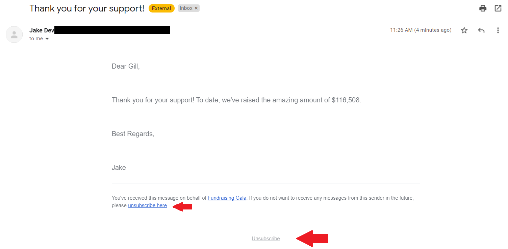

<!-- Source: https://ch.crowdchange.help/cnak/how-to-opt-out-of-email-marketing | Nav: How to Opt Out of Email Marketing | Mirrored 2026-10-14 -->

# How to Opt Out of Email Marketing

CrowdChange does not share donor information for marketing purposes and will continue this practice moving forward. That said, we recommend reaching out to the organization you made your donation to directly to submit this request. Feel free to follow the steps below to do so:

1. Go to the fundraising page you are inquiring about.

2. Under the **"Have questions?"** section, click **"Contact Us"**.

3. Select "**I have a question for the host of this event**" from the drop-down menu.

4. Put in your question and it will be sent directly to the host who will be able to assist you.

## Unsubscribe from Mailing List emails

You can unsubscribe directly from Mailing List emails by clicking the unsubscribe button at the bottom of the email. See screenshot below:  

