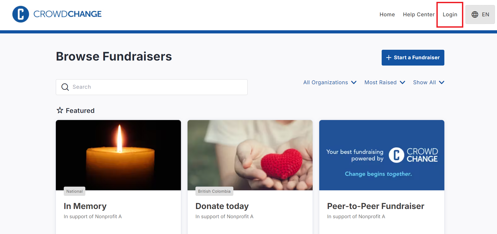
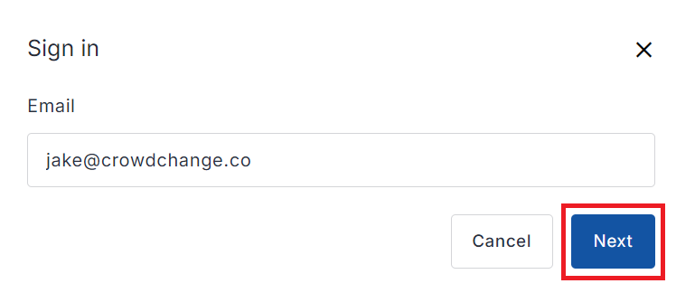
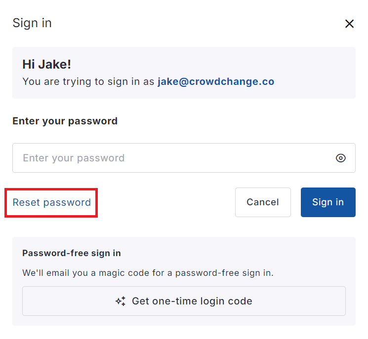
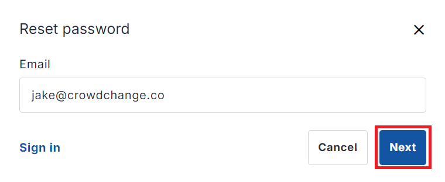
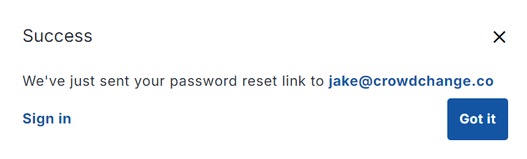
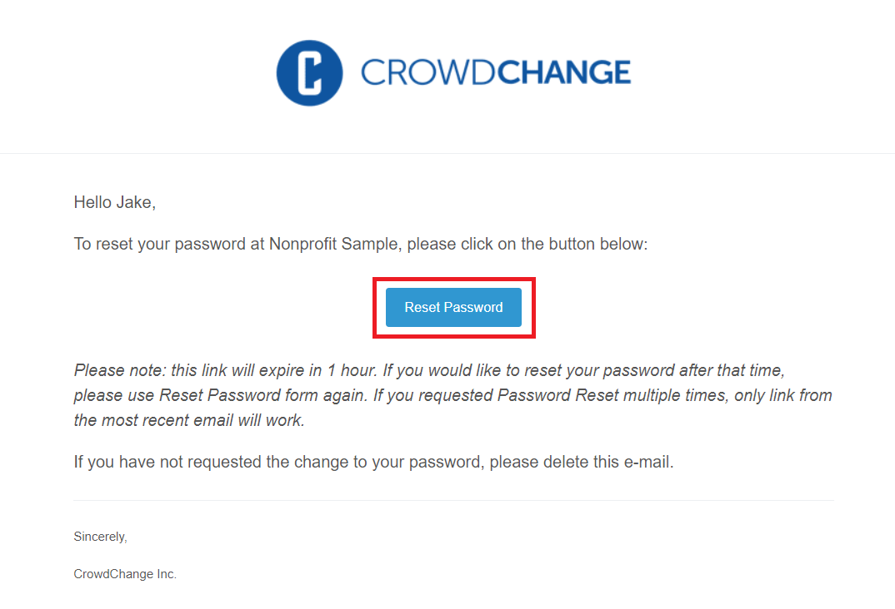
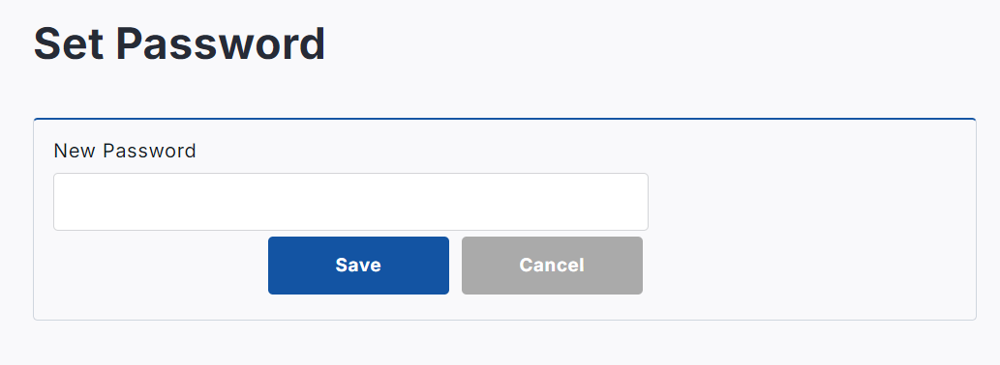

<!-- Source: https://ch.crowdchange.help/cnak/how-to-reset-your-password | Nav: How to Reset Your Password | Mirrored 2026-10-14 -->

# How to Reset Your Password

This process must be performed by the user themselves, using the steps below:

1. Go to your CrowdChange site.

2. Click **Login**on the top-right corner of the site.

   
3. Within the popup that appears, enter your email and click **Next**.

   
4. On the next page, click **Reset password**.

   
5. On the next page, click **Next**.

   
6. You will be sent an **email**with a link to a Password Reset page.

   
7. Ensure you are still **logged out** of your CrowdChange site, then **click the link** in the email you received.

   
8. Enter the new password that you would like to use and then click **Save**.

   

Please note that password reset links expire in one hour. If you exceed that time, it will not work, and you will need to request a new link following the same steps above.  
If the user themselves is having trouble doing this, you can complete steps 1 through 5 on their behalf, and have them complete steps 6 and 7 once they have received the reset email.

They must be **logged out** before clicking the password reset link, or they will be directed to their Profile, where they would need to enter the current password as well as the new one.
