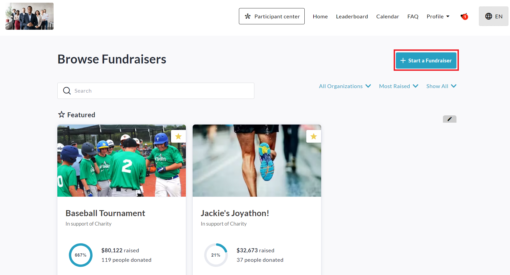
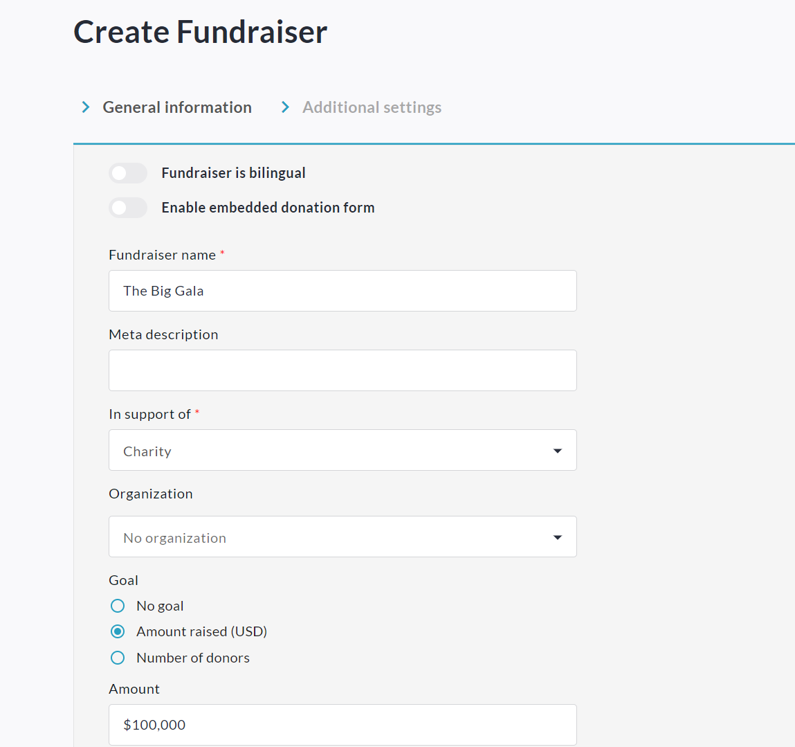
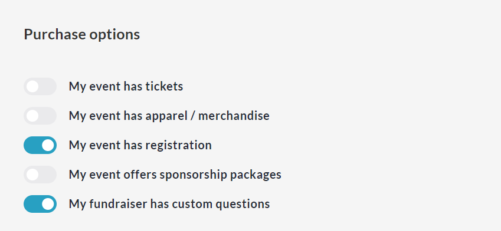
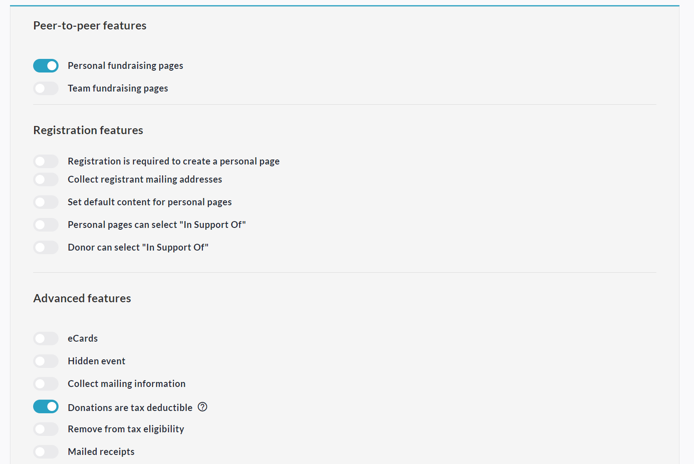

<!-- Source: https://ch.crowdchange.help/cnak/how-to-start-a-fundraiser | Nav: How To Start a Fundraiser | Mirrored 2026-10-14 -->

# How To Start a Fundraiser

You can create a custom fundraising page on your CrowdChange site in under 5 minutes!

Simply follow the steps below:

1. Click the **Start A Fundraiser** button in the top-right corner of your CrowdChange site.

   
2. Fill out the **General Information** page, toggling on any features you'd like to use for your fundraiser under **Purchase options**. For example:

     
   
3. Click **Next** and further customize your fundraiser on the **Additional Settings**page, enabling P2P features and more as/if needed.

   
4. Click **Create Fundraiser** at the bottom to sign up / log in and publish your fundraiser.

5. Use the **Share**button to get the word out to your friends \& family!

Please see the following related tutorials as well:

* [How Ticketing Works](how-ticketing-works.md)
* [How Merchandise Works](how-merchandise-works.md)
* [How Registration Works](how-registration-works.md)
* [How Sponsorship Works (Sponsorship Packages)](how-sponsorship-works-sponsorship-packages.md)
* [How to Create a Personal Fundraising Page \& Share It](how-to-create-a-personal-fundraising-page-share-it.md)
* [How to Create a Team \& Invite Members](how-to-create-a-team-invite-members.md)
## Detailed Steps:

1. Click the **Start A Fundraiser** button in the top-right corner of your CrowdChange site.

2. Fill out the **General Information** page:

   1. Fundraiser is bilingual - This allows you to enter all information in both English and French.

   2. Fundraiser Name - Set a name for your fundraiser that will be the main heading.

   3. In support of - You may be allowed to choose from a list of options, or type your own.

   4. Goal - You can turn the goal feature on or off, and set it to either a certain amount raised, or a certain number of donors.

   5. Date and time - Turn this on if you want to show a start date / time for your fundraiser.

   6. Fundraiser has an end date and time - Turn this on if you want to show an end date / time for your fundraiser.

   7. Fundraiser has a location - Turn this on if you want to show the location of your fundraiser.

   8. Fundraiser Description - Enter all the information donors \& participants will need to know.

   9. Cover Image - Upload a banner / header image for your fundraiser.

   10. Add a Video - Allows you to paste a video link so that a video will be displayed instead of the Cover Photo on your fundraising page.

3. Under **Purchase options**enable any features you want to use for your fundraiser:

   1. My event has tickets - See **How Ticketing Works**

   2. My event has apparel / merchandise - See **How Merchandise Works**

   3. My event has registration - See **How Registration Works**

   4. My event offers sponsorship packages - See **How Sponsorships Work**

   5. My fundraiser has custom questions - See **How to Use Custom Questions**

4. Click **Next** and enable **Peer-to-peer features**:

   1. Personal fundraising pages - See **How to Create Personal Page**

   2. Team fundraising pages - See **How to Create a Team**

   3. Personal fundraising pages within teams - Allow personal pages to be created under teams.

   4. Set default content for personal pages - Set a default description for personal pages.

   5. Set default content for team pages - Set a default description for team pages.

5. Enable and set up **Registration Features** if desired and if Multi-Registration is enabled on your site.

6. **Advanced Features**:

   1. Donations are tax deductible - Enable only if you will be issuing tax receipts for this fundraiser.

   2. eCards - Turn on and select **Tribute Cards** if you would like to set up personal pages 'In honor of' or 'In memory of' individuals. Otherwise, select **eCards**.

   3. Collect Mailing Information - Turn on if you want to collect donor mailing information specifically.

   4. Allows donors without emails to use their physical address - Let donors donate \& register without an email address.

   5. Hidden event - Hide fundraiser from the public so only Admins and those with a link can find it.

   6. Show list of donors - Turn on if you want a public donor list for your fundraiser.

   7. Start accepting funds on date - Turn on if you want the fundraiser to open automatically at a certain date / time. A countdown will be displayed.

   8. Stop accepting funds on date - Be sure to turn this on to set a close-off date for your fundraiser.

   9. Donation matching - Enable if you would like donations to be matched. You will be able to set up the matching pool and settings through **Donation Matching** once enabled.

7. Click the **Create Fundraiser** button to sign up or log in - if you haven't already, otherwise, you are ready to start sharing your fundraiser!

You can hide the 'Share' button on your fundraiser if desired using the steps below:

1. From your fundraiser, click **Manage Fundraiser** in the top-right corner.

2. Click **Design your fundraiser**.

3. Hover over your banner/hero image and click the **Gear**icon on the left.

4. On the right sidebar, within the **Layout** section, click **Set up sharing**.

5. Disable **Show on page** and click **Save**at the bottom.
