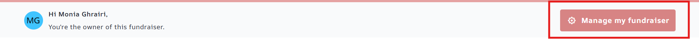
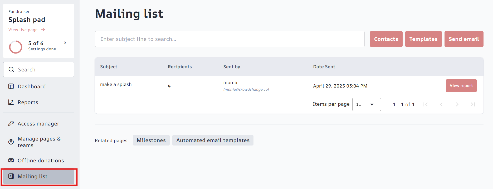
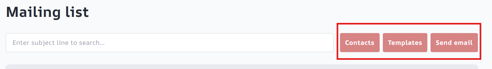
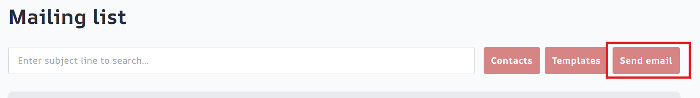
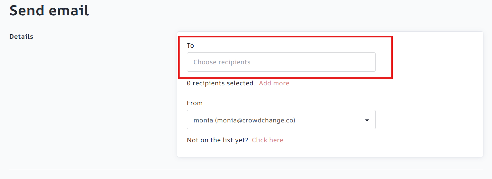
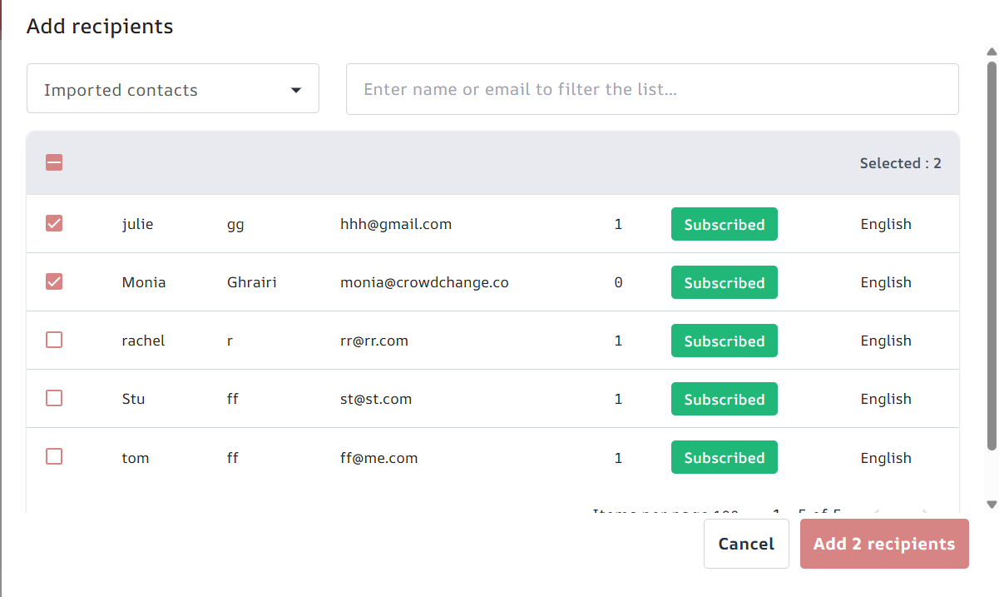
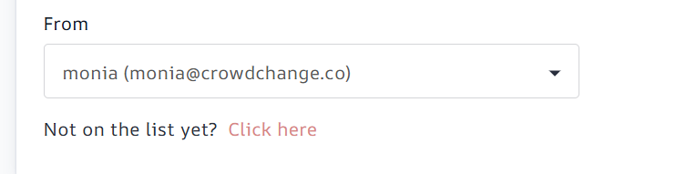
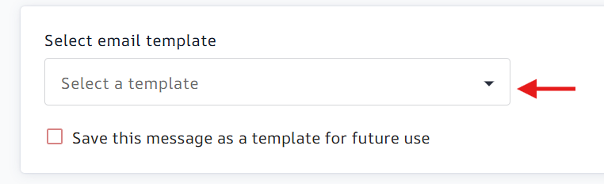
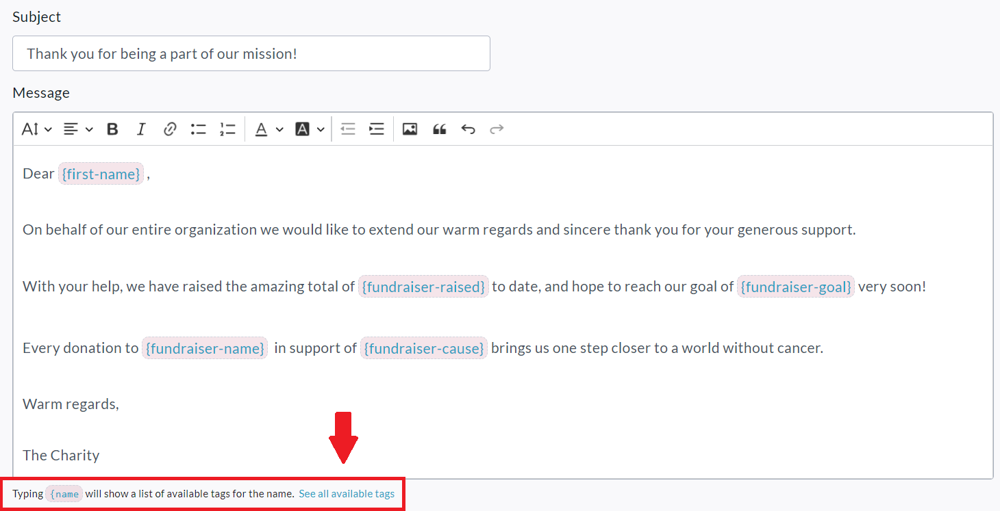
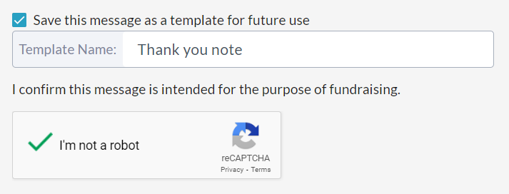

<!-- Source: https://ch.crowdchange.help/cnak/how-to-use-the-mailing-list | Nav: How to Use the Mailing List | Mirrored 2026-10-14 -->

# How to Use the Mailing List

You can use our **Mailing List** feature to send out email fundraising campaigns, or just to send a personalized thank you to your donors!

It's a great way to keep supporters up to date and engaged with your fundraiser, team or personal page.

To get started, follow the simple steps below!

1. From your fundraiser, click **Manage Fundraiser** in the top right corner, then **Mailing List** .

   (*On a personal page or team, go to* ***Manage my page/team → Mailing List*** *in the top right).*

   

   

2. You will then be taken to the Mailing List main page, where you have three options:

   *You may also return here at any time to view information and reports on sent emails.*

   

   1. **Contacts**- From here you can add to and manage your contact list. You may add contacts manually or import them from a CSV file. Donors to your fundraiser/team/page will be added automatically. Team Captains on your fundraiser will be added automatically.

   2. **Templates**- From here you can create and manage your email templates. For detailed tutorials on using email templates, check out the following articles:

      1. **How to Create a Custom Email Template**

      2. **How to Edit a Pre-existing Email Template**

      3. **How Email Templates Work**

   3. **Send email** - This is where you will go to send out emails (campaigns).

3. To send out your first email campaign, click on **Send Email**.

   

4. Click **Choose Recipients** within the **To**field and select all contacts you'd like to send to.

   

5. Click the**Add Recipients** button in the bottom right.

   Note that you can use the dropdown in the top left corner to view these lists:**Imported Contacts** , **Donors** ,**Previous Donors** and **Team Captains**. The latter three are automatically stored as contacts.

   

6. Add and verify your email address in the **From** field. *If you are adding yourself as sender for the first time, CrowdChange will send a verification code to your email to confirm your identity. When you receive the email verification code, copy \& paste the code into CrowdChange and click* ***Verify*** *. If you do not receive a verification email, click* ***resend verification code*** *.*

   

7. If you would like to use an email template you added previously, select it under **Select email template**.

   

8. Fill out your **Subject** and **Message** fields, using the **Dynamic Tags** feature to have certain information automatically pulled in when sending a campaign to multiple recipients. This allows you to send **one** email to **multiple** recipients, rather than sending many one-recipient emails, and having to enter data like this each time: *Recipient First Name \& Last Name, Fundraiser Raised Amount, Link to Fundraiser.* See further examples in screenshot below. For more info, see **How Email Templates Work**.

   
9. Check the '**Save this message as a template for future use** ' field if desired, and complete the **reCAPTCHA**verification.

   
10. If you'd like, you can send yourself a preview email before sending out the email campaign. Simply click the '**Send preview email**' button to do so.

    
11. When you are ready, click on the **Send**button to send out your email campaign.

    
