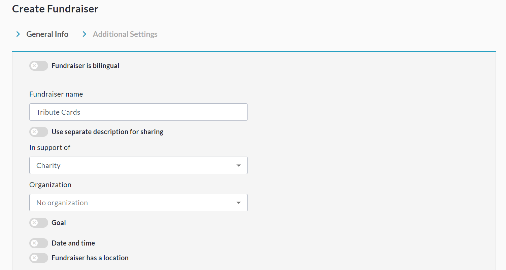
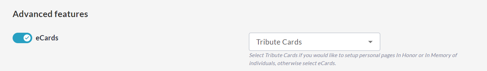
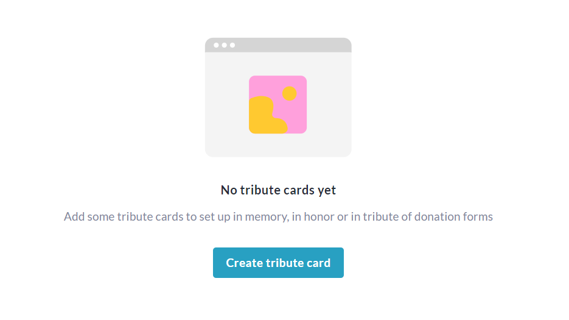
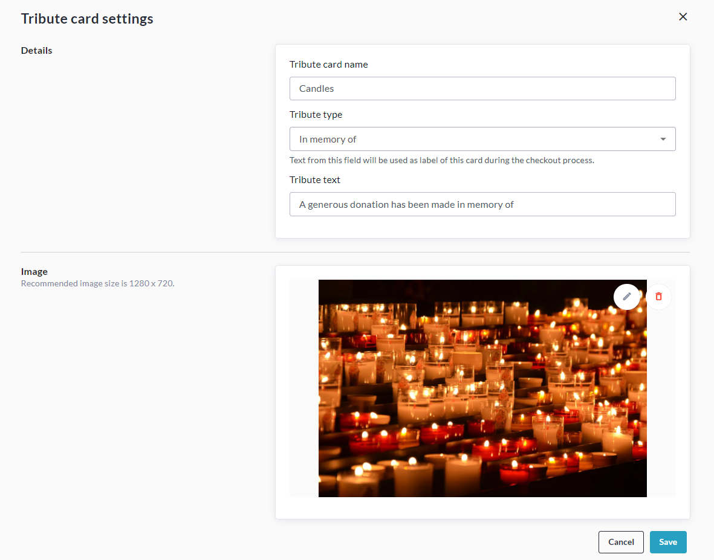
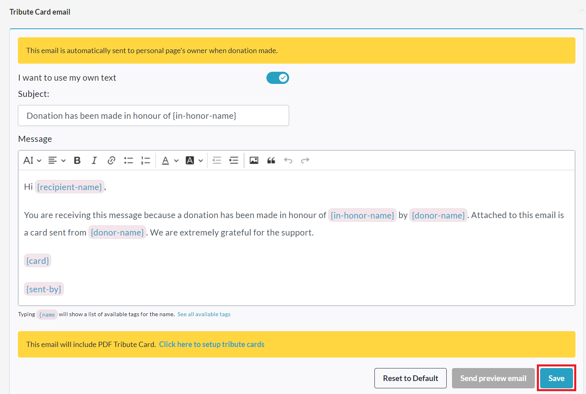

<!-- Source: https://ch.crowdchange.help/cnak/how-to-use-tribute-cards | Nav: How to Use Tribute Cards | Mirrored 2026-10-14 -->

# How to Use Tribute Cards

In this tutorial, you will learn how to set up and use **Tribute Cards**. The Tribute Cards feature allows you to create Memorial Fund / "In Memory Of" type fundraisers, or simply add tribute giving to your fundraiser.  
Tribute Cards can be sent via Email, postal Mail or SMS.  

## How to Enable Tribute Cards when Creating your Fundraiser

To use Tribute Cards on a fundraiser, you must enable the required feature while creating or editing it.

Here are the steps to enable Tribute Cards while creating a new fundraiser.

1. From the homepage of your CrowdChange site, click**Start a Fundraiser**in the top right corner.

   
2. Fill out all necessary information about your fundraiser on the **General Info** page.

   
3. Scroll down and click **Next** to continue to the **Additional Settings**page.

   
4. On the **Additional Settings** page, enable **eCards** under **Advanced Features** , and select **Tribute Cards** from the dropdown that appears.

   
5. Scroll down and click **Create Fundraiser**.

   

If creating an 'In Memory Of' / 'In Memoriam' style fundraiser, we recommend enabling personal fundraising pages as well so that donors can create their own pages in memory of their loved ones.

## How to Set Up Tribute Cards on your Fundraiser

Once the feature is enabled on your fundraiser, the next step is to configure your Tribute Cards purchase settings and add each of your Tribute Card options.

1. From your fundraiser, click **Manage Fundraiser**in the top right corner.

   
2. Go to **Purchase Options** on the left sidebar, then **Tribute Cards**.

3. Click**Purchase settings**to configure Tribute Cards settings and delivery methods on your fundraiser.

   
   1. *Please note that if you leave '* ***Require card purchase to complete checkout*** *' un-checked, donors will be able to complete general donations without adding a Tribute Card. Generally we recommend requiring card (Tribute Card) purchases on Tribute Giving fundraisers.*

      
4. Click **Save**to confirm your choices.

5. Click**Create Tribute Card**to add your first card.

   
6. **Name** the card, set a **Dedication type** (eg: In Memory of, In Honour of, In Celebration of, or custom), enter your **Dedication text** ,and upload an **Image**. For example:

   
7. Click **Save**in the bottom right to create the card.

8. You may return to the Tribute Cards menu at any time to **add** , **edit, remove** or **preview**cards.

Please note that **Tax Receipts** will only be issued for Tribute Card purchases if the following are true:

* Tax Receipts have been enabled in the Tribute Cards store / fundraiser settings.

* The transaction amount meets the minimum amount set either at the site-wide, or fundraiser level.

## How to Edit the Tribute Card Email Template

If you would like to change the default text of the Tribute Card email, follow these steps:

1. Go to your Tribute Cards fundraiser and click **Manage Fundraiser**in the top right.

2. Go to**Automated email templates** on the left sidebar.

3. Click on **Tribute Card Email** and toggle on '**I want to use my own text'.**

4. Edit the default text as desired and click **Save**.

   

## Tribute Giving - Live Partner Examples

Here are a few examples of tribute giving fundraisers created by our partners:

* **Israel Cancer Research Fund - Tribute Cards:** <http://icrf.crowdchange.ca/1078>

  * Sending a card is tied to completing your donation.

* **Cystic Fibrosis Canada - In Memory:** <https://cysticfibrosistribute.crowdchange.ca/2196>

  * Uses Peer to Peer functionality, allowing supporters to create memorial pages on their own.

* **Kelowna General Hospital Foundation - Donate Today:** <http://kghfoundation.crowdchange.co/14594>

  * Gives donors the option for a **general** gift, an 'In honour of' / 'In memory of' gift **without** a card or an 'In honour of' / 'In memory of' gift **with**a card.

*** ** * ** ***

To create a **Donate Today** page like the Kelowna General Hospital Foundation example above:

1. Go to your CrowdChange site's homepage and click **Start a Fundraiser**.

2. Fill out the **General Info** page, then click **Next**.

3. On the **Additional Settings** page, under **Advanced Features** , toggle on **eCards** and select **Tribute Cards** from the dropdown that appears.

4. Click **Create Fundraiser**at the bottom of the page.

5. From the fundraiser's main page, click**Edit Mode** in the top right corner

6. Go to**Advanced settings → Setup → Tribute Cards**.

7. Click **Purchase Settings.**

8. Select **Require card purchase to complete checkout** if you'd like to make sending a card mandatory when completing a donation. Leaving this unchecked will give donors the option to add a card to their donation if they so desire - as in the KGH example: <http://kghfoundation.crowdchange.co/14594/donate>.

9. Select the delivery methods you would like to offer to your donors when sending a card (**Email** , **Mail** and/or **SMS**Text Message).

10. Click **Save** to confirm.

11. Next, click **New Tribute Card** to begin adding your Tribute Card options.
