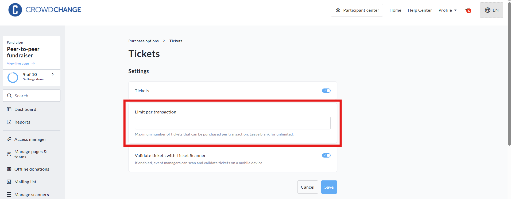
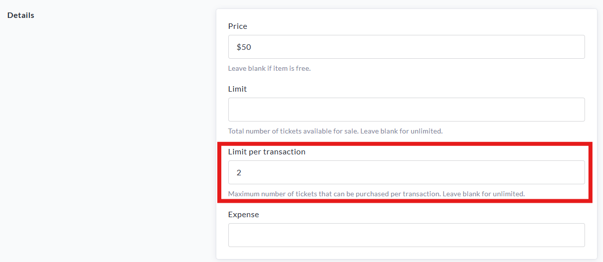
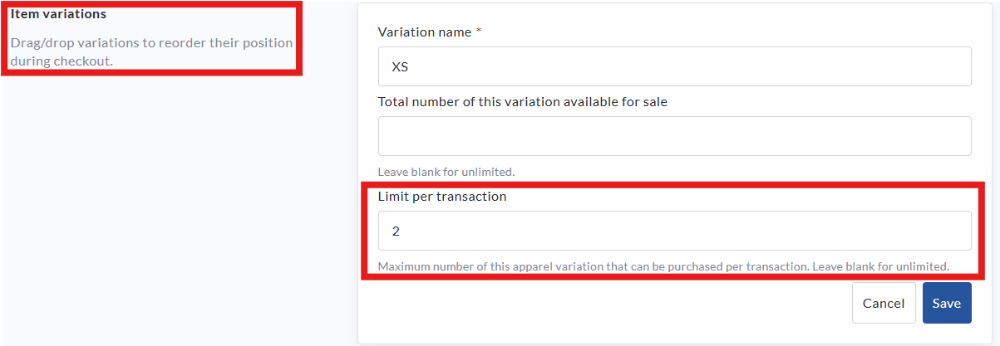

<!-- Source: https://ch.crowdchange.help/cnak/per-transaction-limits-for-purchase-options | Nav: Per-transaction Limits for Purchase Options | Mirrored 2026-10-14 -->

# Per-transaction Limits for Purchase Options

You can now set limits on the number of items a supporter can purchase in a single transaction - perfect for enforcing rules like "2 tickets per person" or "limit 1 hoodie per order."

This feature can be used for:

* **Tickets**

* **Registration**

* **Apparel \& merchandise**

## How it works

When a quantity limit is set, users will not be able to add more than that number of the selected item to their cart. This is especially useful for capacity control or limiting availability of high-demand items.

### How to Set a Limit

1. Go to your fundraiser and click **Manage Fundraiser** in the top-right.

2. From the left sidebar, click **Purchase Options**.

3. Choose one of the following categories:

   * **Tickets**

   * **Registration**

   * **Apparel \& Merchandise**

4. Click on the item you wish to edit (or create a new one).

5. Find the field labeled **Limit per transaction** and enter the desired number.

   *(Leave this blank for unlimited.)*

6. Click **Save**.

📸 *See screenshot example below from the Tickets section:*  

**Limit per transaction** settings within the **Tickets** section of the **Fundraiser dashboard**

*** ** * ** ***

**Limits can be set individually per item** - for example, you could allow 5 tickets per transaction, but only 1 hoodie.  

**Limit per transaction** settings within an individual **Ticket** type

If an item has **variations** (like sizes), the limit applies **across all variations**. For example, a limit of 2 would allow the user to purchase 1 Small + 1 Medium, but not 3 of any combination.

*** ** * ** ***

Limits can also be applied per transaction to individual **variations** of a specific purchase option item - meaning you could limit popular sizes of a merchandise item if stock is low.  

**Limit per transaction** settings shown at the Purchase Option Item **Variation**level
