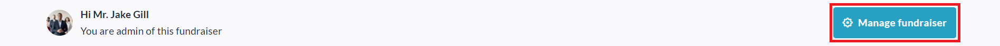
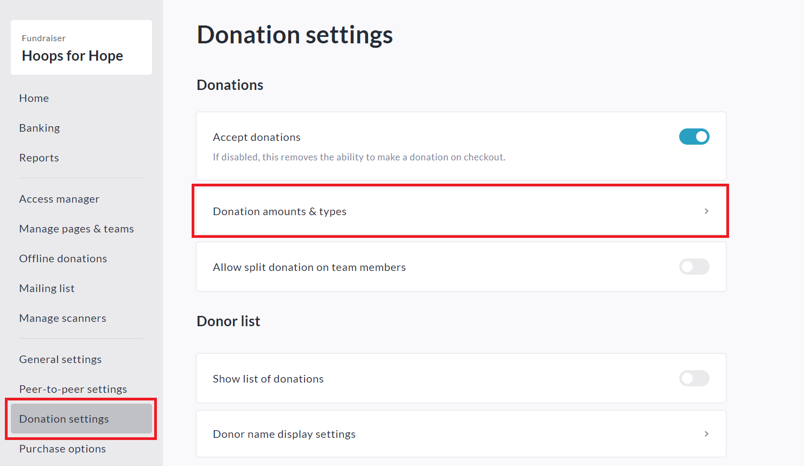
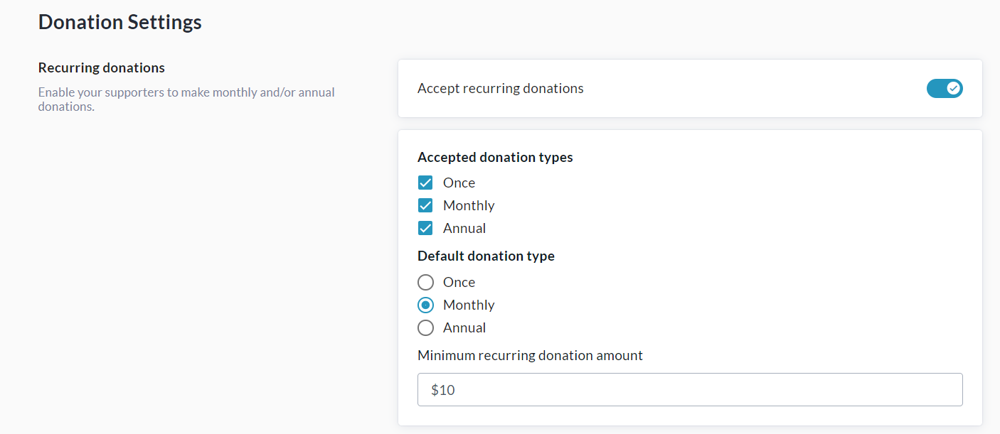
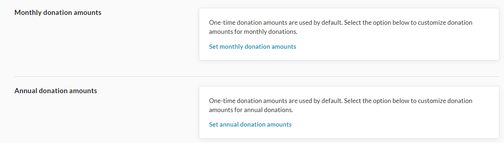
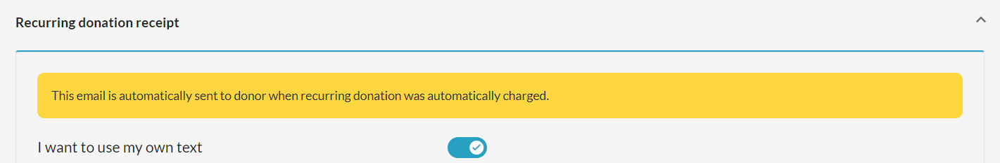

<!-- Source: https://ch.crowdchange.help/cnak/recurring-donations | Nav: Recurring Donations | Mirrored 2026-10-14 -->

# Recurring Donations

To get started with **Recurring Donations**, check out the steps below to learn how to do the following:

* Enable Recurring Donations on a Fundraiser and set the default donation type

* Edit Automated Email Templates connected to Recurring Donations

* Access your Profile to edit your Recurring Donations

Admin users can set a minimum amount for Recurring Donations via [**Admin → General Settings**](https://chadmin.crowdchange.help/ct/Admin-%3E-General-Settings.2006614017.html).

They also have access to the **Recurring Donations Report** within **Admin → Reports**.

For more information, please see [**How to Access the Recurring Donations Report**](https://chadmin.crowdchange.help/ct/How-to-Access-the-Recurring-Donations-Report.2037448799.html?t=lsmx9P7KHk1WU6-3G11a4w).

## Note on Tax Receipts for Recurring Donations

**Please note** that **Tax Receipts** for recurring donations are generated at year-end (First week of January of the following year) and are populated in your **Tax Receipts Report**automatically. All recurring donations for the year are consolidated into one tax receipt. These will show as 'Annual'.

## Getting Started with Recurring Donations

### Enable Recurring Donations on a Fundraiser and set the default donation type

1. From your fundraiser, click **Manage Fundraiser** , then**Donation Settings**.

     
   
2. Click **Donation amounts \& types**as shown above.

3. Enable **Accept Recurring Donations** , then specify your **Accepted Donation Types** , **Default Donation Type** , and **Minimum Recurring Donation Amount**. For example:

   
4. ***Optional*** *- if desired, you can also set default donation amounts and impact statements for each type of donation you have enabled. To set monthly and annual donation amounts, scroll down to this section:*

   
5. At the bottom of the page, click **Save** to confirm.

### Edit Automated Email Templates connected to Recurring Donations

1. From your fundraiser, go to **Manage Fundraiser →** **Automated Email Templates**.

2. Click on any template you want to edit and toggle on**I want to use my own text**.

   
3. Edit the subject and message body as desired and click **Save**.

4. *Optional: You can send yourself a* ***Preview Email*** *or* ***Reset*** *the message to default by clicking the respective buttons.*

### Access your Profile to update your Recurring Donations

1. From anywhere on your CrowdChange site, click **Profile** in in the top right, then**My Profile**

2. Select**My Recurring Donations** from the left sidebar.

3. For any recurring donation in the list, you can perform the following actions:

   1. **Change Amount** *- Note that if a minimum recurring donation amount is set at the Admin \> General Settings level, you are not able to set the amount lower than this number.*

   2. **Change Payment Day**

   3. **Skip Next Payment**

   4. **Pause \& Resume Recurring Donation**

   5. **Cancel Recurring Donation**

      
4. To update your payment method (credit / debit card), click the pencil icon next to the last 4 digits of your card number at the top of the recurring donation. Enter the new details and click **Save**to confirm.

If you would like to receive email notification for every recurring donation charge, you can enable this from **Profile \> Notifications \> General Notifications**

## If a Recurring Donation Fails...

In cases where a Recurring Donation fails (for example: credit card has expired or amount exceeds limit), we will try to process the transaction again at a later date according to this timeline:

* **1st Failure** → Notification email is sent to donor and Admin, advising that the charge failed and why. Retry in 3 days is scheduled.

* **2nd Failure** → Retry in 7 days is scheduled.

* **3rd Failure** → Retry in 7 days is scheduled.

* **4th Failure** → Retry in 7 days is scheduled.

* **If Rety 4 fails** , Recurring Donation is *Paused* - email notification will be sent to the donor stating that this donation has been paused, and that it can be resumed via the **Profile** section.
