<!-- Source: https://ch.crowdchange.help/cnak/registering-for-a-peer-to-peer-registration-event | Nav: How to Link Registrations to Personal & Team Pages > Registering for a Peer to Peer + Registration Event | Mirrored 2026-10-14 -->

# Registering for a Peer to Peer + Registration Event

Here's what the process looks like for a donor when registering for a fundraiser with Peer-to-Peer Pages and Registration linked together as described in parent article.

## **Step 1** : Go the fundraising page and click **Register** .

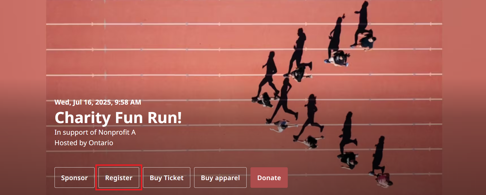

### **Step 2** : Select either **Start a team** , **Join a team** , or **Register as an individual** .

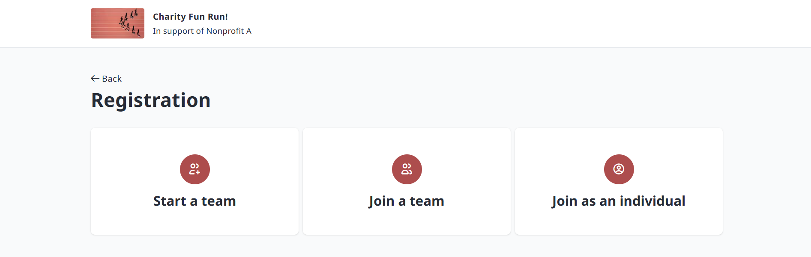
Start a team  
You will be prompted to enter a team name, goal amount and depending on the setup of the site, other required info such as custom question responses, super team selections and more.  
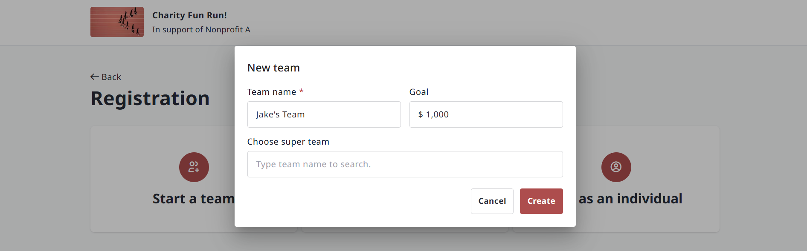

Once you click Create, you will then be prompted to fill out **Registrant Details**as below for your first registrant (yourself).
Join a team  
You will be able tosearch for a team to join, or join an existing one from those listed.

If you change your mind, you can simply click 'Start a team' at the top to create your own.  
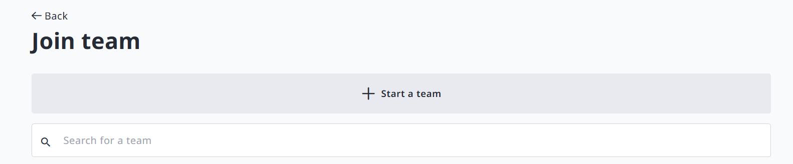

If you find an existing team you'd like to join, click the **Join team**button next to it:  
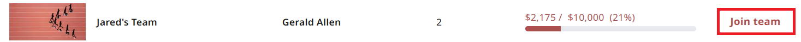

You will then be prompted to fill out **Registrant Details**as below for your first registrant (yourself).
Join as an individual  
You will be prompted to fill out **Registrant Details**as below for your first registrant (yourself).

### **Step 3** : When registering yourself or others, you will need to fill out **Registrant Details** first.

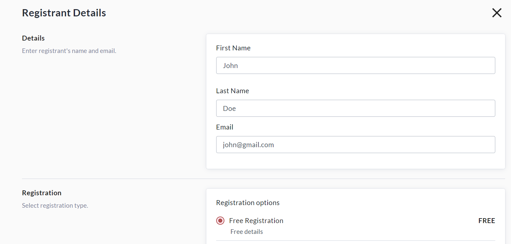

### **Step 4** : After filling out Registrant Details, create a **Personal Fundraising Page** to share with friends and family and raise support! We recommend selecting a personal donation amount to kick-start your fundraising. You may set the donation display name, comment, and whether to show or hide the amount (shown below).

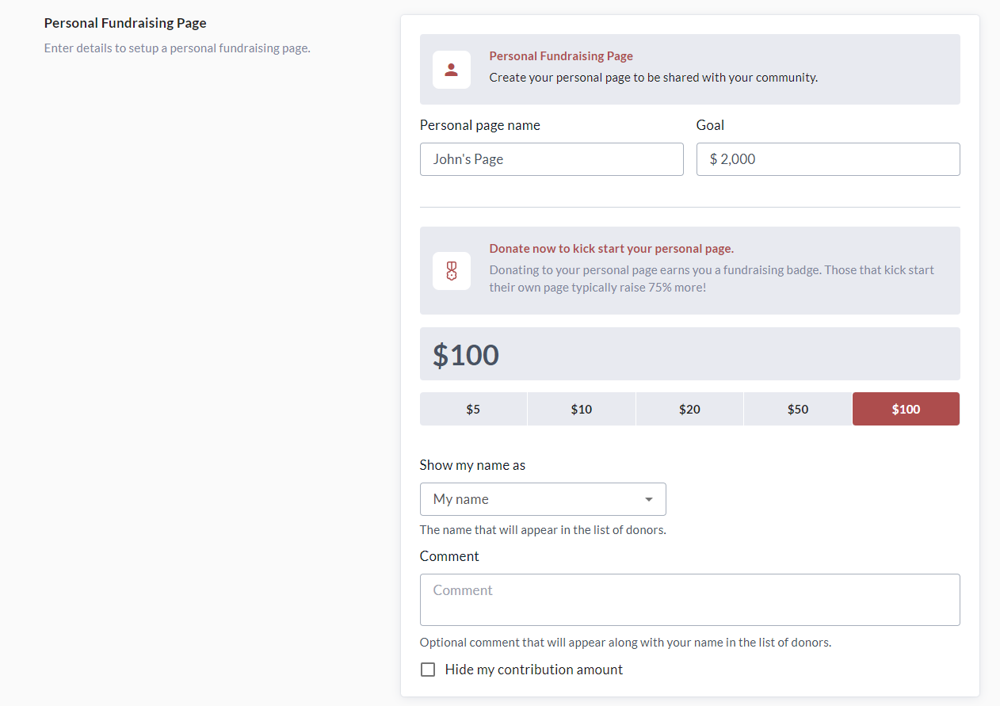

### **Step 4:** Complete any other required information such as custom question responses.

### **Step 5:** Scroll down to the bottom of the page and click one of the options below:

#### **- Save \& add new registrant** to add another registrant.

#### - **Save \& checkout** to continue to checkout.

Please note: If you created a Team, the **first**registrant will be assigned as the Team Captain.

If you add more registrants, you will be given the option of making them the team captain.

### **Step 6** : On the **Checkout** page, you can review your transaction details, and make any desired adjustments to self donation and general donation amounts. (See screenshot below)

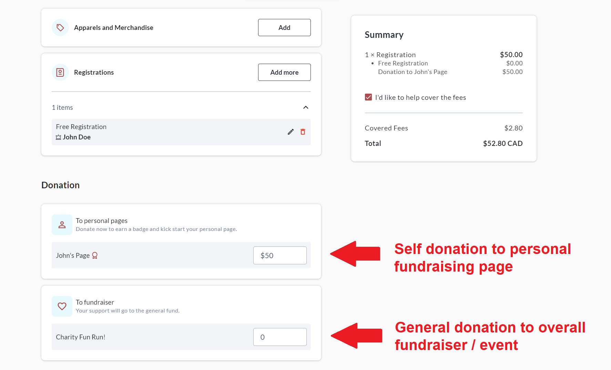

### **Step 7** : Fill out your email address under**General Information** (if not already logged in), and if making a donation at checkout, feel free to change the public display name and comment that will be shown with your donation.

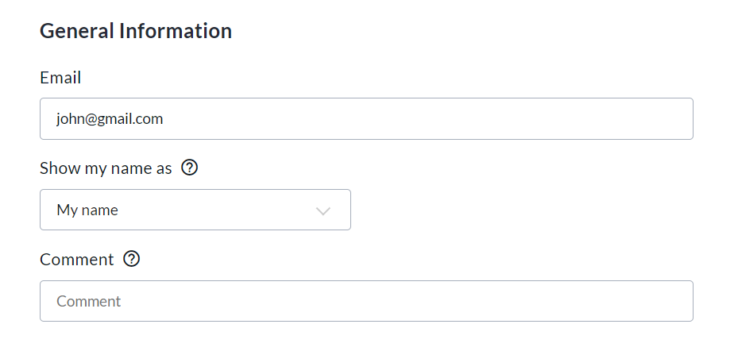

### **Step 8** : Enter your **Payment, Billing and/or Mailing Information** , and click **Complete** .

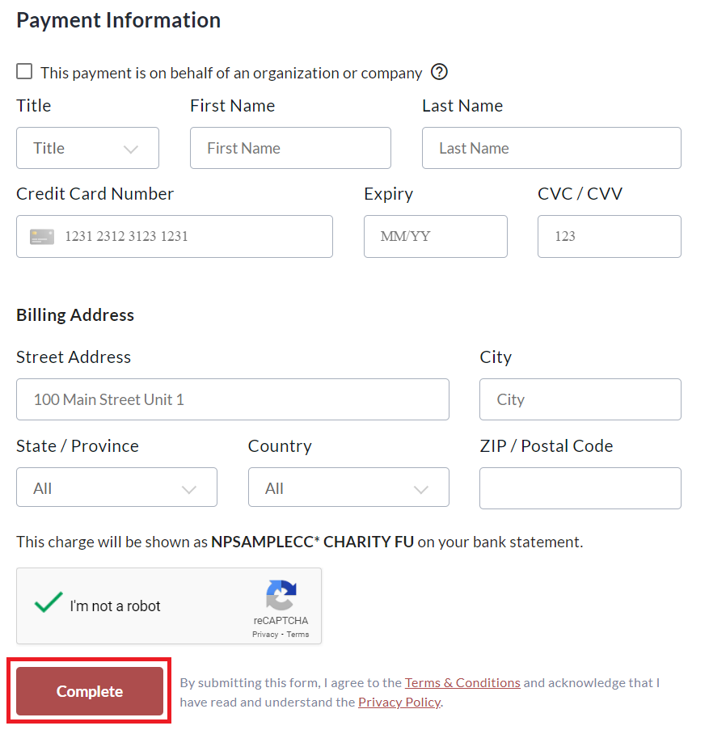

### **Step 9** : Go to your **Personal Fundraising Page** by clicking **Back to Page** on the 'Thank You' page that appears, or via the email confirmation you received after creation.

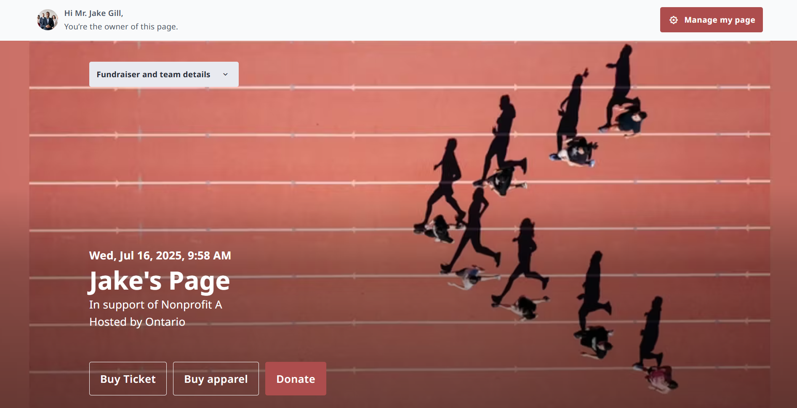
