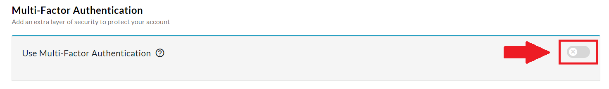
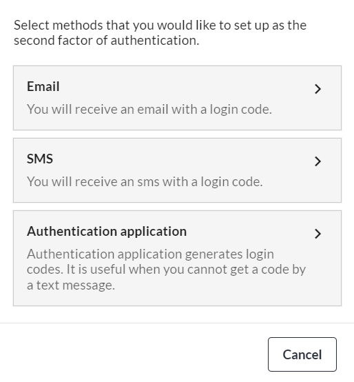

<!-- Source: https://ch.crowdchange.help/cnak/setting-up-multi-factor-authentication-2fa | Nav: Setting Up Multi-Factor Authentication (2FA) | Mirrored 2026-10-14 -->

# Setting Up Multi-Factor Authentication (2FA)

**Multi-Factor Authentication**(commonly referred to as Two-Factor Authentication or 2FA) is the best way to secure your CrowdChange account against security breaches. This can be set up using the following steps:

1. Go to your CrowdChange site and log in to your account.

2. In the upper right-hand corner of your CrowdChange site, click on **Profile → My Profile**.

3. Scroll down and toggle on **Multi-Factor Authentication**.

There are three options for **Multi-Factor Authentication** - **Email, SMS,** and **Authentication Application**. These options refer to different methods by which a confirmation code will be provided to you in order for you to log in to your account.  
  
**Authentication Application** is by far the most secure option for **Multi-Factor Authentication** and is, therefore, our recommended choice (for all online applications, not just CrowdChange).

To use this method you will need to install an authentication app on your smartphone (there are some desktop applications as well). Unlike the SMS method, the authentication app method does not rely on receiving a code sent by the platform you want to log into.

When you first configure an authentication app to work with a platform, the app and platform exchange a secret code. This is generally done by using your device's camera to scan a QR code containing the shared secret. Using that secret code, the app then generates a numeric authentication code for you to enter into the platform when required. The authentication apps generate new codes every 30-60 seconds which must be entered before they expire.

**Here is a list of the most popular authentication apps:**

Google Authenticator ([Apple App Store](https://apps.apple.com/us/app/google-authenticator/id388497605), [Google Play](https://play.google.com/store/apps/details?id=com.google.android.apps.authenticator2&hl=en_CA&gl=US))

Microsoft Authenticator ([Apple App Store](https://apps.apple.com/us/app/microsoft-authenticator/id983156458), [Google Play](https://play.google.com/store/apps/details?id=com.azure.authenticator&hl=en_CA&gl=US))

Authy 2-Factor Authentication ([Desktop](https://authy.com/download/), [Apple App Store](https://apps.apple.com/us/app/authy/id494168017), [Google Play](https://play.google.com/store/apps/details?id=com.authy.authy))

1Password ([Desktop](https://1password.com/downloads/), [Apple App Store](https://apps.apple.com/app/1password-password-manager/id568903335), [Google Play](https://play.google.com/store/apps/details?id=com.agilebits.onepassword))

LastPass ([Desktop/Browser](https://lastpass.com/misc_download2.php), [Apple App Store](https://apps.apple.com/us/app/lastpass-for-premium-customers/id324613447?ign-mpt=uo%3D4), [Google Play](https://play.google.com/store/apps/details?id=com.lastpass.lpandroid))
