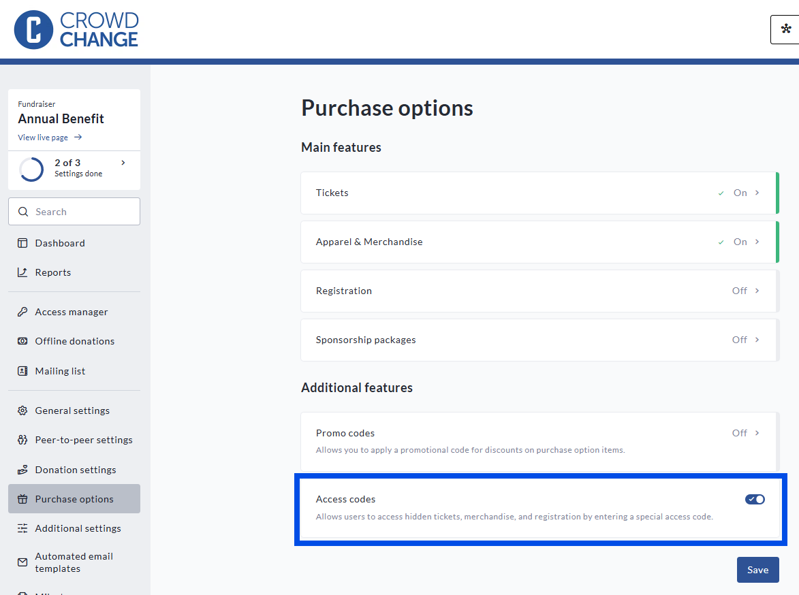
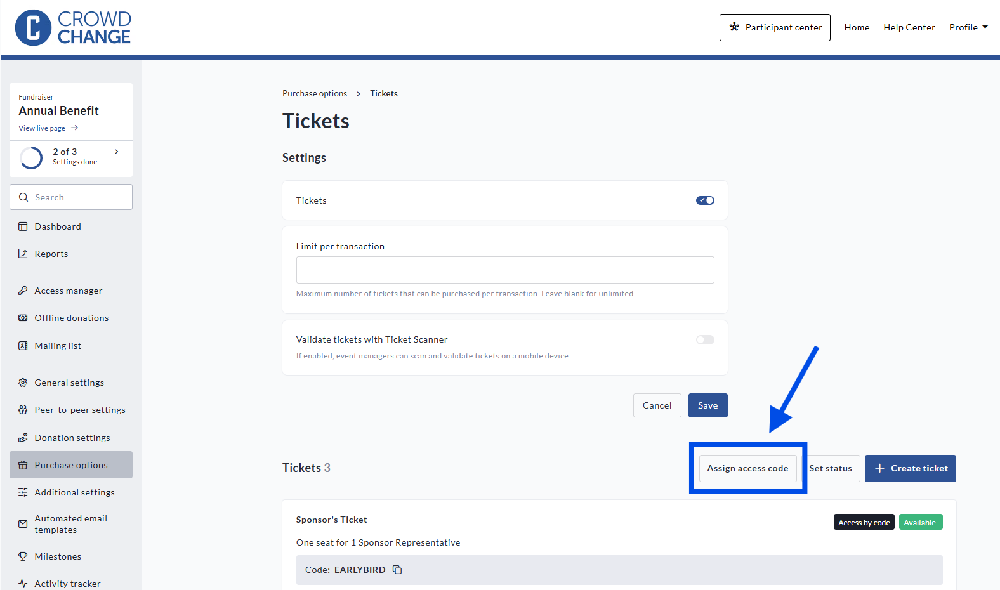
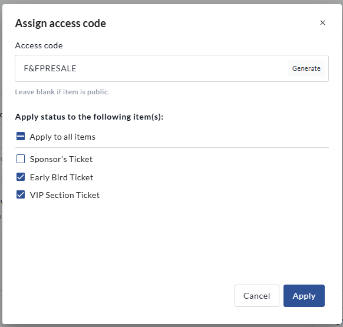
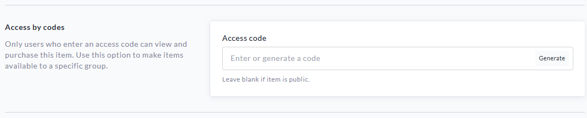
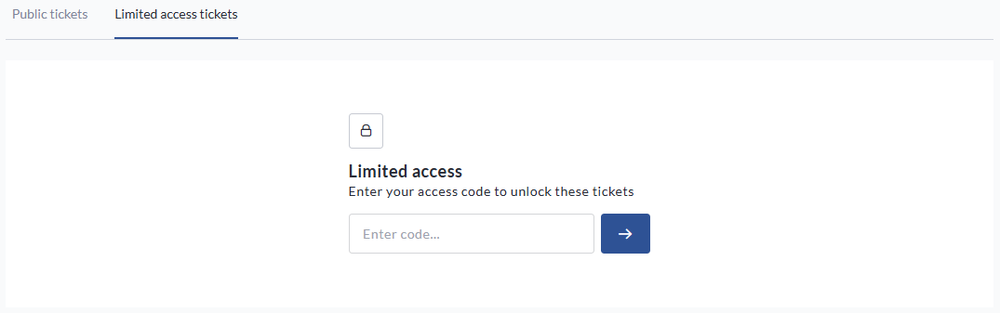
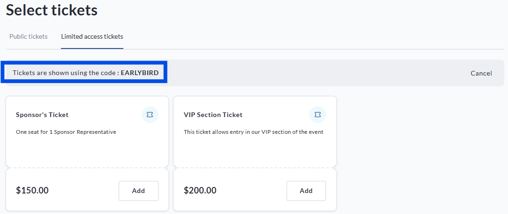

<!-- Source: https://ch.crowdchange.help/cnak/access-codes-for-purchase-options-pre-sale-or-priv | Nav: Access Codes for Purchase Options (Pre-Sale or Private Tickets, Merchandise, Registration, and Sponsorship) | Mirrored 2026-10-14 -->

# Access Codes for Purchase Options (Pre-Sale or Private Tickets, Merchandise, Registration, and Sponsorship)

**Access Codes** is a feature that allows you to gate access to purchase options (tickets, apparel and merchandise, registration, or sponsorships) behind a password. This can allow you to have separate, specialized purchase tiers that are only accessible to those who have been given a specific code. This can be used for:

* Pre-Sale Codes

* Special Discounted Purchase Tiers

* Staff or Friends and Family Purchase Tiers

The **Access Codes**feature is currently in beta, and therefore is not available on CrowdChange by default. If your organization does not have access to this feature, and feel like it would be a worthwhile addition to your site, speak to your Partner Success Manager to discuss adding this function.

*** ** * ** ***

**Access Codes** are turned on via the **Purchase Options** menu within the **Fundraiser Dashboard** . To enable this option for any purchase options, simply toggle it on under *Additional Features*.

To do this, please follow these steps:

* Go to your fundraiser (please ensure you are logged in)

* Click **Manage my fundraiser** to access the **Fundraiser Dashboard**

* From the Fundraiser Dashboard, click **Purchase options**

* In the *Additional features* section, toggle on **Access codes**

* Below the Access codes toggle, click Save to save your settings

\<p\>Toggle on \<strong\>Access codes\</strong\> in the \<em\>Additional features\</em\> section of the \<strong\>Purchase options \</strong\>menu\</p\>

Once this function is toggled on, you can **Assign access codes**to any existing Purchase Option tiers:  

\<p\>Click \<strong\>Assign access codes\</strong\> to set up a new code\</p\>

Once you click **Assign access codes** , you will be prompted to either enter or generate a new code. If you select **Generate**, a random code will be created. Once you have established your code, you can choose whether to assign this code to all purchase tiers, or select the tiers that this code will apply to.  

\<p\>Apply your Access Code to the desired tiers that you would like to gate behind a password\</p\>

Once you have selected your purchase tiers, click **Apply** to save your changes.

*** ** * ** ***

You can also assign an **Access code** to a purchase option within the individual purchase option tier setup page - this is also accessible when creating a new tier.  

\<p\>The \<strong\>Access codes \</strong\>function is available on a tier-by-tier basis for all Purchase Options\</p\>

*** ** * ** ***

Once your code is in place, if a user attempts to select the Purchase Option in question, they will see a field to input a password to access the desired Purchase Option.  

If there are both public tiers and limited access tiers, users can select where to browse using the options in the menu header . If all purchase tiers require an access code, users will only see the Limited Access menu, shown above. Once the user inputs the correct code, the limited access tiers will be made available to them.  

