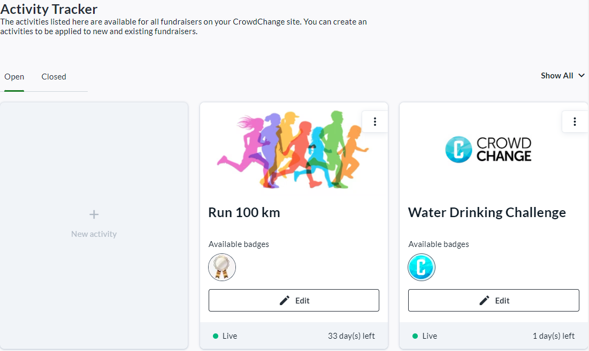
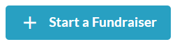
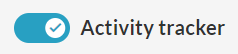
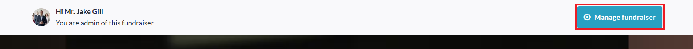
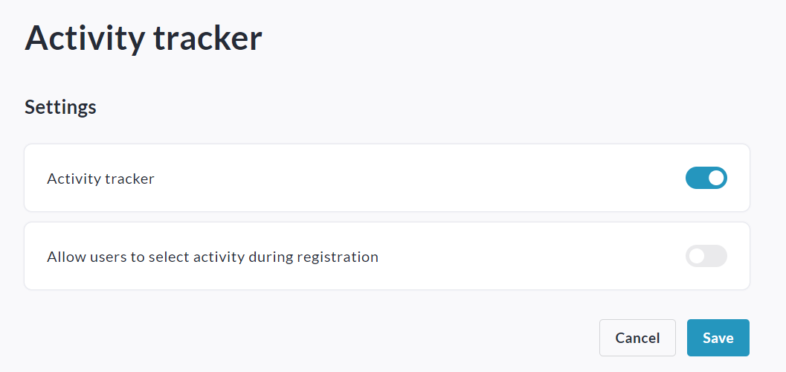
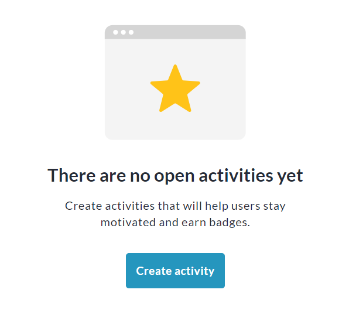
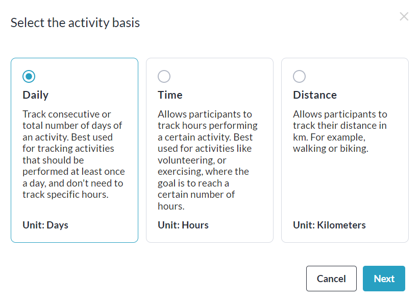
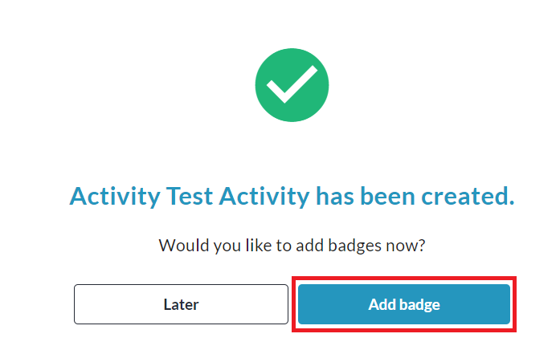

<!-- Source: https://ch.crowdchange.help/cnak/activity-tracker | Nav: Activity Tracker | Mirrored 2026-10-14 -->

# Activity Tracker

The CrowdChange **Activity Tracker** feature allows you to create various Activities within your site, connected to fundraising campaigns, which participants can opt into and track progress towards, while achieving [Badges and Milestones](https://chadmin.crowdchange.help/ct/Badges-and-Milestones.2236383233.html). Scroll down to see an example use case of this functionality.

It's a great way to increase participant engagement with your campaign and your organization's mission.  
Please note that this feature is **NOT** enabled by default.

To have the Activity Tracker enabled, reach out to your Partner Success Representative today!  

**When Activity Tracker is enabled on your site:**

* Fundraisers have a toggle slider within Advanced Features to enable Activity Tracker. Turning this on allows the fundraiser host to access Activities and enables the fundraiser-level Activity Tracker Report.

* Blueprints (if enabled) have a toggle slider to enable Activity Tracker. Turning this on allows fundraiser hosts using the blueprint to access Activities.

* Activity Tracker setup menu is added to Admin Dashboard under Fundraisers Settings → Activity Tracker.

The **Activity Tracker Admin Report** must also be enabled on your site by a CrowdChange Support Agent. Once enabled, it is added to the Admin Dashboard under Reports → Activity Tracker Report.

**Example Use-Case for Activity Tracker:**
> Nicholas has a personal fundraising page within the "*Jackie's Joyathon* " fundraiser, hosted by "*Run for Joy Canada*". The organization has set up activity challenges leading up to the day of the event such as "Jog for 10 minutes every day" and "Eat 7 fruits/vegetables each week", etc.

Using Activity Tracker on his page, Nicholas can track and publicly show his progress towards these activities.

He can also do so via his Personal Page Dashboard within Participant Center (if enabled).

His activity progress is shown publicly (if desired) within the Activity Tracker block on his personal page.

## Getting Started with Activity Tracker

**Please Note:** You will not be able to follow these instructions until Activity Tracker has been enabled on your site by a CrowdChange Partner Success Representative or Support Agent.

### **Enabling Activity Tracker on a New FundraiserEnabling Activity Tracker on a New Fundraiser**

Activity Tracker must be enabled on a fundraiser by fundraiser basis. Additionally, to use it fully, P2P fundraising pages must be toggled on. Follow the simple steps below to enable it on a new fundraiser:

1. From the home page of your CrowdChange site, click the **Start a Fundraiser**button.

   
2. On the **General Info** page, fill out all required information and click **Next**.

3. On the **Additional Settings** page, enable some or all of the following under**Peer-to-peer features**:

   1. *Personal fundraising pages*

   2. *Team fundraising pages*

   3. *Personal fundraising pages within teams*

4. Under **Advanced Features** , turn **ON** the **Activity tracker** toggle slider.

   
5. Click **Create Fundraiser**at the bottom of the page.

### **Enabling Activity Tracker on an Existing Fundraiser**

Activity Tracker must be enabled on a fundraiser by fundraiser basis. Additionally, to use it fully, P2P fundraising pages must be toggled on. Follow the simple steps below to enable it on an existing fundraiser:

1. While logged in, go to your fundraiser and click **Manage Fundraiser**.

   
2. Click **Peer to Peer features**on the left sidebar.

3. Enable some or all of the following under**Peer-to-peer features**:

   1. *Personal fundraising pages*

   2. *Team fundraising pages*

   3. *Personal fundraising pages under a team can be created (within Personal fundraising pages)*

4. Scroll down and click **Save**.

5. On the left sidebar, click **Activity Tracker**.

6. Enablethe **Activity tracker** toggle slider.

   
7. Click **Save**to confirm.

### **Setting up an Activity at the Fundraiser Level**

Activities can also be set up at the individual fundraiser level (once Activity Tracker has been enabled on both the site and the specific fundraiser) by following these steps:

1. While logged in, go to your fundraiser and click **Manage Fundraiser**.

   
2. Click **Activity Tracker**on the left sidebar.

3. Scroll down and click the **Create Activity**button.

   
4. Select the **Activity Basis** (what unit will be measured) in the popup that appears and click **Next**.

   
5. Fill out all the details of your activity, such as **name** , **description** , and **start/end dates**.

6. Set Types (if applicable) and an image for the activity and click **Save**.

#### **Setting up Badges \& Milestones for the Activity**

After creating an activity, you will be prompted to add **Badges**for the activity:

1. Click on **Add Badge**and fill out all the required information.

   
2. Before saving, create a **Milestone email**under 'Message content' to be sent to the participant on achievement of this Badge.

3. Click **Save** , and you'll be taken to the Badges menu, where you can return at any time to **Add** or **Edit** badges.

4. Click**Back to Activities**in the top left corner to return to the Activity Tracker menu.

5. You can return here at any time to **Add** , **Edit** or **Archive**activities.
