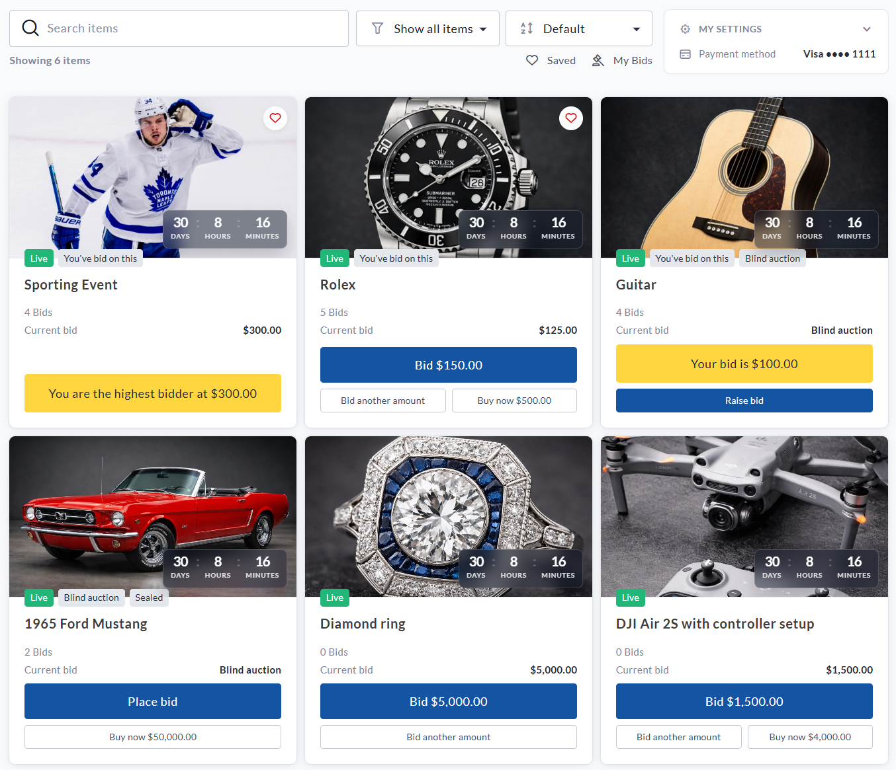
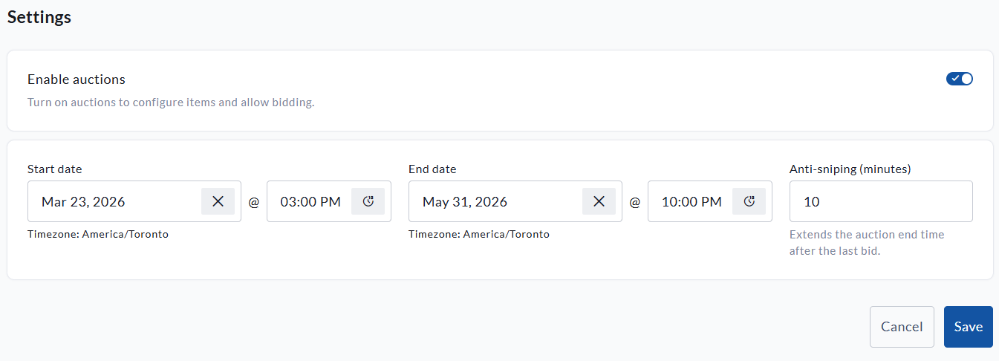
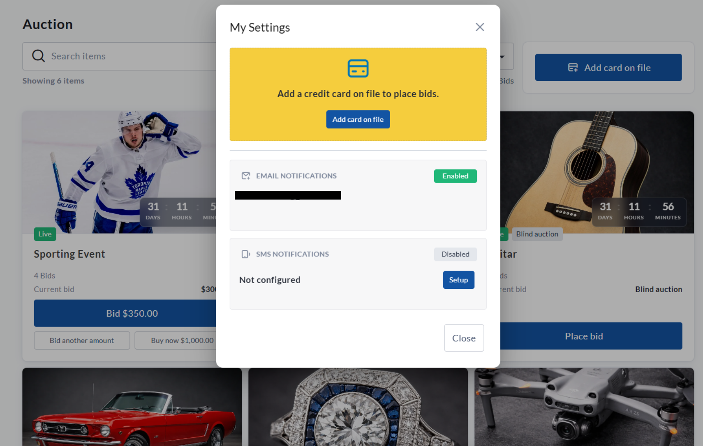

<!-- Source: https://ch.crowdchange.help/cnak/auctions-how-to-host-an-auction-on-crowdchange | Nav: Auctions - How to host an Auction on CrowdChange | Mirrored 2026-10-14 -->

# Auctions - How to host an Auction on CrowdChange

We're excited to introduce **Auctions**, a new way to bring more energy, engagement, and fundraising potential to your CrowdChange campaigns.

With Auctions, your fundraiser can now go beyond donations, tickets, merchandise, and registrations. You can showcase special items, donated prizes, exclusive experiences, gift baskets, memorabilia, travel packages, and more, all directly from your CrowdChange fundraiser.

Auctions give supporters a reason to come back, check the latest bids, save their favourite items, and stay engaged right up until closing time. Whether you are running a gala, campaign, community event, chapter fundraiser, or online giving initiative, Auctions help turn your fundraiser into a more interactive experience.

*** ** * ** ***

## What Are Auctions?

Auctions allow your organization to run an online auction directly through your existing CrowdChange fundraiser.

Once enabled, supporters can browse auction items, place bids, follow items they are interested in, and receive notifications when there is bidding activity. This creates a fun, competitive way for your community to support your cause while helping your organization raise more from donated items and experiences.  

### Auction formats available

CrowdChange supports a few different auction formats, giving you flexibility based on the type of experience you want to create.

#### Standard Auction

A standard auction shows supporters the current bid and allows them to place a higher bid while the item is open.

This is a great option when you want supporters to see the momentum building and compete openly for an item.

#### Blind Auction

A blind auction hides the current highest bid from supporters.

This means bidders place their bid based on what the item is worth to them, rather than simply increasing the current bid by the minimum amount.

Blind auctions can be a great fit for high-value items, unique experiences, or situations where you want bidders to submit more intentional offers.

#### Sealed Auction

A sealed auction is a type of blind auction where each bidder can submit only one bid.

Once submitted, the bid cannot be changed.

This format works well when you want supporters to submit their strongest bid upfront.

*** ** * ** ***

## How to Enable Auctions

To enable Auctions on your fundraiser:

1. Go to your fundraiser and log in.

2. Click **Manage Fundraiser**.

3. From the dashboard, click **Purchase Options**.

4. Click **Auctions**.

5. Toggle **Enable auctions** to **On**.

6. Click **Save**.

Once Auctions are enabled, you can set your auction dates, configure anti-sniping, and start building your item list.

If you do not see **Auctions** under **Purchase Options**, please contact your CrowdChange representative to confirm whether Auctions are enabled on your site.

*** ** * ** ***

### Set Your Auction Schedule

Your auction schedule determines when bidding opens and closes.

You can set:

#### Start Date

This is when bidding opens for your auction.

#### End Date

This is when bidding closes for your auction.

These dates apply to all auction items by default. You can also set different dates on individual items if you want certain items to open or close at different times.

#### Anti-sniping

Anti-sniping helps keep the final moments of your auction fair, active, and exciting.

The number entered in the **Anti-sniping** field creates a final bidding window. If a bid is placed within that timeframe, the auction end time is extended by the same number of minutes.

For example, if your auction is set to end at **8:00 PM** and anti-sniping is set to **10 minutes** , a bid placed at **7:55 PM** will extend the auction to **8:05 PM**.

If another bid is placed at **8:02 PM** , the auction extends again to **8:12 PM**.

This helps prevent last-second bidding and gives other supporters a fair chance to respond, keeping the excitement going right until the true final bid.

*** ** * ** ***

## How to Set Up an Item

Each auction item is its own opportunity to inspire supporters. A strong title, clear description, great image, and thoughtful starting bid can make a big difference in how much attention and activity an item receives.

To create a new auction item:

1. Go to your fundraiser and log in.

2. Click **Manage Fundraiser**.

3. Click **Purchase Options**.

4. Click **Auctions**.

5. Click **Create item**.

6. Complete the item details.

7. Click **Save**.

Once saved, the item will use your main auction schedule unless you set custom dates for that specific item.

*** ** * ** ***

### Item Details

This is where you introduce the item and make it shine.

#### Item Name

Enter the name of the item as it should appear to supporters.

Examples:

* Signed Team Jersey

* Weekend Getaway Package

* VIP Event Experience

* Local Favourites Gift Basket

#### Description

Use the description to help supporters understand why the item is worth bidding on.

A great description can build excitement and answer important questions before someone places a bid.

Consider including:

* What is included

* Any restrictions or expiry dates

* Pickup, delivery, or shipping details

* Donor or sponsor recognition

* What makes the item special

* The impact of bidding on this item

For example, instead of writing "Dinner gift card," you might write:

"Enjoy a special night out with a $200 gift card to one of our favorite local restaurants, generously donated in support of this campaign. Perfect for a date night, celebration, or well-deserved treat."

**Suggested screenshot placement: Screenshot 5**

Place the first item setup screenshot here, showing **Item name** , **Description** , and the start of the **Bidding** section.

*** ** * ** ***

### Bidding Settings

This section controls how supporters can bid on the item.

#### Starting Bid

This is the first bid amount for the item.

For example, if the starting bid is $50, the first bidder must bid at least $50.

A thoughtful starting bid can help encourage early activity. For many items, it may be helpful to choose an amount that feels approachable while still reflecting the value of the item.

#### Bid Increment

This is the minimum amount each new bid must increase by.

For example, if the current bid is $100 and the bid increment is $25, the next minimum bid will be $125.

Bid increments help keep the auction moving. Smaller increments may encourage more bidding activity, while larger increments may be better suited for higher-value items.

#### Enable Buy Now

Buy Now gives supporters the option to purchase an item immediately at a set price.

When Buy Now is used:

* The supporter's payment method is charged immediately.

* The item closes.

* No further bids can be placed on that item.

Buy Now is a great option when you have a clear target price in mind, or when you want to give supporters the chance to secure a popular item right away.

*** ** * ** ***

### Auction Visibility Settings

These settings help shape the bidding experience for each item.

#### Blind Auction

A blind auction hides the current highest bid from supporters.

When Blind Auction is enabled:

* Supporters cannot see the current highest bid.

* Supporters cannot see whether they are currently winning.

* Bid history is hidden.

* Supporters only see their own bid information.

This can encourage supporters to bid based on the true value of the item to them, rather than only bidding slightly above the current amount.

#### Show Bidding History

For regular auctions, you can choose whether to show bidding history.

When enabled, supporters can view previous bids on the item details page.

When disabled, supporters will not see the full bidding history.

Please note that bidding history is never shown for blind auctions.

#### Sealed Auction

A sealed auction is a blind auction where each supporter can submit only one bid.

Once their bid has been submitted, it cannot be changed.

This creates a "best offer" style experience where every bidder has one chance to submit their strongest bid.

Please note that Sealed Auction can only be used with Blind Auction.

*** ** * ** ***

### Item Schedule

Each auction item can follow your main auction schedule, or have its own custom start and end dates.

Leave the item schedule blank if you want the item to use your general auction dates.

Set custom dates if you want an item to open or close at a different time.

This can be useful if you want to:

* Feature certain items for a limited time

* Launch new items throughout your campaign

* Keep high-value items open longer

* Create special bidding windows during an event

*** ** * ** ***

### Images

Upload images that help supporters quickly understand and get excited about the item.

Strong visuals can make your auction page feel more polished and engaging, especially when supporters are browsing multiple items.

Supported file types include:

* PNG

* JPG

* JPEG

* WEBP

*** ** * ** ***

### Additional Item Details

#### Expense

If tax receipts are enabled for auction purchases, use the **Expense** field to enter the portion of the item that is not eligible for an automated tax receipt.

For example, if an item sells for $300 and $100 should not be eligible for a tax receipt, enter $100 in the Expense field.

Please confirm your organization's receipting practices before launching your auction.

#### Fair Market Value

Enter the fair market value of the item.

This is the actual value of the item and may be used for display and reporting purposes.

#### Custom Code

Use this field for internal reporting or tracking.

For example, you may enter a SKU, package number, donor reference, or internal item code.

This code is not shown to supporters.

*** ** * ** ***

### Tips for Building a Strong Auction Item

A great auction item does more than list the details. It helps supporters imagine the experience, understand the value, and feel excited to participate.

To get the most out of each item:

* Use clear, high-quality images.

* Write descriptions that feel engaging and complete.

* Include pickup, delivery, shipping, or fulfillment details.

* Set a starting bid that encourages early participation.

* Choose a bid increment that matches the value of the item.

* Use Buy Now for items with a strong fixed value.

* Consider blind or sealed bidding for unique or high-value items.

* Promote standout items before the auction opens.

* Remind supporters when bidding is closing soon.

A strong auction item can become a mini-campaign of its own, giving supporters something specific and exciting to rally around.

*** ** * ** ***

## Bidder Actions \& Experience

Once your auction is live, supporters can browse, bid, save items, and stay connected through notifications.

This section explains what bidders can expect when participating in your auction.

*** ** * ** ***

### Browsing Auction Items

Supporters can view all available auction items from the fundraiser's auction page.

Depending on your item settings, supporters may see:

* Item name

* Image

* Status, such as Live or Closed

* Time remaining

* Current bid

* Number of bids

* Buy Now option, if enabled

* Saved items

* Items they have already bid on

This makes it easy for supporters to explore what is available, return to their favourite items, and stay involved throughout the campaign.

*** ** * ** ***

### Viewing an Individual Item

Supporters can click into an auction item to see more details before placing a bid.

Depending on your settings, the item page may show:

* Item image

* Item description

* Current bid

* Number of bids

* Time remaining

* Starting bid

* Bid increment

* Minimum bid

* Fair market value

* Buy Now price, if enabled

* Bid history, if enabled

This gives supporters the information they need to bid confidently.

**Suggested screenshot placement: Screenshot 2**

Place the individual auction item screenshot here to show what a bidder sees when reviewing an item.

*** ** * ** ***

### Logging In Before Bidding

To place a bid, supporters must log in to their CrowdChange account.

If a supporter tries to bid while logged out, they will be prompted to log in or create an account before continuing.

This ensures each bid is connected to a valid user account.

*** ** * ** ***

### Adding a Payment Method

Before placing a bid, supporters must add a valid payment method to their account.

If they do not already have a payment method saved, they will be prompted to add one before their bid can be submitted.

This helps create a smoother checkout experience when the auction closes, since winning bids are charged automatically.  

*** ** * ** ***

### Placing a Bid

Once logged in and once a payment method has been added, supporters can bid on live auction items.

Supporters may be able to:

* Click the automatic next bid button

* Enter a custom bid amount

* Use Buy Now, if enabled

* Save items they want to follow

* View items they have bid on

The automatic next bid is based on the current bid plus the bid increment.

For example, if the current bid is $100 and the bid increment is $25, the next minimum bid is $125.

All bids are final and cannot be cancelled by the bidder.

*** ** * ** ***

### Saved Items and My Bids

Supporters can save items they are interested in and view items they have already bid on.

This makes it easier for bidders to return to the auction, follow their favorite items, and jump back in when the competition heats up.

*** ** * ** ***

### Bidder Notifications

Supporters can configure auction notifications from their settings.

Notifications may be available by:

* Email

* SMS, if configured

Supporters can receive notifications when:

* They place a bid

* They are outbid

* They win an auction item

These notifications help keep bidders engaged and encourage them to return when there is new activity on an item they care about.

*** ** * ** ***

### How Bidders Are Charged

Bidders are not charged when they place a standard bid.

Instead, their payment method is charged if they win the item when the auction closes.

#### If the bidder wins an item

Their saved payment method is automatically charged for the winning bid amount after the auction ends.

#### If the bidder uses Buy Now

Their saved payment method is charged immediately, and the item closes right away.

#### If the payment fails

The bidder will be notified and prompted to update their payment method. The fundraiser admin will also be notified so they can follow up if needed.

There is no "bid now, pay later" option. A valid payment method must be added before bidding.

*** ** * ** ***

### Important Notes for Bidders

* Bidders must log in before placing a bid.

* Bidders must have a payment method on file before bidding.

* Bids are final and cannot be cancelled by the bidder.

* Standard bids are only charged if the bidder wins.

* Buy Now purchases are charged immediately.

* Winning bids are charged automatically when the auction closes.

* Covered fees do not apply to auction purchases, so the bidder pays the exact winning bid or Buy Now amount.
