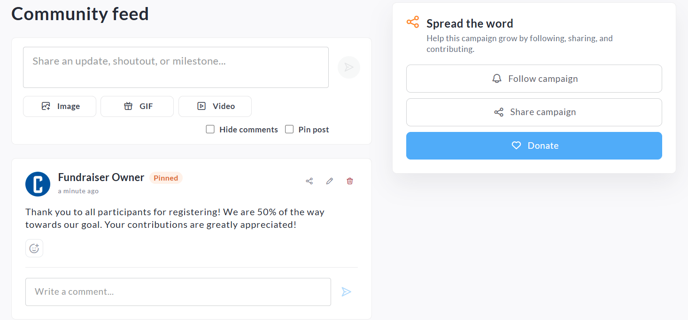
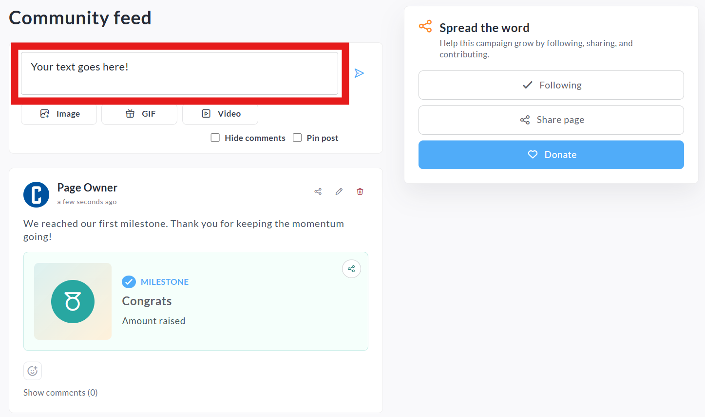
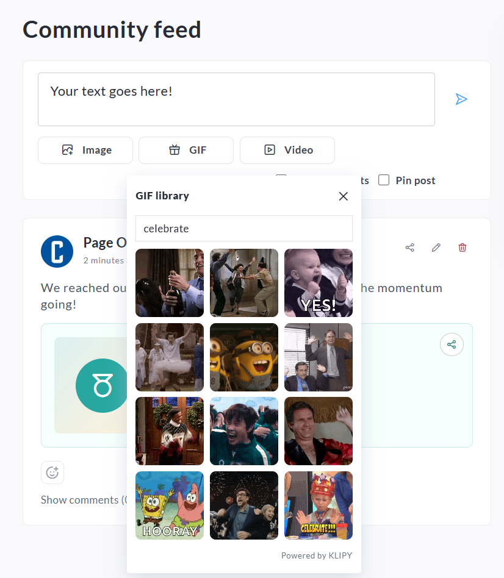
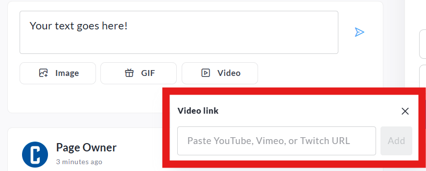
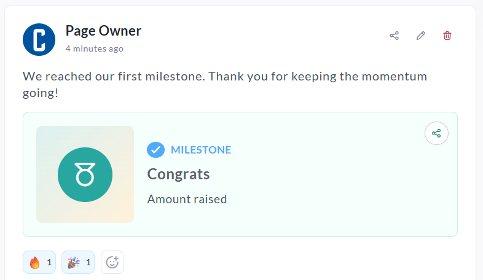
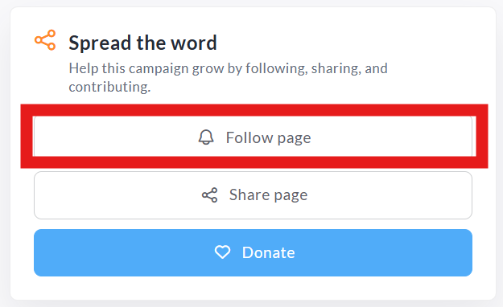
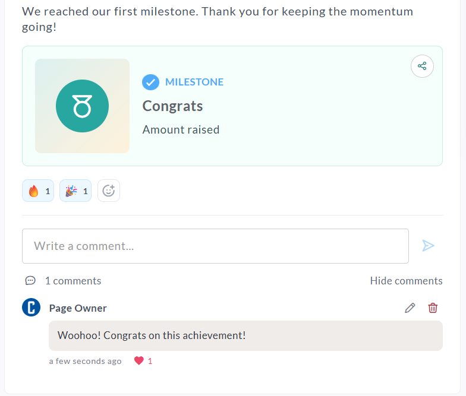
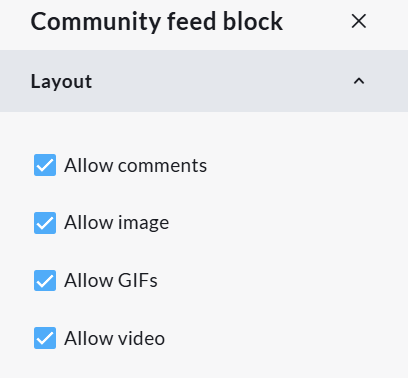

<!-- Source: https://ch.crowdchange.help/cnak/community-feed-block-how-to-share-updates-on-your- | Nav: Community Feed Block - How to share updates on your fundraiser, team or personal fundraising page | Mirrored 2026-10-14 -->

# Community Feed Block - How to share updates on your fundraiser, team or personal fundraising page

The Community Feed is a social engagement feature that allows fundraiser owners, team captains, and personal page owners to share updates, celebrate achievements, and engage with supporters directly on their fundraising pages.

Community Feed helps keep supporters informed throughout a campaign by making it easy to post updates, share photos and videos, celebrate fundraising milestones, and encourage ongoing participation.  

*The Community Feed allows page owners to share updates, media, and milestones while keeping supporters engaged throughout their fundraising journey.*

*** ** * ** ***

## Creating a Post

Page owners can create and publish updates directly from the Community Feed section.

### To create a post:

1. Navigate to your Fundraiser, Team, or Personal Fundraising Page.

2. Locate the **Community Feed** block.

3. Enter your message in the text field.

4. Optionally add media or a milestone.

5. Select any additional options:

   * Hide comments

   * Pin post

6. Click **Post**.

*Enter your update directly into the Community Feed composer before posting.*

*** ** * ** ***

## Adding Images, GIFs, and Videos

Community Feed posts can include media to make updates more engaging and visually appealing.

Depending on your site's configuration, page owners may be able to add:

### Images

Upload photos from your device to share event updates, fundraising progress, thank-you messages, or campaign highlights.

### GIFs

Add GIFs to celebrate milestones, thank donors, or create fun and engaging updates.  

*GIFs can be added to make Community Feed updates more engaging and celebratory.*

### Videos

Share video content to tell your story, provide campaign updates, or thank supporters.  

*Videos from YouTube, Vimeo, or Twitch can be added via the* ***Video*** *button*

*** ** * ** ***

## Milestone Posts

Community Feed includes milestone-sharing functionality that helps page owners celebrate fundraising achievements.

When a page reaches certain fundraising milestones, CrowdChange may display a suggested post that can be shared with a single click.

Examples include:

* Reaching a fundraising amount goal

* Reaching a donation count milestone

* Earning an Activity Tracker badge

Page owners can choose to:

* Share the milestone immediately

* Dismiss the suggestion

If dismissed, the same milestone prompt will not continue to appear repeatedly.  

*When a milestone is reached, page owners can quickly share their achievement with supporters.*

*** ** * ** ***

## Following a Page

Supporters can follow Fundraiser, Team, and Personal Pages to stay informed about future updates.

### Registered Users

Logged-in users can click **Follow Page** and automatically receive Community Feed notifications using the email address associated with their account.

### Anonymous Visitors

Visitors who do not have a CrowdChange account can subscribe to updates using their email address or SMS notifications (if enabled).  

*Supporters can follow a page to receive future Community Feed updates and notifications.*

*** ** * ** ***

## Notifications

When a new Community Feed post is published:

* Followers receive a notification about the update.

* Email notifications include a direct link back to the page.

* Followers can unsubscribe at any time.

* Users can manage their notification preferences within their CrowdChange profile settings.

*** ** * ** ***

## Comments and Reactions

Community Feed is designed to encourage supporter engagement.

### Reactions

Supporters can react to posts and comments.

Anonymous visitors may react without creating an account.

### Comments

Supporters can comment on Community Feed posts to show encouragement and interact with page owners.

Please note:

* Commenting requires a registered CrowdChange account.

* Comments are subject to spam and profanity filtering.

* Site administrators may disable comments entirely.

*Supporters can engage with Community Feed posts through reactions and comments.*

*** ** * ** ***

## Pinning Posts

Page owners can pin important posts to keep them visible at the top of the Community Feed.

Pinned posts are ideal for:

* Campaign announcements

* Event reminders

* Fundraising challenges

* Sponsor acknowledgements

* Thank-you messages

To pin a post, select **Pin Post** before publishing.

*** ** * ** ***

## Community Feed Configuration (Admins)

Administrators can customize the appearance and functionality of the Community Feed block through the Fundraiser Design Editor.

### Available Configuration Options

#### Appearance Settings

* Block title

* Title alignment

* Background colour

* Accent colour

* Background image

* Mobile background image

* Background opacity

* Title text colour

#### Content Controls

* Allow comments

* Allow images

* Allow videos

* Allow GIFs

#### Page-Specific Settings

Separate Community Feed settings can be configured for:

* Team Pages

* Personal Pages

This allows administrators to control which Community Feed features are available across different page types.  

*Administrators can customize both the appearance and functionality of the Community Feed block.*

*** ** * ** ***

## Best Practices

We recommend posting regularly throughout your campaign to keep supporters engaged.

Popular Community Feed content includes:

* Fundraising progress updates

* Donor thank-you messages

* Event photos

* Team achievements

* Activity Tracker accomplishments

* Milestone celebrations

* Calls to action encouraging donations or participation

Frequent updates help maintain momentum and encourage supporters to return to your page throughout the campaign.
