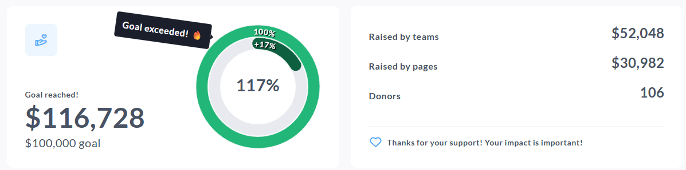

<!-- Source: https://ch.crowdchange.help/cnak/donation-progress-block-how-to-track-amount-raised | Nav: Donation Progress Block - how to track amount raised and goals on your fundraiser | Mirrored 2026-10-14 -->

# Donation Progress Block - how to track amount raised and goals on your fundraiser

The **Donation progress block** displays key fundraising metrics on your fundraiser page, including the total amount raised, your goal (if enabled), and optional totals like **Raised by teams** , **Raised by pages** , and **Donors**.

This block now supports **stretch goals**, meaning that if your fundraiser exceeds its goal, the progress indicator can display progress above 100%, and you can optionally show a "goal exceeded" celebration hint and customize the exceeded progress colors.

If your fundraiser has a goal enabled, it will be shown in the **Donation progress block** . If you elect to display this block without a goal set, it will count **overall funds raised**, without showing a goal.  

The **Donation progress block** on a peer-to-peer fundraiser

*** ** * ** ***

## How to edit the Donation progress block

To edit the Donation progress block, follow the below steps:

* Go to your CrowdChange page and Log in

* Once on the fundraiser you would like to edit, click **Manage fundraiser**

* Once on the Fundraiser dashboard, click **Design your fundraiser**

* Scroll to the **Donation progress** block, and click the **Edit** button

* Make your updates (Layout, Appearance, Content, etc.)

* Click **Save** to publish your changes

*** ** * ** ***

## How to add a Donation progress block

If your fundraiser is missing a Donation progress block, it is possible it was previously deleted. To restore it, please follow these steps:

* Go to your CrowdChange page and Log in

* Once on the fundraiser you would like to edit, click **Manage fundraiser**

* Once on the Fundraiser dashboard, click **Design your fundraiser**

* Within the user interface, between any two blocks, click the **Plus** icon

* The list of available blocks will then be shown, select the **Donation progress** block

* Click **Save** if prompted

*** ** * ** ***

## Layout options

Within the **Layout** section, you can control how the Donation progress block is displayed on the page:

* **One column** - Displays your fundraising progress in a single, streamlined section.

* **Two columns** - Displays a larger primary panel on the left (for example, total raised and the progress chart) and a secondary panel on the right for additional stats (for example, raised by teams, raised by pages, donors).

### Primary block

The **Primary block** is the main metric shown in the Donation progress block. In the **Raised amounts** section, you can choose to display:

* **Raised amount**

* **Goal**

If the **Goal** is enabled, you can edit the goal amount directly in this panel. Please note, updating this goal value will also update the fundraiser goal in the fundraiser's **General settings**.

### Secondary blocks

The **Secondary blocks** section allows you to show or hide additional fundraising stats, such as:

* **Raised by teams**

* **Raised by pages**

* **Donors**

You can toggle each secondary block on or off. If needed, you can also promote a secondary stat to be the main display by selecting **Make primary**.

*** ** * ** ***

## Stretch goals and goal exceeded settings

When your fundraiser exceeds its goal, the Donation progress block can visually display progress beyond 100% (for example, 115%), which supports stretch goal momentum and helps communicate that the campaign is continuing to grow.

Within the **Appearance** settings, you can also enable and customize:

* **Celebrate goal reached** - Shows a celebration confetti effect when the goal is reached.

* **Exceeded goal hint** - Displays a short celebration label near the progress chart when the goal is exceeded (the text is customizable, and is designed for short messages like "Goal exceeded!" or a stretch goal callout).

* **Exceeded progress bar color** - Allows you to set a separate color for the exceeded portion of the progress bar or chart, making stretch progress visually distinct from standard progress.

Tip: If you are testing these settings while editing, use the fundraiser preview in the **Design your fundraiser** view to confirm how the goal reached and goal exceeded states look before publishing.

*** ** * ** ***

## Appearance

The **Appearance** section controls how the Donation progress block looks, including the progress visualization and colors.

### Progress bar style

You can choose between:

* **Donut chart** - A circular progress chart, ideal for highlighting percent-to-goal.

* **Horizontal bar** - A more traditional progress bar display.

### Color settings

You can also customize:

* Background color

* Primary block background color and text color

* Secondary block background color and text color

* Progress bar color

* Filled progress bar color

* Exceeded progress bar color (stretch goals)
