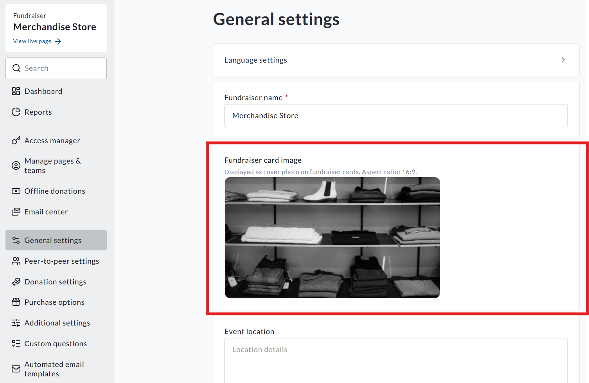

<!-- Source: https://ch.crowdchange.help/cnak/fundraiser-cards-how-to-change-the-image-on-homepage-tickets-and-preview | Nav: Fundraiser cards - how to change the image on homepage, tickets, and preview | Mirrored 2026-10-14 -->

# Fundraiser cards - how to change the image on homepage, tickets, and preview

**Fundraiser cards**refer to the images shown on your CrowdChange homepage, smaller versions of your fundraiser's cover image at checkout, and the image shown on PDF tickets generated via CrowdChange. This image can be different from your main cover image. This is due to the differing dimensions/layout of these areas.

## How to change / update your **Fundraiser card**

Once you have created your fundraiser, please follow these steps to update your **Fundraiser card**.

* Go to your fundraiser and click **Dashboard**

* Once on the **fundraiser dashboard** , click **General settings**

* Then you will see the **Fundraiser card** section

* Click on your image to adjust this

The aspect ratio for fundraiser cards is 16:9.  

## Things to note

* When you initially create your fundraiser, the cover image uploaded during the **Start a fundraiser** process will be your fundraiser card

* Changes to your cover image post-creation, however, will not adjust the fundraiser card - the above steps must be taken

* Bilingual fundraisers will require separate images for English and French - however, the option to **Copy to French** will be there if an English image is uploaded
