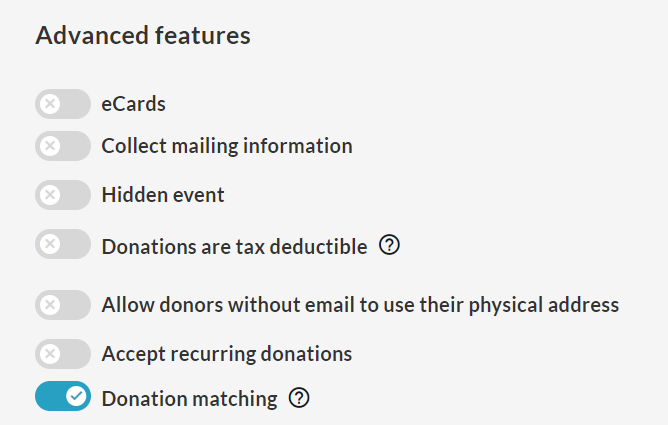
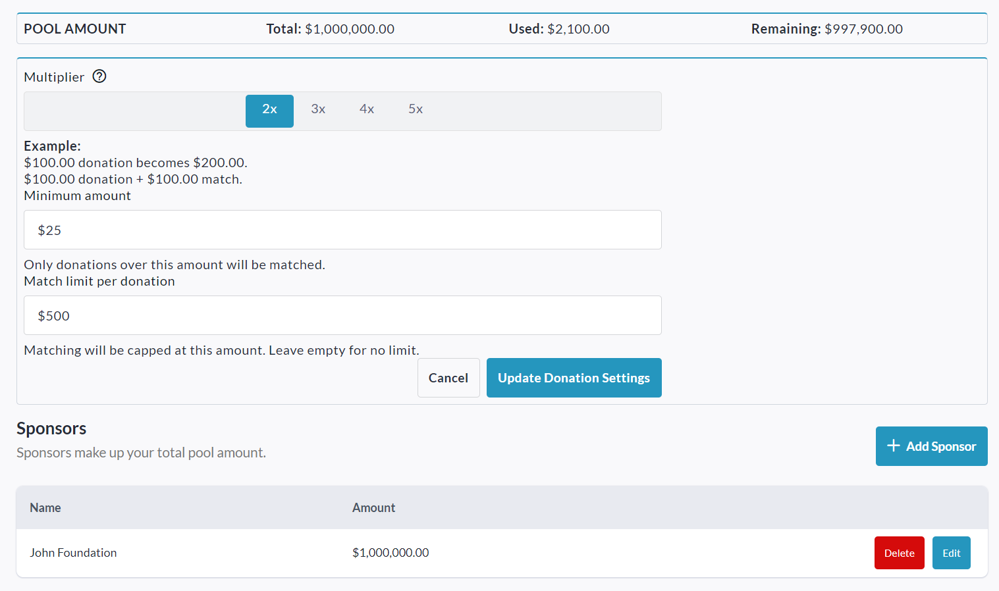
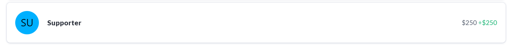
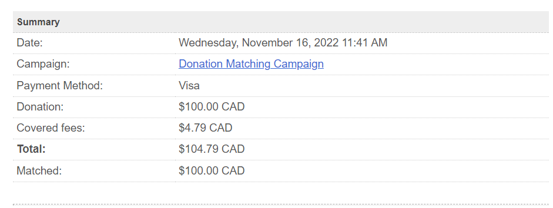
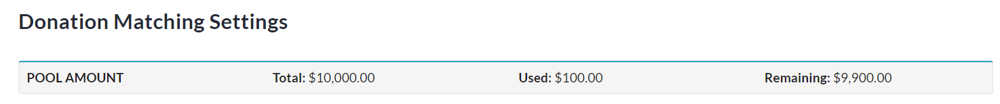

<!-- Source: https://ch.crowdchange.help/cnak/how-donation-matching-works | Nav: How Donation Matching Works | Mirrored 2026-10-14 -->

# How Donation Matching Works

**Donation Matching**is a great way to encourage donors to increase the value of their donation, while also allowing corporate donors the chance to associate themselves with a large donation campaign.

Itallows your organization to designate an offline pool of funds which can be used as a multiplier for standard donations. This is a feature which must be enabled by a CrowdChange administrator, so please reach out to your Partner Success Representative if you wish to have it enabled.

To enable **Donation Matching** , toggle it on while creating your fundraiser under **Advanced Features**.  

Once your fundraiser is created, follow the steps below to set up Donation Matching.

1. Go to your fundraiser while logged in and click **Manage Fundraiser**.

2. Click **Donation Settings** on the left sidebar, then**Donation Matching**.

3. **Enable** the Donation Matching toggle slider and click **Save**.

4. Scroll down to set up Donation Matching, as described below.

You can select the **multiplier**you would like to use (2x, 3x, 4x, or 5x).

If desired, you can also set a **minimum** and **maximum**donation amount for matching. E.g. If a minimum of $25 is set, only donations $25 and above will be matched. If a limit of $500 is set, any donations made above that will only be matched up to $500.

The **Sponsors** section determines where you will draw your funds from. This is an offline pool of money, so please ensure that you are accounting for it with your sponsor directly. Click**Add Sponsor**to get started.

Set the **Sponsor Name** , and Pool**Amount** (this is essential so that you don't over-promise to your donors).  

Once these settings have been confirmed, all donations made during your Donation Matching campaign will show both the donated amount and the matched amount when looking at the **Donations**list:  

**Donor Receipts**will also show this matched amount, as well as the original donation amount.  

The **Donation Matching**menu will reflect any changes to the pool of funds, allowing you to keep up with how much money is available at any point in time for this matching campaign.  
  
Details of matched amounts through a **Donation Matching** campaign can also be seen in the [**Admin Donations Report**](https://chadmin.crowdchange.help/ct/How-to-Access-the-Admin-Donations-Report.2025226327.html).
