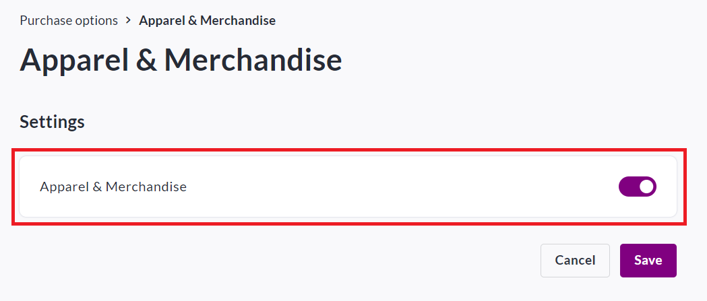
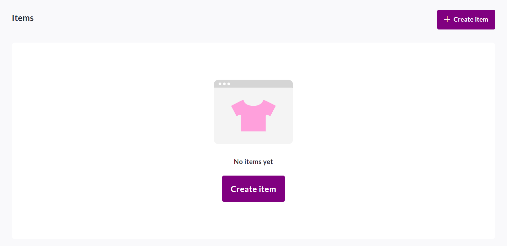
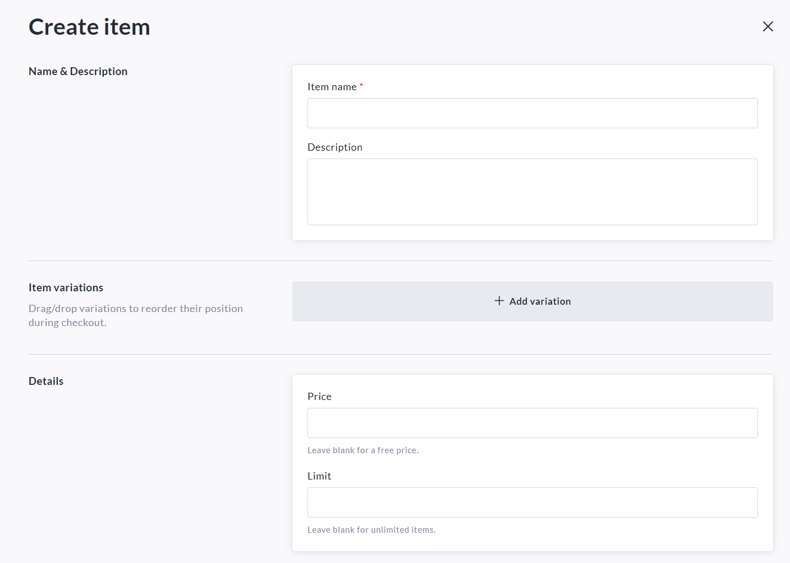
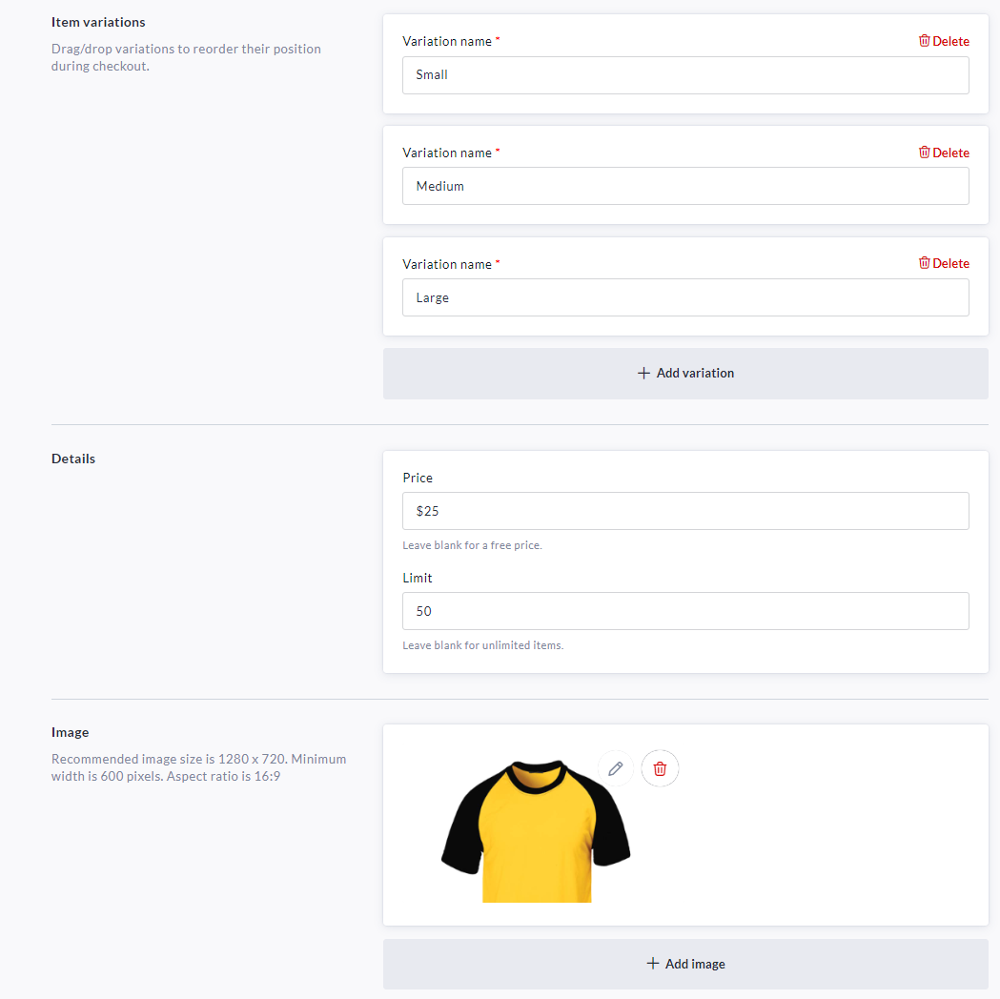
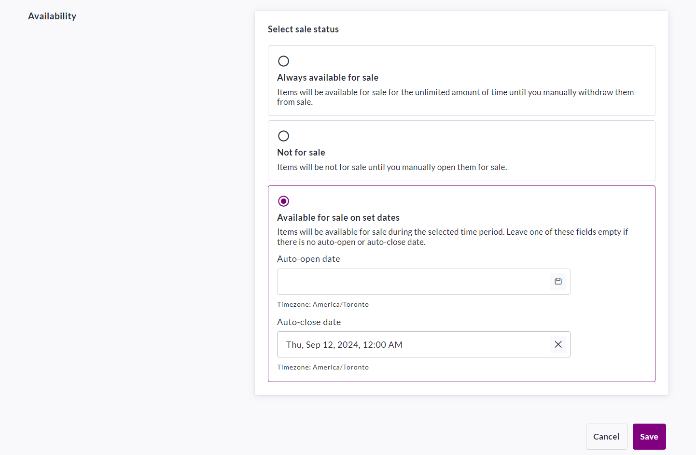

<!-- Source: https://ch.crowdchange.help/cnak/how-merchandise-works | Nav: How Merchandise Works | Mirrored 2026-10-14 -->

# How Merchandise Works

If you're looking to sell **apparel** or **merchandise** for your event, we've got you covered!

You can add as many items (with variations/sizes) as desired, and participants can pay directly online.

Upon completing checkout, the donor will receive an email confirmation of their purchase.  
Please note that CrowdChange **does not** handle shipping and fulfillment of items sold within your fundraiser.

To set up apparel and merchandise within your fundraiser, follow these simple steps:

1. Go to your fundraiser, **Log In** , and then click **Manage Fundraiser**.

   
2. On the left sidebar, click **Purchase Options**.

   
3. On the **Purchase Options** page, click Apparel \& Merchandise and toggle the feature on.

   
4. Click **Save**.

5. To add your items, scroll down and click **Create Item.**

   
6. Set a **name** , **description** , add **variations** if needed (*all variations will carry the same price.)* , set a **price** (if desired), a **limit**(if desired), and add image(s).

   
7. *For events with registration that includes a T-shirt, you can set the name to "Registration + T-shirt", this allows you to collect sizes from participants who register. For example:*

   
8. Set your desired **availability** for the new apparel / merchandise item.

   *\*If desired, you may set a date to automatically close sales.\**

   
9. Click **Save** in the bottom-rightto confirm.

As the fundraiser owner, you will have access to all transaction details and apparel sizes/variations in your **Donations Report**. To access it, refer to the below:

[How to Access the Donations Report (Fundraiser Level)](https://chadmin.crowdchange.help/ct/How-to-Access-the-Donations-Report-(Fundraiser-Level).2006974566.html)  
Donors will receive a **confirmation email** once their purchase is complete.

Please refer to [How Email Templates Work](https://chadmin.crowdchange.help/ct/How-Email-Templates-Work.2013757497.html) when confirming the Automated Trigger Emails within your fundraiser.
