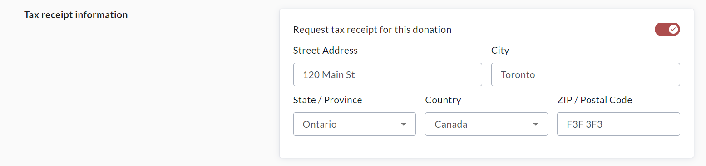
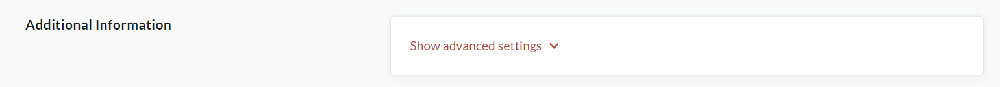

<!-- Source: https://ch.crowdchange.help/cnak/how-pledging-works | Nav: How Pledging Works | Mirrored 2026-10-14 -->

# How Pledging Works

CrowdChange is equipped with **Pledging** functionality, allowing you to send a direct payment link to your donors via Email or SMS, so they can pay the pledge online. This link is fundraiser-specific and you can set the amount that your donor has committed to pay. This can be done using the **Offline Donations**page.

Please see the following steps to use this functionality:

1. Go to your CrowdChange fundraiser while logged in, and click **Manage Fundraiser**(Manage my page or Manage my team on P2P pages).

2. On the left sidebar, click **Offline Donations**.

3. Once on the **Offline Donations** page, click **Add Donation**.

4. Within **General Information**, enter your donor's first and last name, email address, and donation amount.

   1. If you would like to send the payment link via **Email** , click the checkbox under Email that says '**Send link for individual or group to make online payment**'. This will send your donor the payment link directly to their email address.

   2. If you would like to send the link via **SMS**, leave this box unchecked, and once the donation has been added, you will be able to click 'Share Payment Link' and send to a Phone Number.

      
5. If a tax receipt is desired for this donation, within Tax Receipt Information, enable **Request tax receipt for this donation** and enter the donor's address \& postal code.

   
6. To assign the donation to a team or personal page, change the date of donation, payment method, display name, show/hide amount setting, comment and add notes, click **Show Advanced Settings** within **Additional Information**.

   
7. Click **Save** at the bottom to confirm. **DO NOT** check 'Mark as received'.

   

## How to Re-send a Pledge Payment Link

If you need to re-send a payment link to a Pledge you have already entered in Offline Donations, this can be done using the following steps:

1. Go to your CrowdChange fundraiser while logged in, and click **Manage Fundraiser**.

2. On the left sidebar, click **Offline Donations**.

3. Find the donation that you would like to send a payment link for and click on it to get to the **Edit Donation** menu.

4. At the bottom of the page, click on **Share Payment Link**. You will be able to send via Email or SMS.

   

If your fundraiser has **Tax Receipts** enabled, you can include your donor's Billing Address while entering their pledge. Tax Receipts can also be issued at a later date if you don't have this information, using the **Tax Receipts Report.**  
In a Pledging scenario, donors **do not** have the option to cover any transaction fees (Credit Card or CrowdChange platform fees) associated with the transaction.
