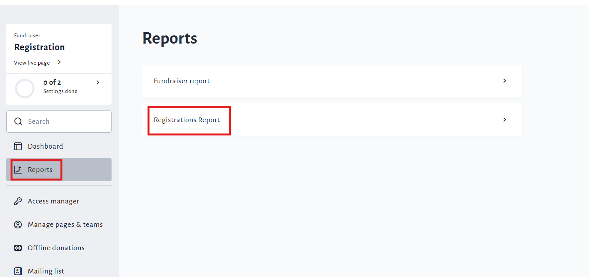
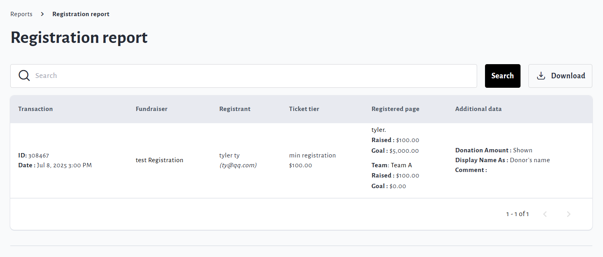

<!-- Source: https://ch.crowdchange.help/cnak/how-to-access-the-registrations-report-fundraiser- | Nav: How to Link Registrations to Personal & Team Pages > How to Access the Registrations Report (Fundraiser Level) - Multi-registration fundraisers only | Mirrored 2026-10-14 -->

# How to Access the Registrations Report (Fundraiser Level) - Multi-registration fundraisers only

As the host of a multi-registration enabled fundraiser, your **Registrations Report**is where you can find details about all registrants and registration transactions. You can search/filter by email address, transaction ID or page name, and download an Excel report of all registrations.

To access it, follow these simple steps:

1. Go to your CrowdChange site and **Log In**.

2. Go to your multi-registration enabled fundraiser and click **Manage Fundraiser**.

3. On the left sidebar, click**Reports** and then **Registrations Report**.

   

4. You will be taken to the **Registration Report** page, where you can see detailed information on all registration transactions. If you're looking for information on a specific registrant, you can use the search bar and search by email address, transaction ID or page name.

   

You can download a more detailed CSV version of this report by clicking **Download**in the top right.

The email you receive with download link will have the subject 'Registration Report'.

It will also contain the answers to custom checkout and registration questions.
