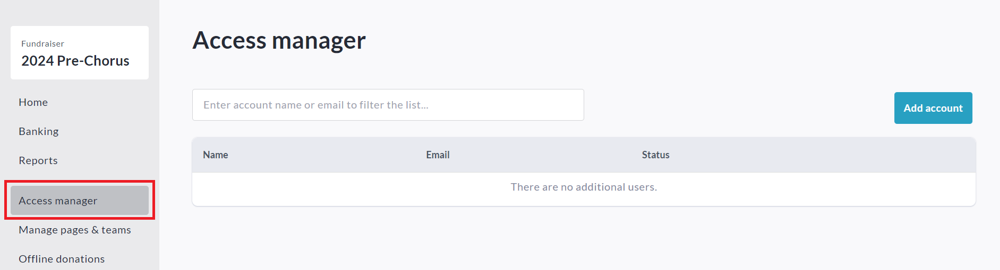
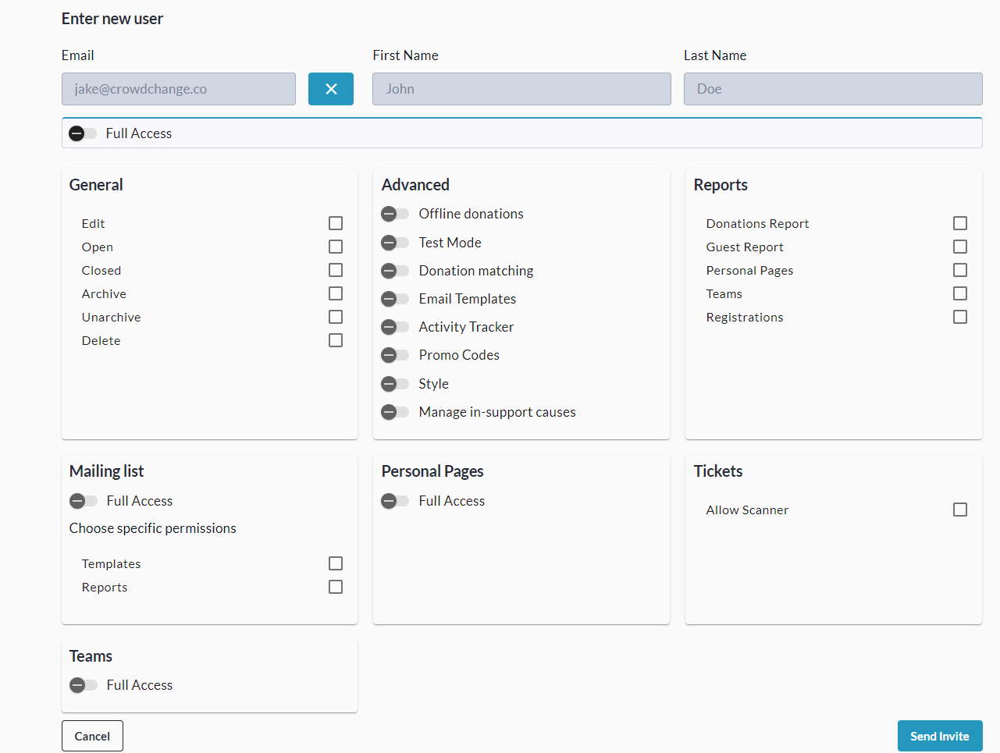
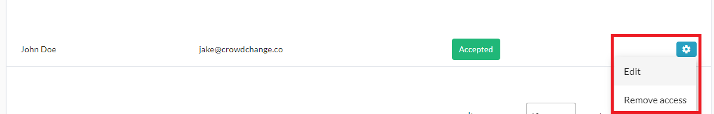

<!-- Source: https://ch.crowdchange.help/cnak/how-to-access-the-tickets-report-fundraiser-level | Nav: How to Access the Tickets Report (Fundraiser Level) | Mirrored 2026-10-14 -->

# How to Access the Tickets Report (Fundraiser Level)

You can use your fundraiser's **Access Manager** to set administrative permissions for new or existing users. This is especially useful when you need to give **Edit** or **Reports Access** to a new user who does not have an existing CrowdChange account.

Once the desired permissions have been set, an invitation email will be sent to the new user, who will be prompted to create an account and accept the permissions.

To utilize this feature, click **Manage Fundraiser** , then**Access Manager** on the left sidebar.  
  

On the Access Manager page, you can **give** , **edit** and **remove**custom access.

When users are given access, they will be listed and edit / remove controls will be shown.  
Please note that users you give access to using Access Manager will **not** receive **Fundraiser Notification Emails**. Currently, these are only sent to the Fundraiser Owner, and site-wide Admins.

## To Give Access

1. Click **Add Account**.

2. Enter the new or existing user's email and click **Continue**.

   1. If the user already exists in our system, you will see the name of the user.

   2. If the user does not yet exist, you will need to enter their first and last name.

3. Click the checkbox or toggle next to all permissions you desire the user to have, or click **Full Access**.

   
4. Click **Send Invite**in the bottom-right corner when ready.

### To Edit Access

1. Click the cog / gear icon next to the user you want to edit.

2. Click **Edit**.

   
3. Change permissions as desired and click **Save**.

### To Remove Access

1. Click the cog / gear icon next to the user you want to remove.

2. Click **Remove Access**.

   
3. Click **Yes**.

If your invitation is pending, you will instead see the option to **resend** , or **cancel**it.
