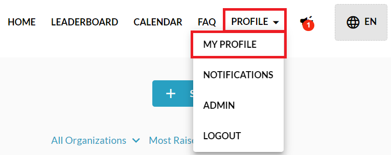
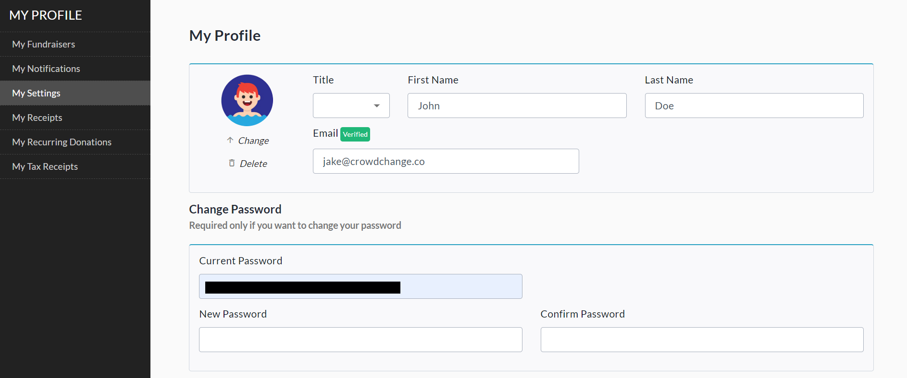
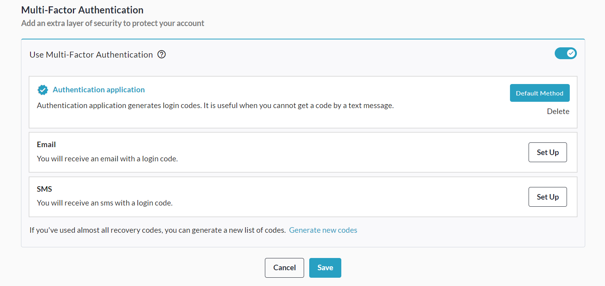

<!-- Source: https://ch.crowdchange.help/cnak/how-to-access-your-profile | Nav: How to Access Your Profile | Mirrored 2026-10-14 -->

# How to Access Your Profile

Your **Profile**is the place to go for changing your name, email address, and password. It also allows you to view your fundraisers, tickets, receipts and more.

Access it in 3 simple steps:

1. Go to your CrowdChange site and **Log In**.

2. Click **Profile** in in the top right corner, then**My Profile**.

   
3. From your profile, you can change your name, title, email address, profile photo, and password.

4. Select a tab from the left sidebar to view other useful sections.

   
5. Scroll down within your Profile to set up **Multi-Factor Authentication**. We recommend using the Authentication Application option.

   

## Sections

Here's some information on what you can do in the other sections:

1. **My Fundraisers**- See all your fundraisers at a glance.

2. **My Settings** - Change your name, email address and password. You can also verify your email address here if you haven't already.

3. **My Receipts** - View and get all your receipts here as well as download any tickets purchased.

4. **My Recurring Donations** - You can make changes to or cancel your recurring donations here. To update your payment method, click the pencil icon next to the last 4 digits of your credit card number.

5. **My Tax Receipts**- You can download all your tax receipts from here.
