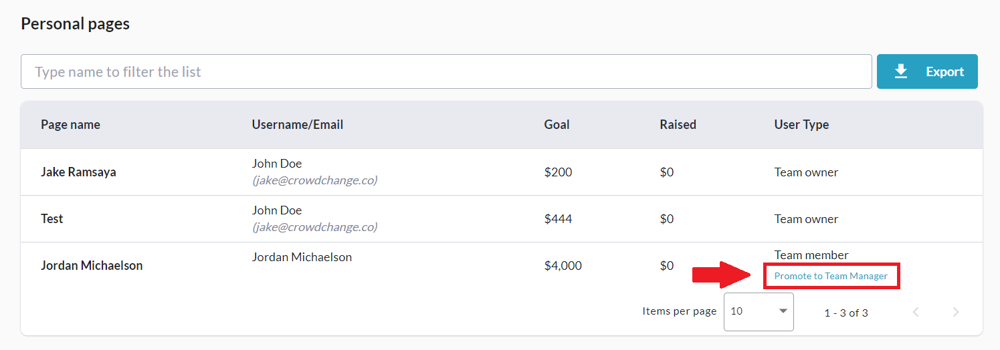
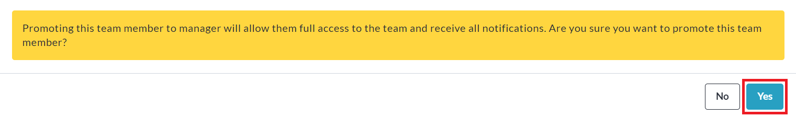

<!-- Source: https://ch.crowdchange.help/cnak/how-to-assign-a-team-manager-co-captain | Nav: How to Assign a Team Manager / Co-Captain | Mirrored 2026-10-14 -->

# How to Assign a Team Manager / Co-Captain

In most cases, the user assigned as Team Captain is the only user who needs access to manage the team fundraising page. However, there are some cases where the team is large enough that the team captain needs assistance managing the team and tracking their progress.

If desired, you have the ability to make the owner of one of the pages within your team the **Team Manager**.

* The Team Manager will be given the same permissions/access as the Team Captain (reports, edit access, etc), but will not be able to delete the team.

* All team email notifications (page joined, donation received, etc) will be sent to the Team Manager as well as the Team Captain.

## How to Assign a Team Manager (as a Team Captain)

To assign a Team Manager for your team, follow the steps below:

1. **Log In** and go to your Team Fundraising Page.

2. Click**Manage my team**in the top right corner.

   
3. Click **Report**on the left sidebar.

4. Scroll down to the **Personal Pages** section and click**Promote to Team Manager** for a team member you would like to make the Team Manager.

   
5. Click **Yes**to confirm.

   

You have the ability to return to this page at any time and demote/change the Team Manager.
