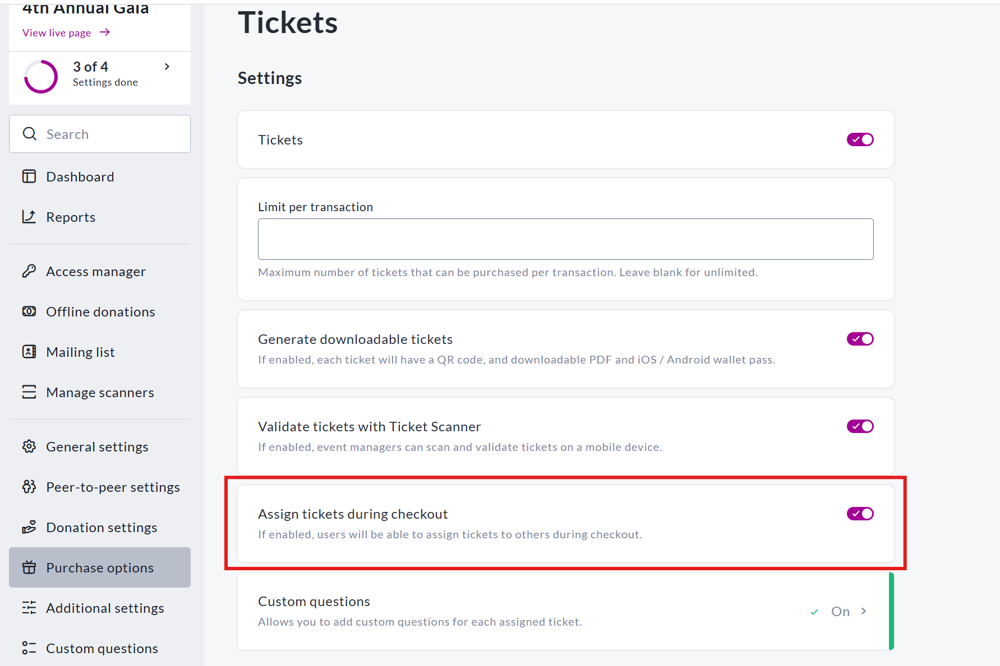
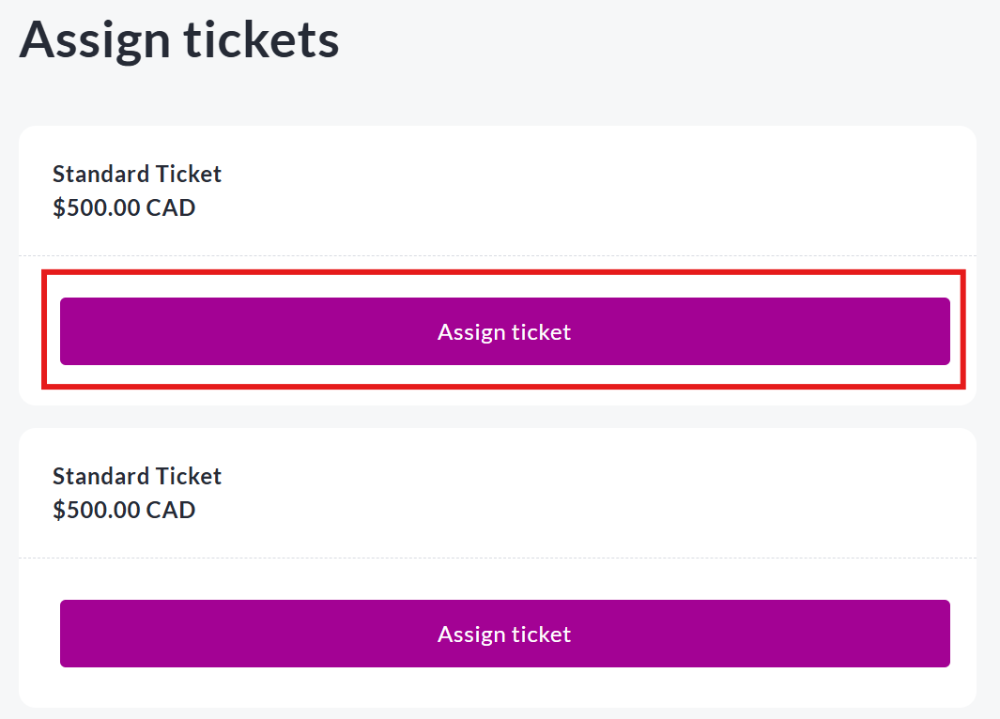

<!-- Source: https://ch.crowdchange.help/cnak/how-to-assign-tickets-to-different-attendees-durin | Nav: How to Assign Tickets to Different Attendees During Checkout | Mirrored 2026-10-14 -->

# How to Assign Tickets to Different Attendees During Checkout

Our "Assign Tickets During Checkout" feature makes it easier than ever for purchasers to distribute individual tickets to multiple attendees in a single transaction. This is ideal for group purchases and improves the check-in experience at your event.

*** ** * ** ***

## Enabling the Feature

To enable this setting for your fundraiser:

1. Log in to your CrowdChange site.

2. Go to your fundraiser and click **Manage Fundraiser**.

3. In the left-hand menu, click **Purchase Options** , then select **Tickets**.

4. Scroll to the **Assign tickets during checkout** option and toggle it **ON**.

5. Click **Save** at the bottom of the page to apply your changes.

View of the **Assign tickets during checkout**feature being toggled on

Once enabled, users will be able to assign a name and email address to each ticket during the checkout process.

*** ** * ** ***

### How It Works for Ticket purchasers

When a ticket purchaser selects more than one ticket at checkout, they will see a new step where they can assign each ticket individually.

* Required fields: **First Name** , **Last Name** , and **Email**

* Optional fields: **Phone Number** and any **Custom Questions** you've added

* Donors can select "Same as previous" to speed up entry if multiple tickets are for the same person

View of **Assign ticket**button on checkout page

*** ** * ** ***

### How Tickets Are Delivered

Each assigned attendee will receive their ticket via email, along with the following:

* A **PDF ticket attachment** (for printing or saving)

* A button to add the tickets to your **Apple Wallet** or **Google Wallet**

* A **QR code** embedded directly in the email for quick scanning at the event

The purchaser will also receive a full summary email containing all ticket details, including copies of each assigned ticket.

*** ** * ** ***

### Reporting \& Admin Access

To view assigned ticket data:

1. Log in to your CrowdChange site.

2. Go to your fundraiser and click **Manage fundraiser**.

3. Click **Reports** on the left-hand menu

4. Select **Tickets report**

The report will include each ticket holder's name, email, phone (if collected), and their assigned ticket(s).
