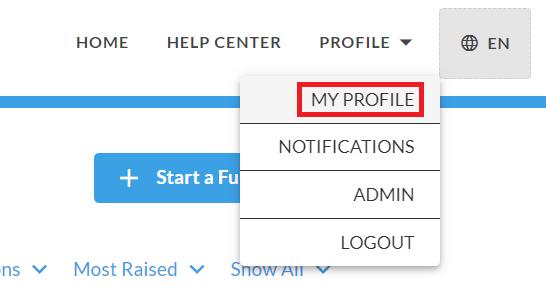
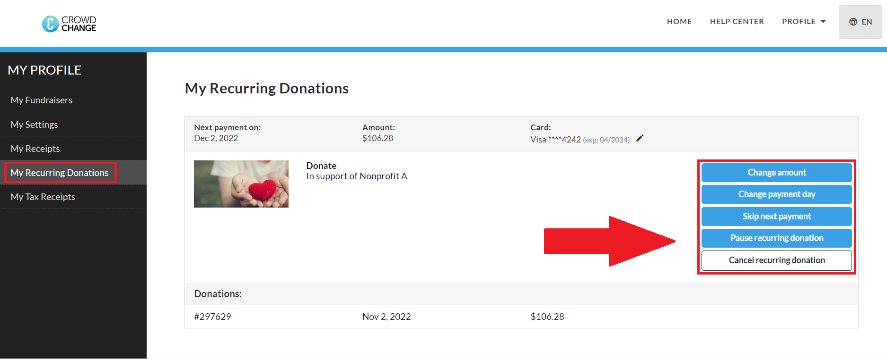

<!-- Source: https://ch.crowdchange.help/cnak/how-to-cancel-a-recurring-donation | Nav: How to Cancel a Recurring Donation | Mirrored 2026-10-14 -->

# How to Cancel a Recurring Donation

This article and video will show you how to cancel any recurring donation you've made through CrowdChange. To do so, follow these steps:

1. From your CrowdChange site, click **Profile** in the top-right corner, then **My Profile**.

   
2. Click **My Recurring Donations** on the left sidebar.

3. Click the **Cancel Recurring Donation**button next to the recurring donation you'd like to cancel.

You also have the option of **Pausing** your recurring donation, or **Skipping** the next scheduled payment, without canceling your subscription entirely, and you can also change the **Amount** or **Payment Day** using the respective buttons. If you'd just like to **Update** your **Payment Method / Credit Card** , click on the **pencil**icon next to the expiry date of your card shown in screenshot below.  

