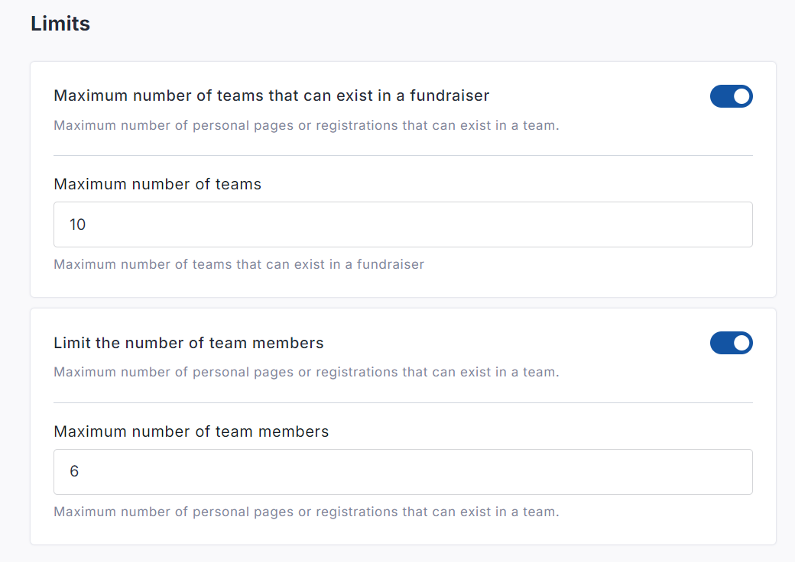
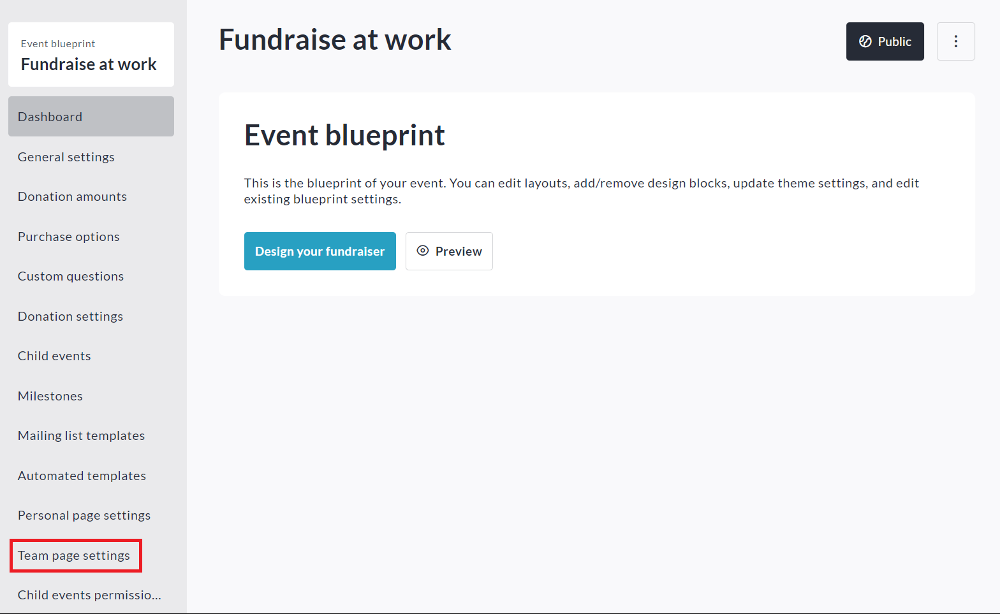
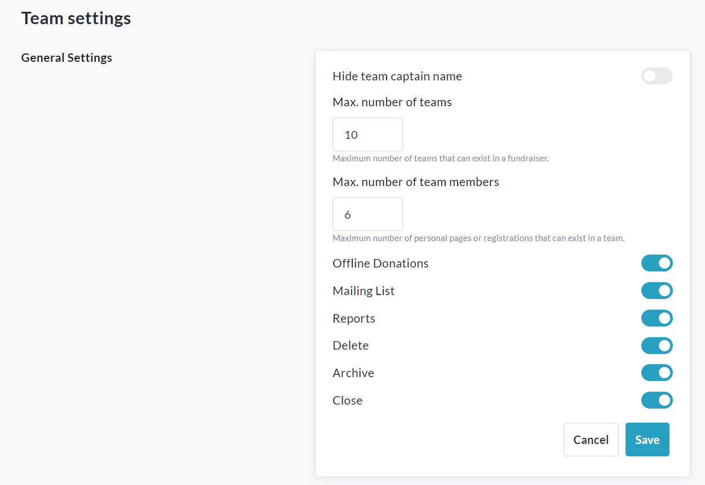

<!-- Source: https://ch.crowdchange.help/cnak/how-to-cap-number-of-teams-and-number-of-personal- | Nav: How to Cap Number of Teams and Number of Personal Pages Within a Team | Mirrored 2026-10-14 -->

# How to Cap Number of Teams and Number of Personal Pages Within a Team

If desired, you are able to set a maximum number of teams which can be created and you can also cap the number of participants / personal pages within each team.

For example: Say a regional campaign has 8 locations (fundraisers) within one CrowdChange site.

Each location has different capacity and therefore it is necessary to be able to cap the number of teams that can be registered at each location. Additionally, the maximum number of participants within a team must be limited to 6.

This feature allows for both of these limits to be set at the fundraiser or Blueprint level.

## Settings these limits at the Fundraiser Level

To set these limits on your fundraiser, follow the simple steps below:

1. Go to your fundraiser while logged in and click **Manage Fundraiser**.

2. Click on **Peer to Peer Settings**on the left sidebar.

3. Click on **Team Fundraising Pages**.

4. Scroll down to the **Limits**section.

5. Enable **Maximum number of teams that can exist in a fundraiser** and/or a **Limit the number of team members**. Then enter numerical limits for each. For example:

   
6. Click **Save** to confirm.

   

## Setting these limits at the Blueprint Level

To set these limits at the Blueprint level, follow the steps below:

1. While logged in to your CrowdChange site, go to **Profile → Admin**.

2. On the left sidebar, click **Blueprints**.

3. Click on the Blueprint you want to edit these limits for.

4. Click **Team Page Settings** on the left sidebar.

   
5. Enter a **Max. number of teams** and/or a **Maximum number of team members**. For example:

   
6. Click **Save** to confirm.
