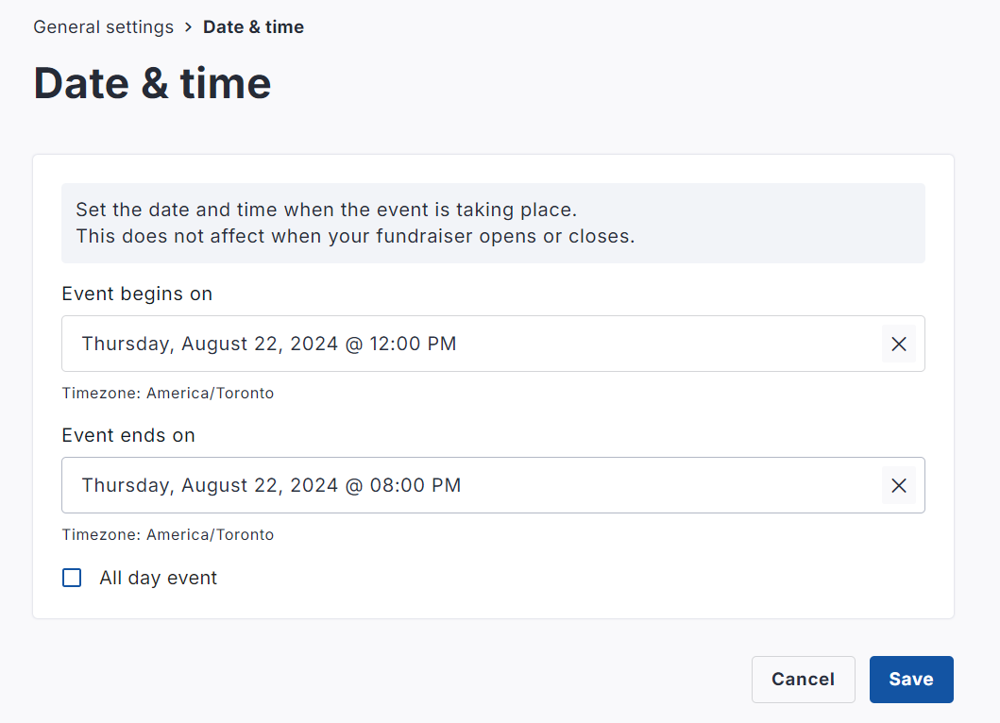
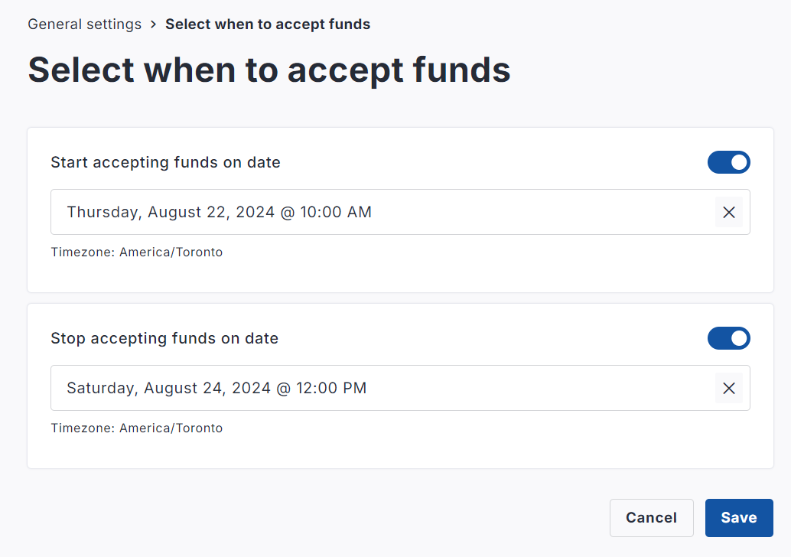

<!-- Source: https://ch.crowdchange.help/cnak/how-to-change-the-date-and-time-of-your-fundraiser | Nav: How to Change the Date and Time of your Fundraiser | Mirrored 2026-10-14 -->

# How to Change the Date and Time of your Fundraiser

YYou have the ability within your fundraiser settings to adjust the **public-facing** **start** **date \& time** of your fundraiser, as well as the **public-facing** **end** **date \& time**.  

Additionally, you may adjust the 'cut-off'**end** **date for accepting funds** , and **start** **date for accepting funds**.  

## Written Steps:

1. Go to your fundraising page on your CrowdChange site and **Log In**.

2. Click on **Manage Fundraiser**in the upper right hand corner.

3. Go to **General Settings** on the left sidebar.

4. Scroll down to the **Dates** section and click '**Date and Time** ' or '**Select when to accept funds**'.

5. Set the dates and times for each to your liking and click **Save**.
