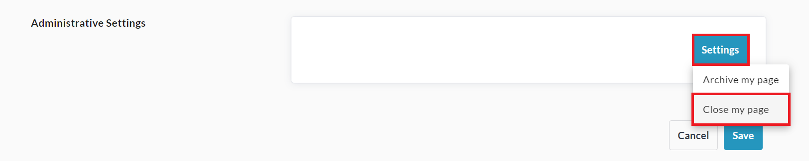
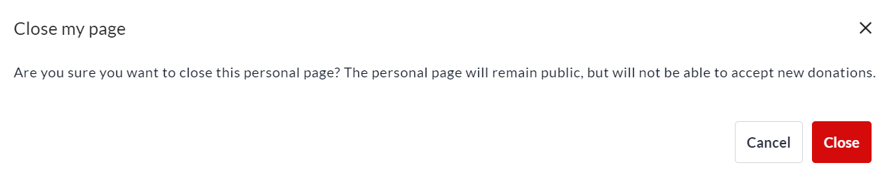
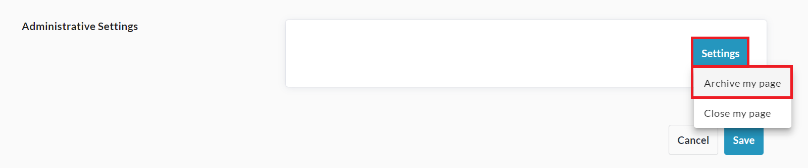
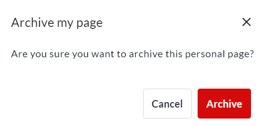
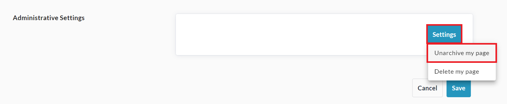
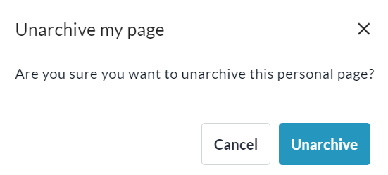
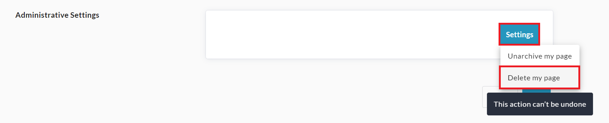
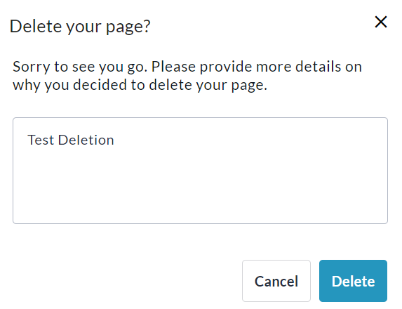

<!-- Source: https://ch.crowdchange.help/cnak/how-to-close-archive-or-delete-a-p2p-page | Nav: Featured > How to Close, Archive, or Delete a P2P Page | Mirrored 2026-10-14 -->

# How to Close, Archive, or Delete a P2P Page

We offer a few different options for deactivating your personal or team fundraising page:

* **Close Page** - This will stop transactions being made through the page. The page will still be publicly accessible and visible in lists. As page owner or admin, you can still make changes to the page.

* **Archive Page** - This will make the page invisible to the public and stop transactions through it. It will only be accessible to admins.

* **Delete Page** - This option only becomes available after a page is archived. Non-archived pages cannot be deleted.

## Closing a Personal or Team Page

To close your personal or team page and prevent further transactions through it, follow these steps:

1. Go to your personal or team page and **Login**.

   
2. Click **Manage my Page** (or **Manage my Team**) in the top right corner.

   
3. Click **Page Settings**on the left sidebar.

4. Scroll down to **Administrative Settings** and click **Settings** , then **Close My Page (or Team)**.

   
5. Click **Close**on the popup that appears to confirm.

   

## Archiving a Personal or Team Page

To archive your personal or team fundraising page so it is no longer publicly visible and cannot process transactions, follow the steps below:

1. Go to your personal or team page and **Login**.

   
2. Click **Manage my Page** (or **Manage my Team**) in the top right corner.

   
3. Click **Page Settings**on the left sidebar.

4. Scroll down to **Administrative Settings** and click **Settings** , then **Archive My Page (or Team)**.

   
5. Click **Archive**on the popup that appears to confirm.

   

BONUS - Unarchiving a Personal or Team Page  

## Unarchiving a Personal or Team Page

To unarchive your personal fundraising page and reverse the archive action, follow the steps below:

1. Go to your personal or team page and **Login**.

   
2. Click **Manage my Page** (or **Manage my Team**) in the top right corner.

   
3. Click **Page Settings**on the left sidebar.

4. Scroll down to **Administrative Settings** and click **Settings** , then **Unarchive My Page (or Team)**.

   
5. Click **Unarchive**on the popup that appears to confirm.

   

## Deleting a Personal or Team Page

To delete your personal or team page, archive it first using the steps above, then do the following:

1. Go to your personal or team page and **Login**.

   
2. Click **Manage my Page** (or **Manage my Team**) in the top right corner.

   
3. Click **Page Settings**on the left sidebar.

4. Scroll down to **Administrative Settings** and click **Settings** , then **Delete My Page (or Team)**.

   
5. Enter a reason for the deletion in the popup that appears and click **Delete** to confirm.

   
