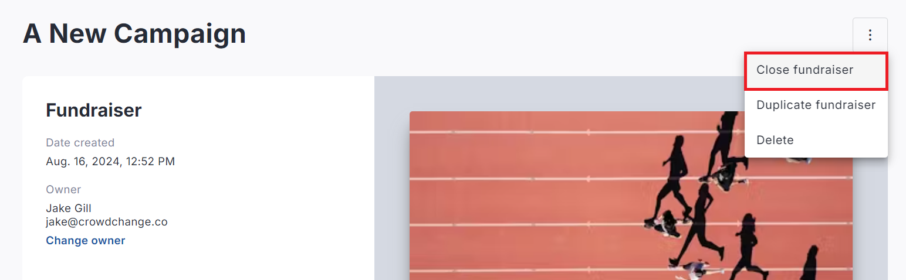
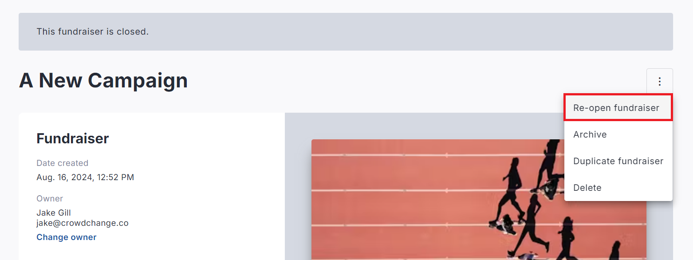

<!-- Source: https://ch.crowdchange.help/cnak/how-to-close-or-reopen-a-fundraiser | Nav: How to Close or Reopen a Fundraiser | Mirrored 2026-10-14 -->

# How to Close or Reopen a Fundraiser

## To Close a Fundraiser

1. Go to the fundraiser you would like to close.

2. Click **Manage Fundraiser**in the top-right corner.

3. Click the **triple-dot icon** in the top right corner, then **Close Fundraiser → Yes**.

This will close the fundraiser and stop it from accepting ticket sales or transactions of any kind.  
  
Even if a fundraiser has been closed, it is **still visible to the public**.

To make it **invisible to the public** , only accessible by Admins and those with a direct link, go to **Manage Fundraiser** ,click **Additional Settings** , and turn on the **Hidden event** feature.  
**TIP:** We recommend leaving your fundraiser open for at least a week after your event date, so that people who couldn't make it can still donate.

The auto-close date is set on the **General Settings** page under **Dates → Select when to accept funds → Stop accepting funds on date**.

## To Reopen a Fundraiser

1. Go to the fundraiser you would like to reopen.

2. Click **Manage Fundraiser** in the top-right corner.

3. Click the **triple-dot icon** in the top right corner, then **Re-open Fundraiser → Yes**.

This will reopen the fundraiser and allow all transactions to proceed.  

