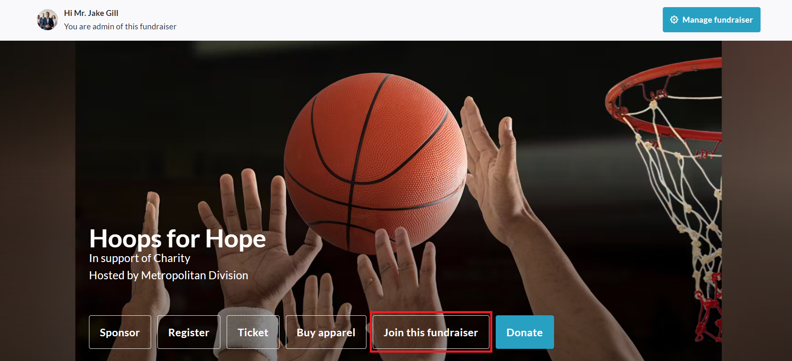
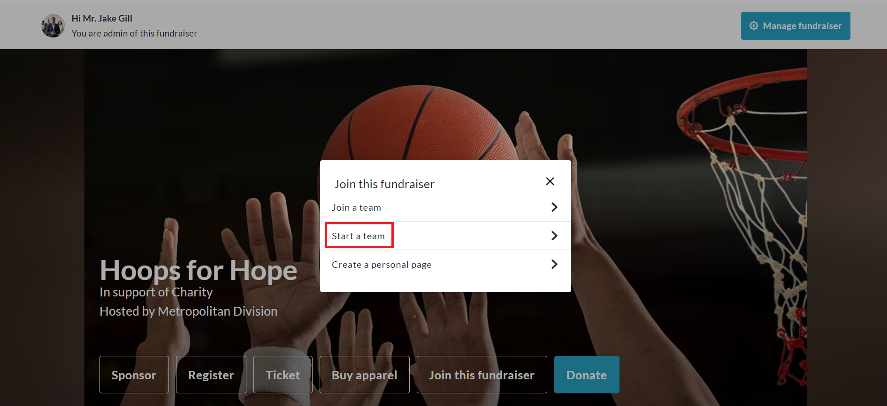
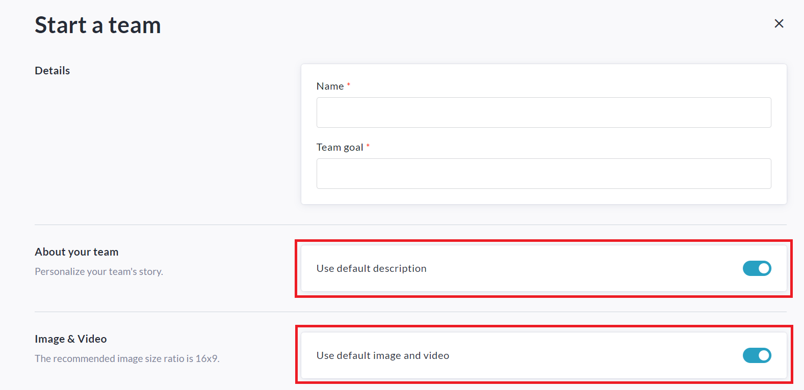
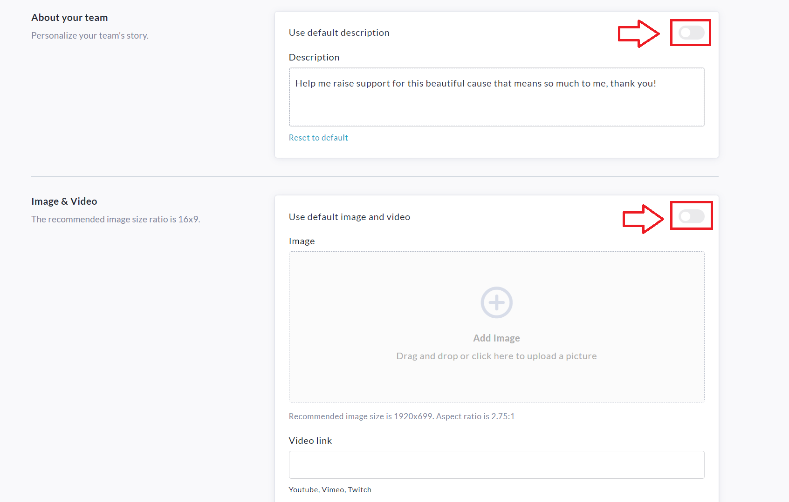
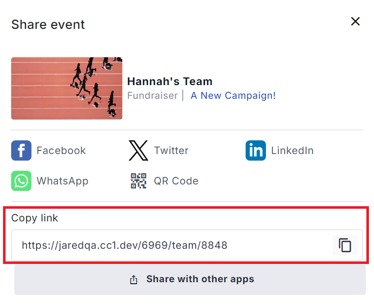

<!-- Source: https://ch.crowdchange.help/cnak/how-to-create-a-team-invite-members | Nav: How to Create a Team & Invite Members | Mirrored 2026-10-14 -->

# How to Create a Team & Invite Members

Use our **Team Fundraising Pages** feature to raise significantly more with your fundraisers and increase supporter engagement!

To use this feature, be sure to turn on **Team fundraising pages** within **Peer-to-peer settings** on the **Additional Settings** page when you are setting up or editing your fundraiser.  
If you would like your team members to be able to create personal fundraising pages within your team, be sure to enable **Personal fundraising pages within teams**as well.

Within an existing fundraiser's peer to peer settings, the feature is titled**Personal fundraising pages under a team can be created**.

Once enabled, participants will be able to click '**Join this fundraiser → Start a team**'.  

Step 1: Click 'Join this fundraiser'.  

Step 2: Click 'Start a team'.

They will then be prompted to enter their **Team Name** , **Fundraising Goal** , and if desired, they can add their own **image** , **video** , or **text description** , by turning **OFF**these toggle switches:  

They will then be prompted to upload an image or video, and enter their own description for the Team page.  

Lastly, they will click the **Start a Team** button at the bottom of the page to complete this process.  

## Sharing and Inviting Members to Your Team

**Step 1:** On your team fundraising page, click the 'Share' button above or below the Hero image.  

**Step 2:** This will open the 'Share event' window which includes a link you can copy and share with your network of contacts to send them directly to your team fundraising page.  

**Step 3:** You can also use the social media share options to post the link to Facebook and Twitter Feeds, WhatsApp Chats, LinkedIn Profiles and more. The QR code option and 'Share with other apps' button provide even more flexibility.

Alternatively, you can use your team page's built-in Mailing List (**Manage Fundraiser → Mailing List**).

*** ** * ** ***

Your supporters can simply click "**Join this fundraiser → Join a Team** " to create a their own personal fundraising page within your team (once **Personal fundraising pages within Teams** is enabled).

Each team member will enter their name and personal fundraising goal. If they would like to upload their own image or video, they can simply toggle off the slider for "**Use fundraiser's image and video** ". If they would like to use their own personalized description, they can toggle off "**Use default description text**" and enter their own message.  
If someone does not have the link to your team page but would still like to create a personal page that is linked to your team, they can do so from the main fundraising page by clicking "**Join this fundraiser → Join a Team**".

Your team members can search or simply scroll through the team list to find the team they want to join. After selecting the team they wish to join, they will be prompted to create their own personal fundraising page within that team. (once **Personal fundraising pages within Teams** is enabled).
