<!-- Source: https://ch.crowdchange.help/cnak/how-to-create-an-ecards-store | Nav: How to Create an eCards Store | Mirrored 2026-10-14 -->

# How to Create an eCards Store

In this tutorial, you will learn how to create your first **eCards Store**! eCards are an awesome, easy-to-use feature of CrowdChange which brings added value and engagement to your online fundraising portal.  
eCards can be sent via Email, postal Mail or SMS.  
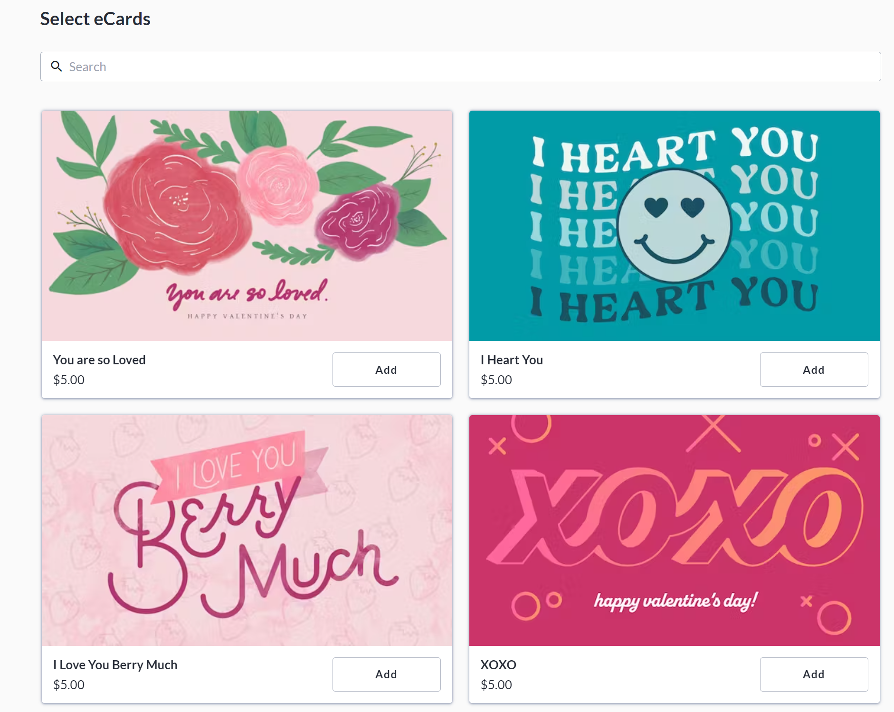

## How to Enable eCards when creating your fundraiser

To create an eCards store, you must first enable the eCards feature on a fundraiser - you can do so while creating (or editing) a fundraiser. Here are the steps to enable eCards while creating a fundraiser.

1. From the homepage of your CrowdChange site, click**Start a Fundraiser**in the top right corner.

   
2. Fill out all necessary information about your fundraiser on the **General Info** page.

   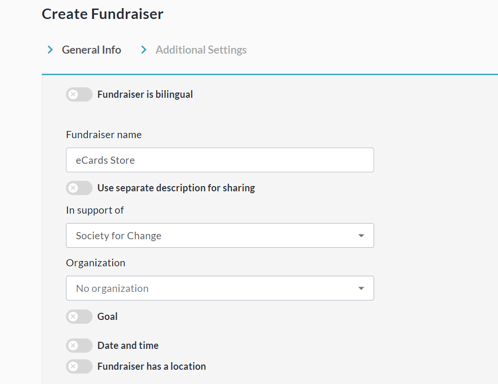
3. Scroll down and click **Next** to continue to the **Additional Settings**page.

   
4. On the **Additional Settings** page, enable **eCards** under **Advanced Features**.

   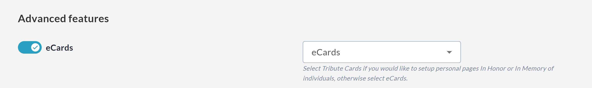
5. Scroll down and click **Create Fundraiser**.

   

## How to Set Up eCards on your fundraiser

Once eCards is enabled on your fundraiser, the next step is to configure eCards settings and add cards.

1. From your eCards fundraiser, click **Manage Fundraiser**in the top right corner.

   
2. Click **Purchase Options** on the left sidebar.

3. Click **eCards/Tribute cards**.

4. Scroll down and click **Purchase settings**to configure eCards settings and delivery methods on your fundraiser.

   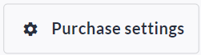
   1. *Please note that if you leave '* ***Require card purchase to complete checkout*** *' un-checked, donors will be able to complete general donations without adding an eCard. Generally we recommend requiring card (eCard) purchases on eCard Store fundraisers.*

      
5. Click **Save**to confirm your choices.

6. Click**Create eCard** to add your first card.

   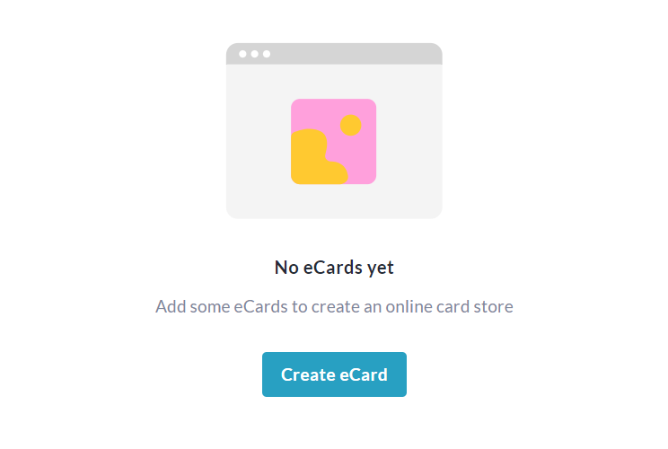
7. **Name** the card, set a **price** , enter **tags** for easy sorting and upload your **image**.

   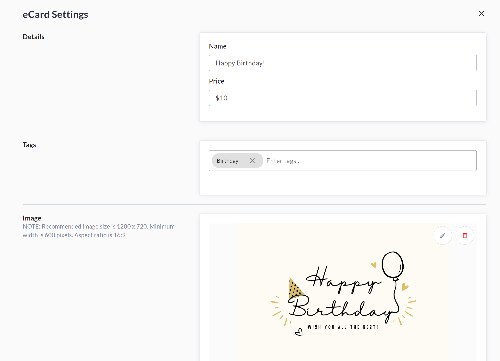
8. Click **Save**to create the card.

   
9. You may return to the eCards menu at any time to **add** , **edit, remove** or **preview**eCards.

## Adding the eCards block to your fundraiser

Next we recommend adding the eCards block to your fundraiser, which allows you to display select eCards on the main fundraiser page, providing a more seamless experience for potential purchasers.

1. Go to your fundraiser and click **Manage Fundraiser**in the top right.

   
2. Click **Design your fundraiser**.

   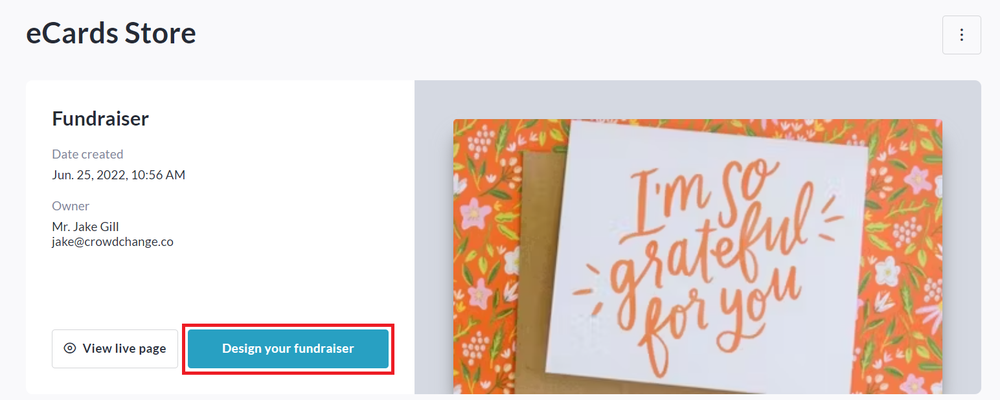
3. Scroll down, hover over an existing block, and click the '**+**' icon.

4. Select **eCards block**.

   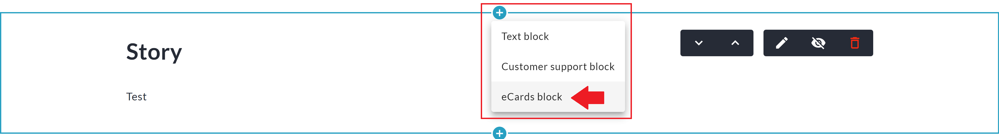
5. The eCards block will appear, showing any eCards you have already added.

6. Click the **pencil**(edit) icon if desired to edit the cards shown, or adjust block colours and text.

   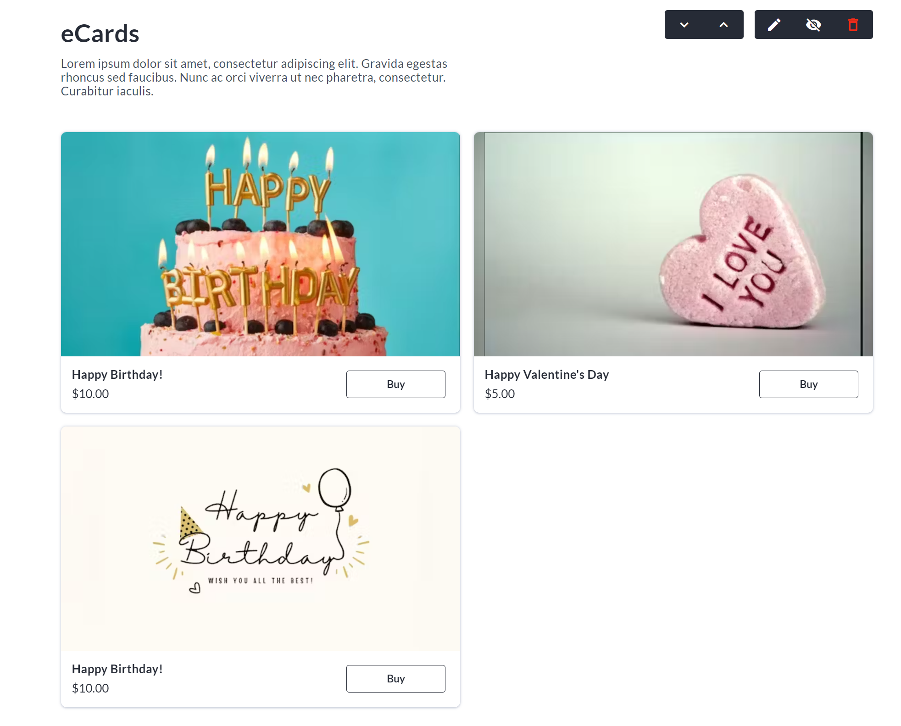

## How to Edit the eCards Email Template

If you would like to change the default text of the eCard emails sent to recipients, follow these steps:

1. Go to your eCards fundraiser and click **Manage Fundraiser**in the top right.

2. Click**Automated email templates** on the left sidebar.

3. Click on **eCard Email** and toggle on '**I want to use my own text'.**

4. Edit the default text as desired and click **Save**.

   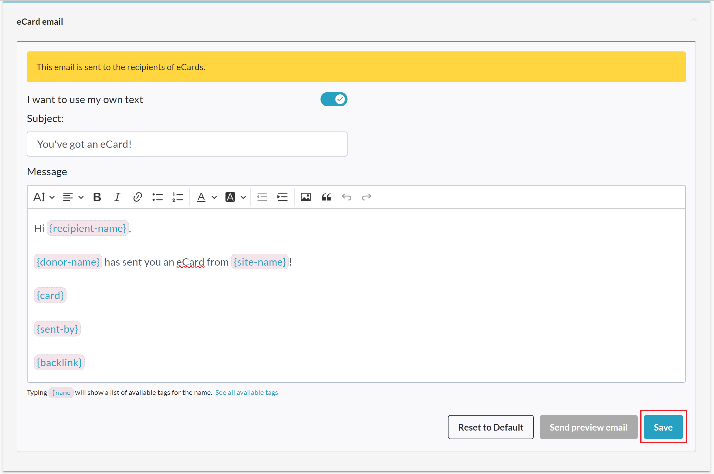

## How to View the eCards Report

You can re-send, re-schedule, and/or cancel eCards from your **eCards Report**.

1. Go to your eCards fundraiser and click **Manage Fundraiser**in the top right.

2. Go to**Reports →** **eCards Report**.

3. From the **eCards Report**you can see all sent and pending cards, delivery status, and you have the ability to update scheduled delivery dates, cancel, resend or preview cards, change recipient emails, and more.

   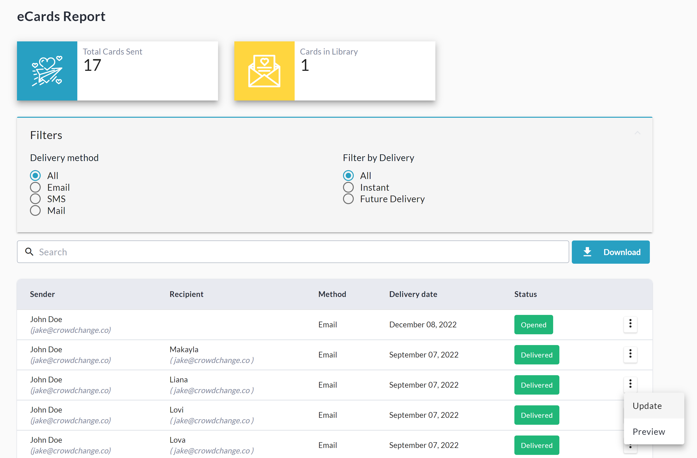

4. Click the **Download** button to download the Excel spreadsheet version of this report.

## A Note on Tax Receipting

Please note that **Tax Receipts** will only be issued for eCard purchases if the following are true:

* Tax Receipts have been enabled in the eCard store / fundraiser settings.

* The transaction amount meets the minimum amount set either at the site-wide, or fundraiser level.
