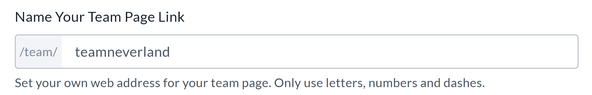
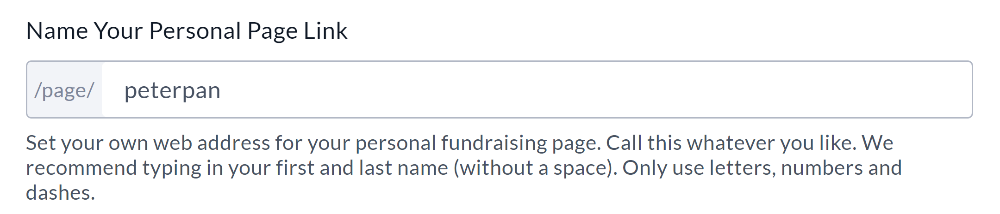

<!-- Source: https://ch.crowdchange.help/cnak/how-to-create-custom-urls-for-team-personal-pages- | Nav: How to Create Custom URLs for Team & Personal Pages (Sub-sites only) | Mirrored 2026-10-14 -->

# How to Create Custom URLs for Team & Personal Pages (Sub-sites only)

If you've ever wanted to add that "Signature Touch" to your Team or Personal Fundraising Page, creating a**Custom URL** is a great way to start! Having a link that is memorable and easy for potential donors is a great way to promote your fundraiser.  
Please note that this feature is **not**enabled by default and it is only available on subsites (child sites).

You will need to reach out to your Partner Success Representative to have it enabled on your site.

This feature allows you to create a custom URL for your Team or Personal Page by setting your own suffix.

For example, if I set my suffix to 'jake', and my site is '[mysite.crowdchange.co](http://mysite.crowdchange.co/)', my custom URL will be:

[*mysite.crowdchange.co/page/jake*](http://mysite.crowdchange.co/page/jake)

Please follow these steps to set your custom URL suffix:

1. Go to your Team or Personal Page and **Log In**.

2. Click **Manage my Team (or Manage my Personal Page)** in the upper right-hand corner of the page.

3. Go to **Team (or Page) Settings**on the left sidebar.

4. Enter a custom URL suffix under **Name Your Team Page / Personal Page Link** (Example below).

     
   

Once successfully saved, you will be ready to share this link with friends and family, or on social media!

Eg: [*mysite.crowdchange.co/page/jake*](http://mysite.crowdchange.co/page/jake)  
Custom Team \& Personal Page URL's will be visible in the following **Admin**Reports:

* Personal Pages Report

* Registration Report

* Teams Report

**This feature is only available on the site where the fundraiser was created. (Sub-sites only)**

For example:

If a fundraiser is created on a sub/child site, the URLs can only be set, and will only work on that site.

They will not work and cannot be changed on the parent site.
