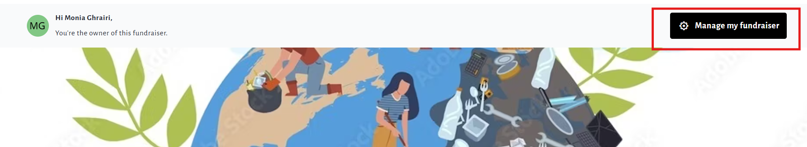
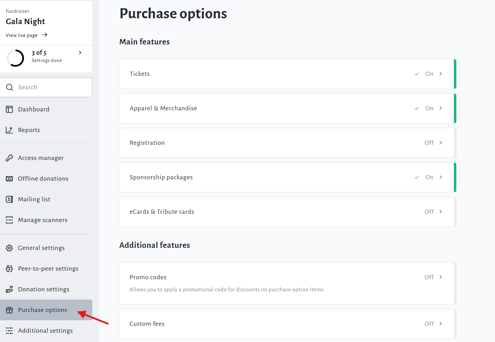
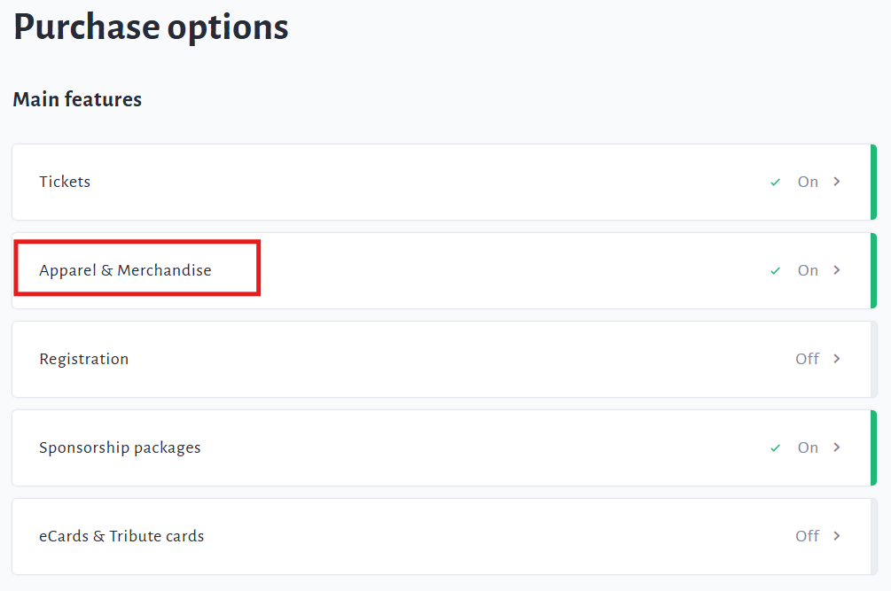
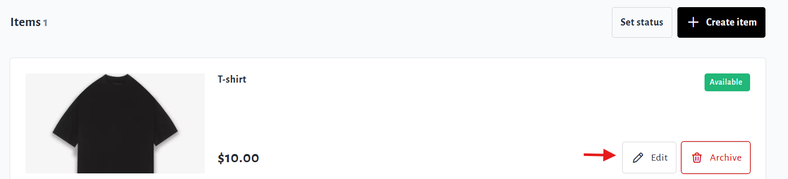

<!-- Source: https://ch.crowdchange.help/cnak/how-to-edit-merchandise-items | Nav: How Merchandise Works > How to Edit Merchandise Items | Mirrored 2026-10-14 -->

# How to Edit Merchandise Items

**Editing** your merchandise for sale is made super easy by following the steps below:

1. Go to your fundraiser, **Log In** , and then click **Manage My Fundraiser**.

   

2. On the left sidebar, click **Purchase Options**.

   

3. On the **Purchase Options** page, click **Apparel \& Merchandise**.

   

4. Scroll down and click on the **Edit**button of an item to make any updates needed.

   

5. Ensure to click **Save**after editing to confirm the changes.
