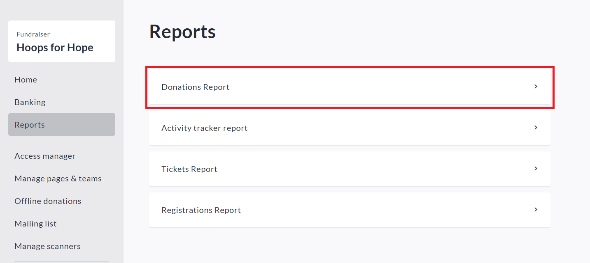
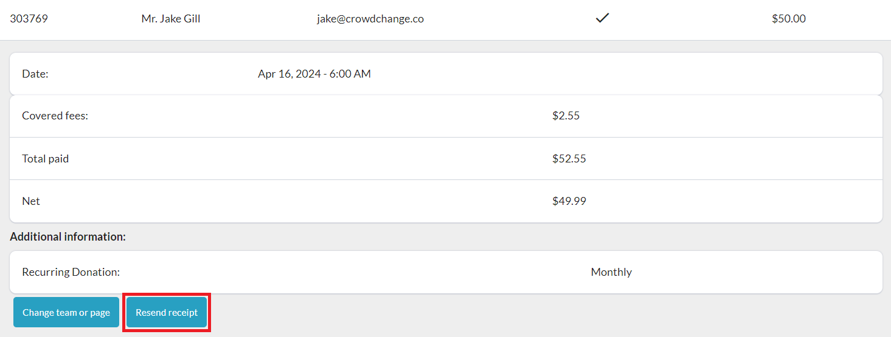
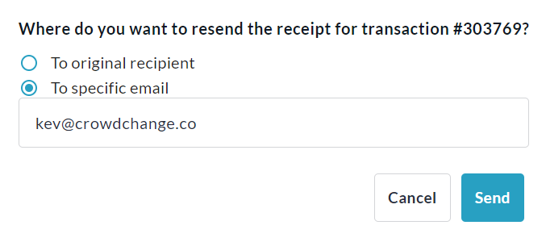

<!-- Source: https://ch.crowdchange.help/cnak/how-to-re-send-a-receipt-confirmation-email | Nav: How to Access Your Fundraiser's Donations Report > How to Re-send a Receipt / Confirmation Email | Mirrored 2026-10-14 -->

# How to Re-send a Receipt / Confirmation Email

As a fundraiser host or Admin user, you have the ability to re-send receipts. This is useful in cases where a donor/registrant/sponsor/purchaser did not receive their email confirmation. This is easily done via your fundraiser-level**Donations Report**.

To re-send a receipt / confirmation email, simply follow the steps below:

1. Go to your CrowdChange site and **Log In**.

2. Go to the fundraiser the transaction was made to and click **Manage Fundraiser**.

3. Click **Reports** on the left sidebar and go to **Donations Report**.

   
4. Scroll down to Detailed Report and search the **Transaction ID** ,**Name or Email Address**of the donor.

5. Click on the transaction and select **Resend Receipt**. See example below.

   
6. Select **To** **original recipient** to re-send to the same email address, or **To** **specific Email** to send to an updated email address. If you select 'To specific Email', you will be prompted to enter the new email.

   
7. Click **Send**to confirm.
