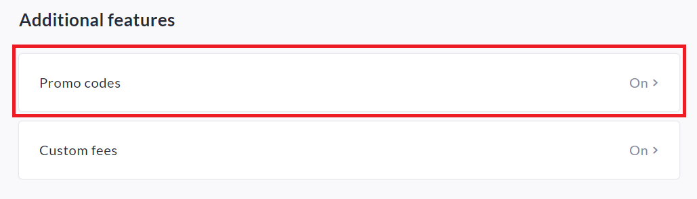
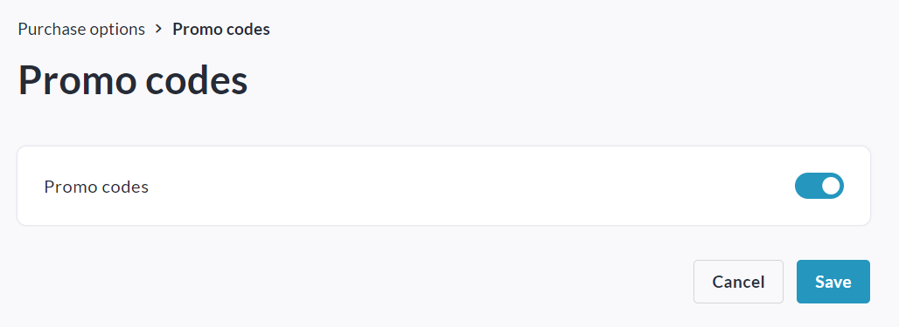
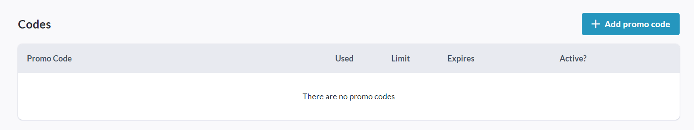
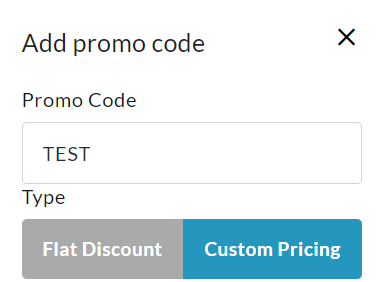
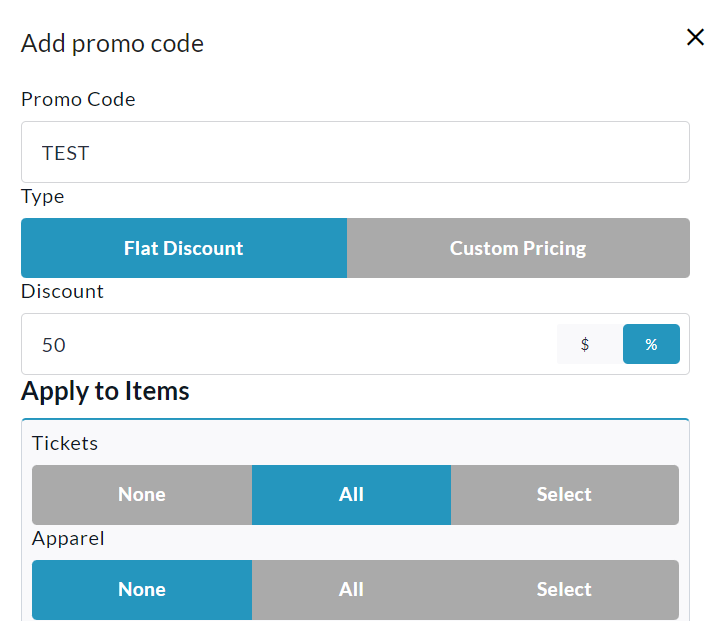
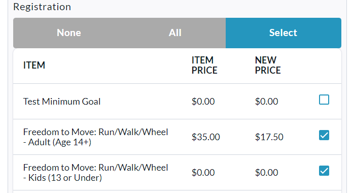
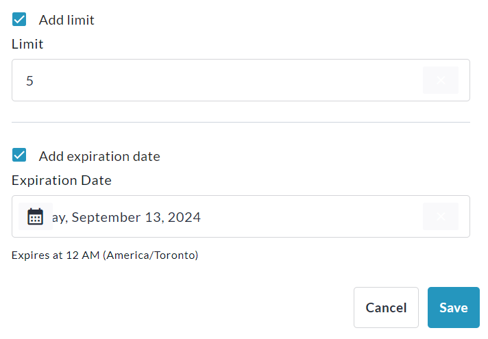
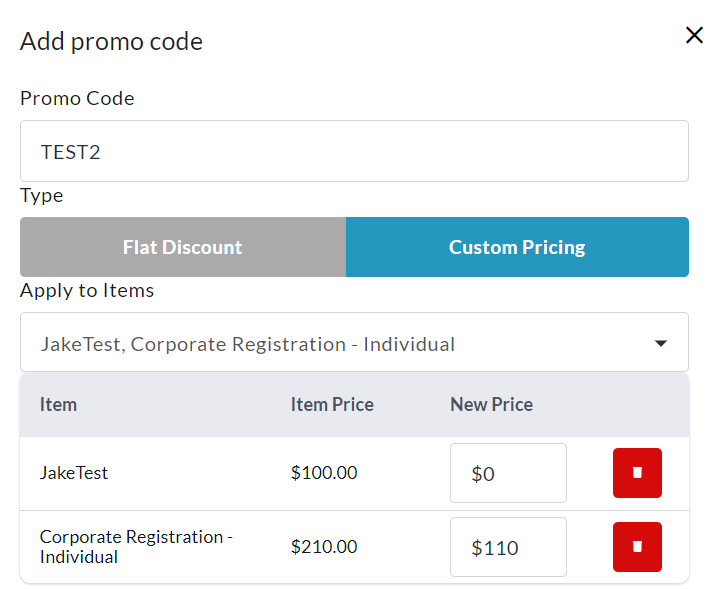
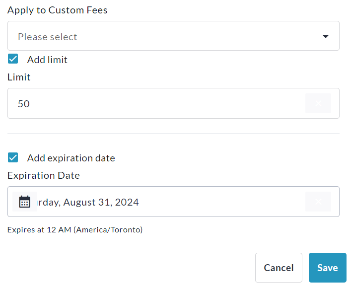
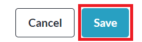

<!-- Source: https://ch.crowdchange.help/cnak/how-to-set-up-promo-codes | Nav: How to Set Up Promo Codes | Mirrored 2026-10-14 -->

# How to Set Up Promo Codes

Do you want to offer special discounts to certain donor groups? CrowdChange includes powerful Promo Codes functionality. There are 2 types of Promo Codes you can create: **Flat Discount** , and **Special Pricing**.  
Promo Codes can be applied to **Tickets** , **Merchandise** and/or **Registrations**.

## Step 1: Enable Promo Codes on your Fundraiser

The first step is to enable the Promo Codes feature within your fundraiser settings. To do so, from your main fundraising page, click **Manage Fundraiser** , then **Purchase Options**on the left sidebar.

On the **Purchase Options** page, scroll down to **Additional Features** and click **Promo Codes**.  

Enable the **Promo Codes** toggle and click **Save**.  

## Step 2: Create a Promo Code

To create a Promo Code, scroll down and click **Add promo code**.  

Select either **Flat Discount** or **Custom Pricing** (see description below).  

*** ** * ** ***

### **Flat Discount**

Allows you to offer a discount of a specific dollar value or percentage, applied to some, or all items.

In the example below, a 50% discount applies for All Tickets and 2 out of 3 Registrations, but no Apparel / Merchandise.

At the bottom you will see that this Promo Code has been limited to a quantity of 5, and will expire on the date set.

  
  
  

### **Custom Pricing**

Allows you to set custom prices for all items, or specific Tickets, Registrations, and Apparel options, selectable via the dropdown menu.

In the example below, the Corporate Registration - Individual option is priced at $110, instead of $210, with the use of this Promo Code, and the "JakeTest" option is free instead of $100.

Limit and Expiration date have also been set.  
  

*** ** * ** ***

3. Once you've set up your Promo Code as desired, click the **Save**button at the bottom.

4. On the Promo Codes page as shown below, you will be able at any time to **Edit** , **Delete** , **De-Activate** , or **Re-Activate** your created Promo Codes.

Unknown Attachment

You can return here at any time from **Manage Fundraiser → Purchase Options → Promo Codes**.

## How to Use Promo Codes at Checkout

Using a Promo Code at checkout is super simple! Simply look for the **Summary** box and enter your code under '**Have Promo Code?** '. Click the arrowand your discounts will be applied.  
Please note that only **one** Promo Code can be applied at a time.  

Unknown Attachment  

Unknown Attachment  
To **Remove** the Promo Code, click the**trash can** icon above, next to '**Promo code applied'**.
