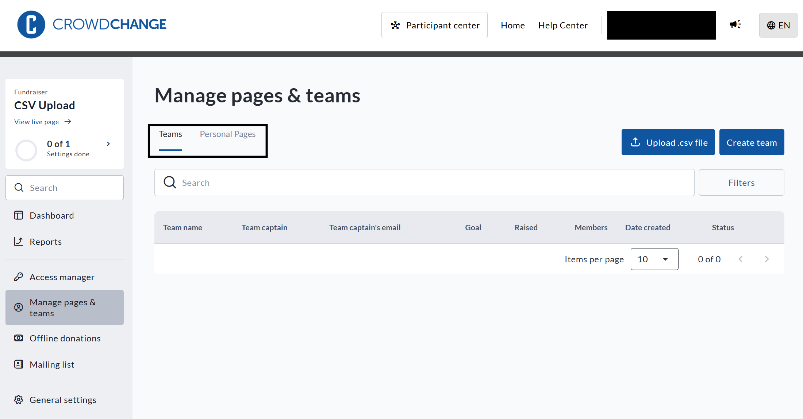
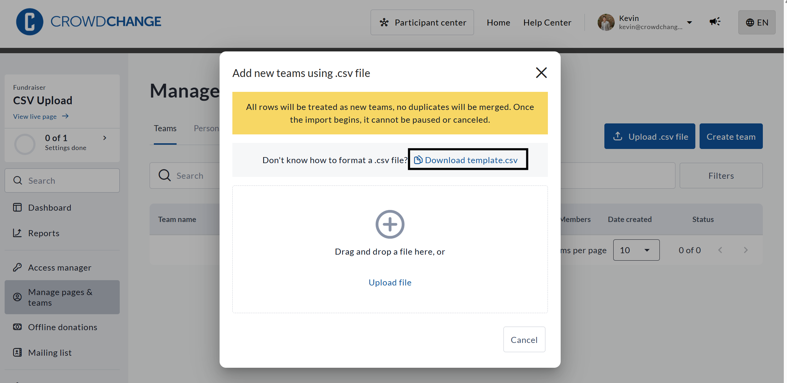

<!-- Source: https://ch.crowdchange.help/cnak/how-to-upload-a-list-of-teams-or-personal-pages-us | Nav: How to Upload a List of Teams or Personal Pages Using a CSV File | Mirrored 2026-10-14 -->

# How to Upload a List of Teams or Personal Pages Using a CSV File

CrowdChange allows you to upload multiple Team or Personal Fundraising Pages in bulk using a simple .CSV file. This feature is available within the **Manage Pages and Teams** section of your fundraiser dashboard.

## Step 1: Go to Manage Pages and Teams

1. Log in to your CrowdChange site.

2. Navigate to your fundraiser and click **Manage Fundraiser**.

3. From the left sidebar, click **Manage pages and teams**.

You will see two tabs at the top of this screen (see below):  

View of the **Manage pages \& teams** feature

* **Teams**

* **Personal Pages**

**Be sure to click into the correct tab before uploading**, depending on whether you are uploading team pages or personal pages.

*** ** * ** ***

### Step 2: Download and Fill Out the Correct Template

Click the **Upload .csv file** button to initiate this process. To download the template, click **Download template.csv**(see below).  

View of how to download the .csv template for **Team fundraising pages**

Ensure that the **column headers are not changed**, and that all required fields are filled out. For example:

* **For Personal Pages:** Email, First Name, Last Name, Page Name, Fundraising Goal (optional depending on Fundraiser settings), and Team ID (optional if not linked to a team).

* **For Teams:** Email, First Name, Last Name, Page Name, Fundraising Goal (optional depending on Fundraiser settings).

*** ** * ** ***

### Step 3: Upload Your CSV

1. Click **Upload .csv file** in the top right.

2. Drag and drop your completed CSV or browse to select it.

3. Review the summary before confirming the upload.

**Important:** All rows are treated as new entries. Duplicates will not be merged, and the import cannot be undone once it begins.

*** ** * ** ***

### Finding the Team ID (For Personal Page Uploads Only)

If you are uploading personal pages and want them linked to teams, you must include the **Team ID**.

You can find the Team ID in two places:

* **Admin Teams Report:** This report shows a list of all teams and their unique IDs.

* **Team Page URL:** Visit the team page and copy the numeric value at the end of the URL.
