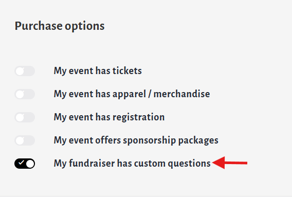
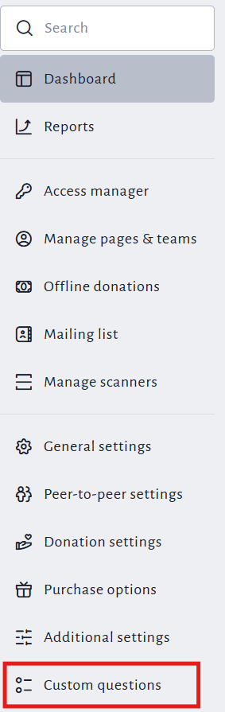
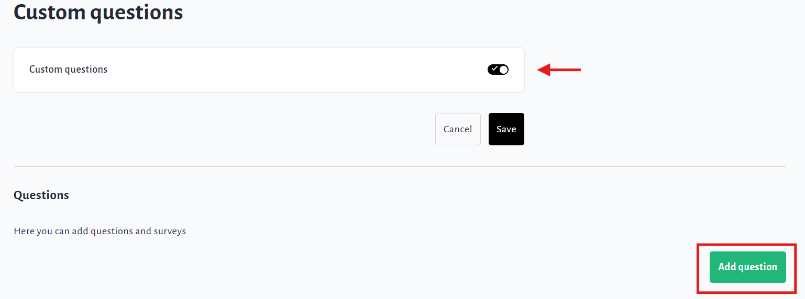
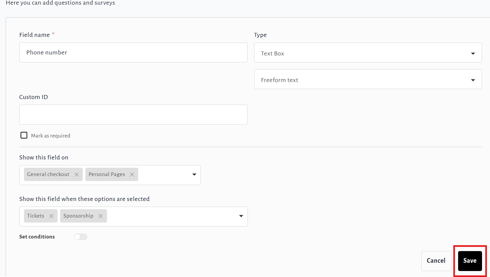
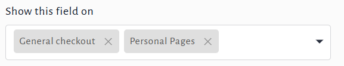
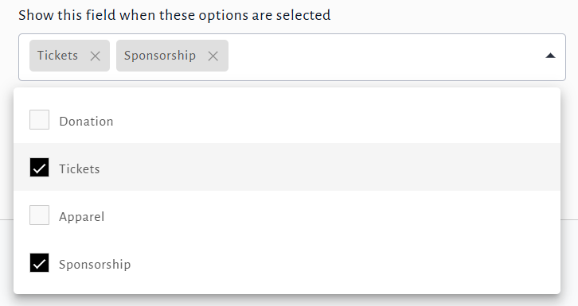
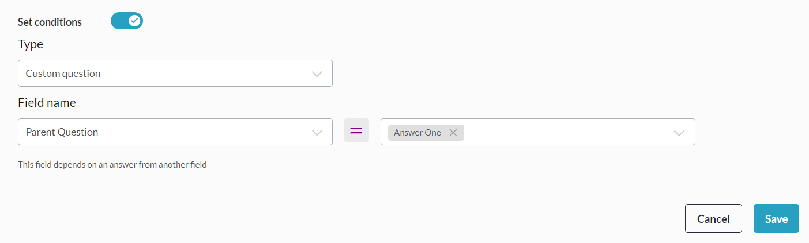
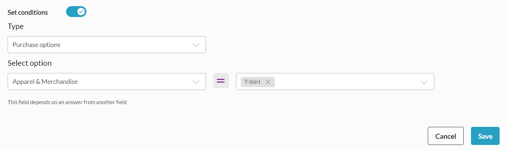

<!-- Source: https://ch.crowdchange.help/cnak/how-to-use-custom-questions | Nav: How to Use Custom Questions | Mirrored 2026-10-14 -->

# How to Use Custom Questions

The **Custom Questions** feature is a great way for you to collect specific information you need from your donors, guests or participants! It allows you to collect information in the form of a **Text Box** , **Dropdown Menu** , or **Checkboxes** . This feature also allows you to attach a **Waiver** to your fundraiser.  
**Custom Questions** are a great way for your fundraising team to collect additional data points about your donors. Looking to find out if a social media campaign for your fundraiser was successful?

Ask your donors! - "*How did you hear about us?"*is one of the most commonly used, and effective examples of a custom checkout question for existing CrowdChange partners.

**Custom Questions** can be toggled on from the **Purchase Options**section when creating a fundraiser.  

Once your fundraiser is created, click**Manage My Fundraiser** in the upper right-hand corner of the page.  

Then go to **Custom Questions** on the left sidebar.  

From the **Custom Questions** page, click **Add** **Question** under **Questions** to create your first one.  
  

Click **Save** in the bottom right corner to confirm.  
If you require the ability to set**Custom ID's** for each question (as shown in the image above), reach out to your Partner Success Representative for this feature to be enabled on your site.

*** ** * ** ***

The available types of Custom Questions are as follows:

* **Text**

  * The **Text** option allows users to enter specific information in response to a question you ask.

    Within the **Text** option, you may select a format: **Freeform text** , **Phone number** , **Date** or **Number**.

* **Checkboxes**

  * The **Checkboxes**option allows users to select from a pre-determined list of answers to your question, which can include the selection of multiple answers.

* **Dropdown**

  * The **Dropdown**option allows users to select an answer to your question from a list that you have determined. In this situation, users are only able to select one option.

* **Waiver**

  * If your event requires a **Waiver**that your participants must agree to, this function allows you to insert the content of your waiver into a box that the user will be prompted to view and agree to.

* **Multi-Line Text**

  * The **Multi-Line Text**option works the same way as the standard Text Box \> Freeform Text option, but allows for more detailed information to be entered via multi-line functionality.

Toggling on the **Mark as Required** checkbox means that users must answer this custom question in order to complete their purchase or donation. This is highly recommended for an event where, for example, a waiver is required for persons to participate.

The '**Show this field on**' section allows you to determine on which pages (General Donations, Team Pages, and/or Personal Pages) the question is presented to the donor.  

The '**Show this field when these options are selected**' section helps to specify even further, in what circumstances the question will show up.

For example, you can ensure that your question is always asked to those who are purchasing tickets, but not to those who are simply donating. This is helpful if you are asking questions specific to one or some of the features you have decided to use.  
  
Note that answers to questions which are set to '**Repeat for each registrant** ' will appear in the Excel version of the[**Registration Report**](https://chadmin.crowdchange.help/ct/How-to-Access-the-Registrations-Report.2022834323.html). Within this report, go to your fundraiser's specific tab (named: Fundraiser ID - Fundraiser Name), and scroll all the way to the right, to the last columns.

Answers to regular custom checkout questions will appear within the [**Admin Donations Report**](https://chadmin.crowdchange.help/ct/How-to-Access-the-Admin-Donations-Report.2025226327.html?t=lsmx9P7KHk1WU6-3G11a4w).

## **Conditional Questions**

CrowdChange offers the ability to ask **Conditional Questions** at check-out.

There are two (2) types of Conditional Questions:

* Those which will only show up if a certain answer is given to a previous question.

  * For example, a question like '*Rare, Medium Rare or Well-Done?* ' could appear after the response '*Steak* ' is given for '*What is your preferred meal option?*'.

* Those which will only show up if specific Purchase options are added to the cart.

  * For example, the question '*What size are you?*' could be asked when a T-shirt purchase option is added to the cart, and registrants could be asked specific sets of custom questions depending on the registration option they select (E.g. Youth vs. Adult vs. Senior registration).

### To create a conditional question linked to a specific answer to a previous question:

Start by creating both questions you would like your donors to answer - the **Parent** question, and the **Child** question. The Parent question must be either a **Single Selection** or **Multiple Choice** question - it cannot be a **Text** or **Waiver**question. You can set the Child question to appear only if a specific answer is given to the Parent question. Please follow the steps below to set this up:

1. Create both the Parent and Child question.

2. Ensure that these questions are set to appear on the same pages (In the '*Show this field on* ' section), and with the same purchase options (In the '*Show this field when these options are selected*' section).

3. On the Child question, toggle on **Set Conditions**.

4. Within the **Type** dropdown that appears, select **Custom question** . From here, within the **Field name** dropdown, you can select the (Parent) question which the Child question should be linked to, and use the **Answer**dropdown to set which answer(s) should cause the Child question to appear.

5. Be sure to click **Save**when you are finished.

### To create a conditional question linked to specific purchase options being added to cart:

In this scenario there is no need for a Parent and Child question. Simply add the desired purchase options to your fundraiser and go to **Manage Fundraiser → Custom Questions**to create your questions.

Follow the simple steps below to set this up:

1. Ensure your desired purchase options have been created at the fundraiser level.

2. Go to **Manage Fundraiser → Custom Questions**.

3. Click **Add Question**.

4. Enter the required information and click **Set conditions**.

5. Within the **Type** dropdown that appears, select **Purchase options** . From here, within the **Select option** dropdown, you can select the type/category of purchase option you are looking for, then the specific option(s) within the dropdown on the right.

6. Be sure to click **Save**when you are finished.

