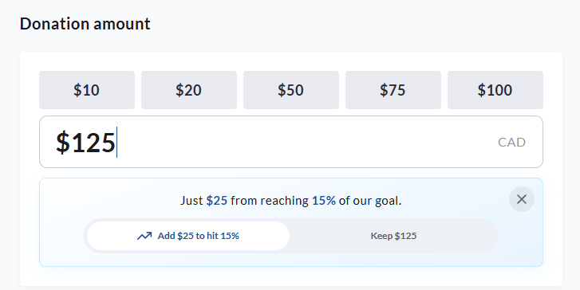
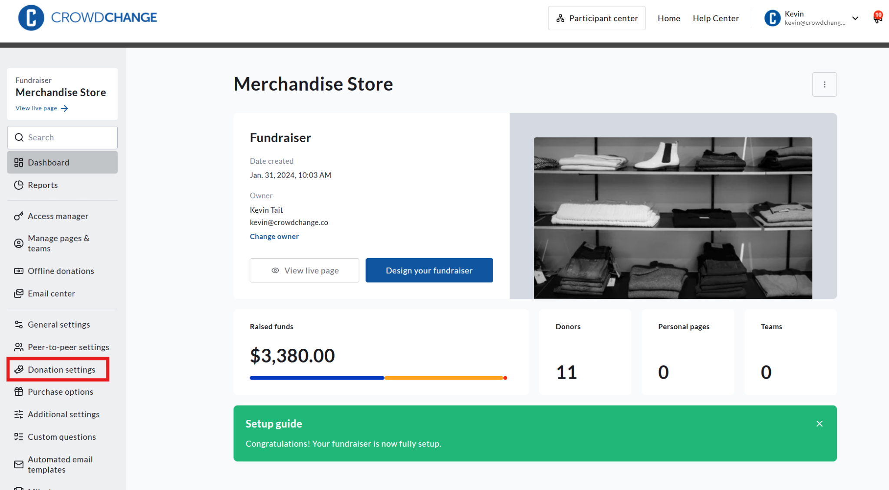
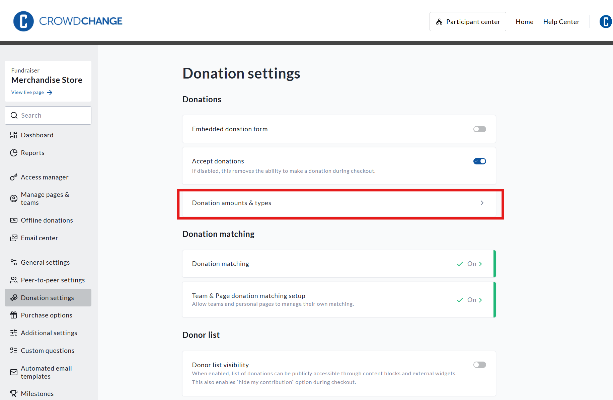
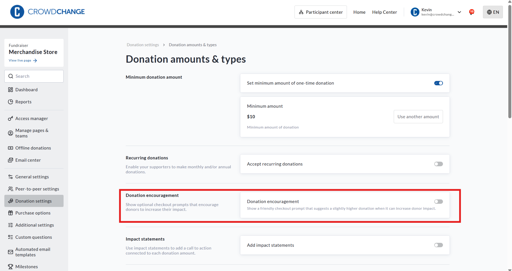
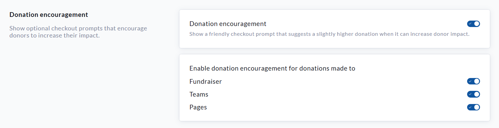

<!-- Source: https://ch.crowdchange.help/cnak/how-to-use-donation-encouragement-to-support-fundraising-goals | Nav: How to Use Donation Encouragement to Support Fundraising Goals | Mirrored 2026-10-14 -->

# How to Use Donation Encouragement to Support Fundraising Goals

Donation Encouragement is an optional checkout feature that invites donors to increase their donation when an additional amount would help the applicable fundraiser, team, or personal fundraising page reach a higher percentage of its goal.

The prompt is optional. Donors can accept the suggested increase, keep their original donation amount, or close the prompt and continue with checkout.  

A view of **Donation encouragement** on a fundraiser with a goal of $1,000

## Before You Begin: Set a Fundraising Goal

A fundraising goal is required for Donation Encouragement to work. The feature uses the amount raised and the applicable goal to determine when a suggested increase can be shown.

For Donation Encouragement to work on a particular fundraiser, team, or personal fundraising page, that destination must have a goal set.

You can review or update goals in the following locations:

* **Main fundraiser:** Go to **Dashboard → General settings → Goal Measure Unit**.

* **Team fundraising page:** Go to **Team dashboard → Team Settings**.

* **Personal fundraising page:** Go to **Page dashboard → Page Settings**.

## How to Enable Donation Encouragement

1. Go to your CrowdChange site and log in.

2. Navigate to the fundraiser where you would like to enable Donation Encouragement.

3. Click **Dashboard**.

4. Select **Donation settings** from the menu on the left.

5. Click **Donation amounts \& types**.

6. Scroll down to the **Donation encouragement** section.

7. Toggle on **Donation encouragement**.

8. Under **Enable donation encouragement for donations made to**, select where the feature should apply:

   * **Fundraiser:** Enables Donation Encouragement for donations made directly to the main fundraiser.

   * **Teams:** Enables Donation Encouragement for donations made to team fundraising pages.

   * **Pages:** Enables Donation Encouragement for donations made to personal fundraising pages.

   These settings can be enabled or disabled separately.

9. Scroll to the bottom of the page and click **Save** to confirm your settings.

## How Donation Encouragement Works at Checkout

When a donor enters a donation amount, CrowdChange uses the applicable fundraising goal and current amount raised to determine whether an optional suggested increase can be shown.

For example, a donor enters a donation of **$125** . If an additional **$25** would bring the fundraiser to **15% of its goal**, the donor will see the following message:
> Just $25 from reaching 15% of our goal.

The donor can then choose one of the following options:

* Select **Add $25 to hit 15%** to increase the donation from $125 to $150.

* Select **Keep $125** to continue with the original donation amount.

* Select the **X** to close the prompt.

The donation amount will only increase if the donor selects the suggested increase.

## Additional Information

* A fundraising goal is required for the feature to provide a goal-based suggestion.

* The suggested amount and percentage will vary based on the applicable goal and current fundraising progress.

* The prompt may not appear for every donation amount.

* Donors are not required to accept the suggestion.

* The donor's original donation amount remains unchanged unless they select the suggested increase.

* The feature can be enabled independently for the main fundraiser, team pages, and personal fundraising pages.
