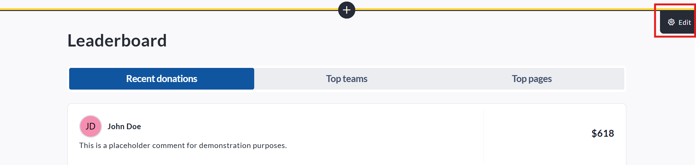
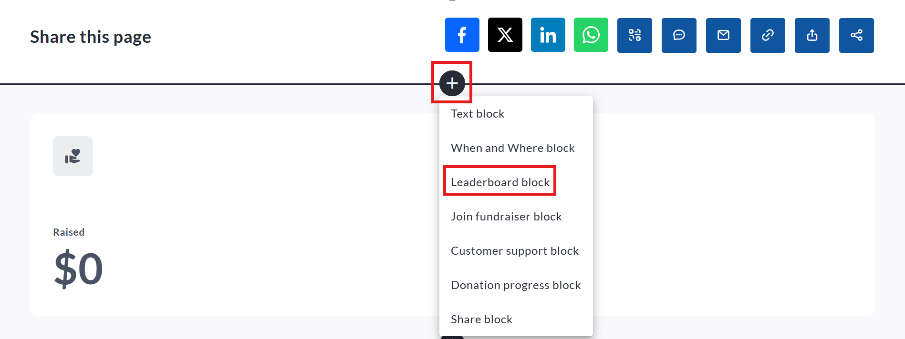
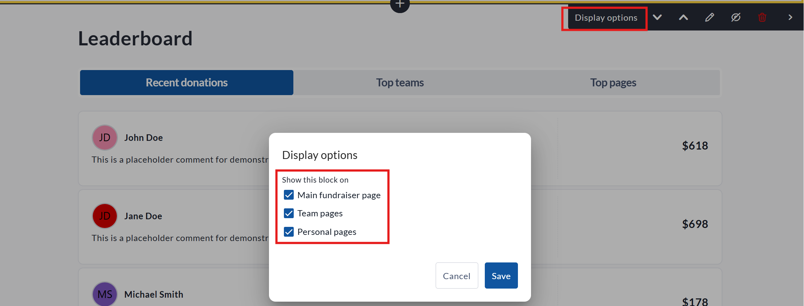
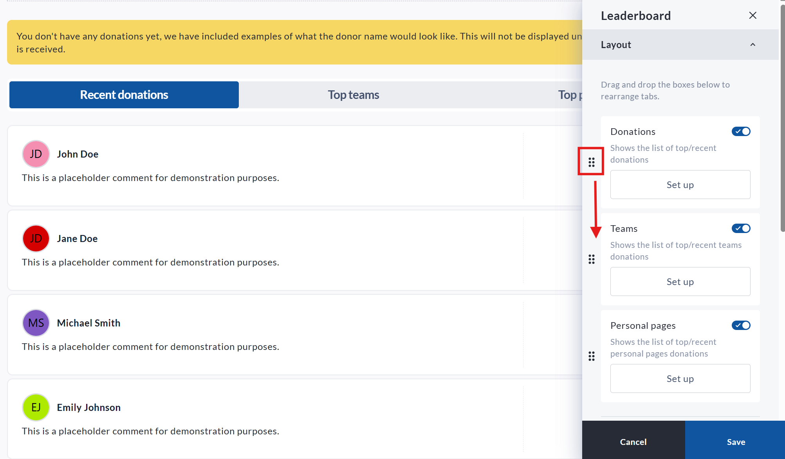
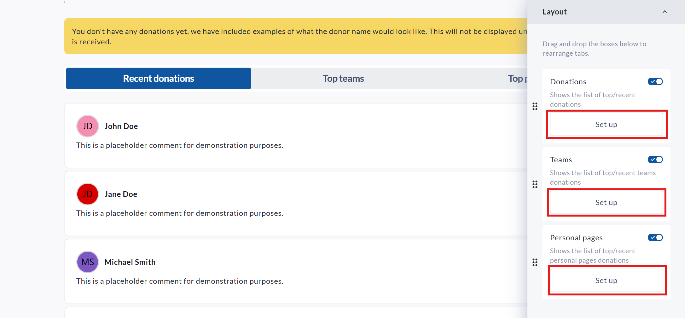
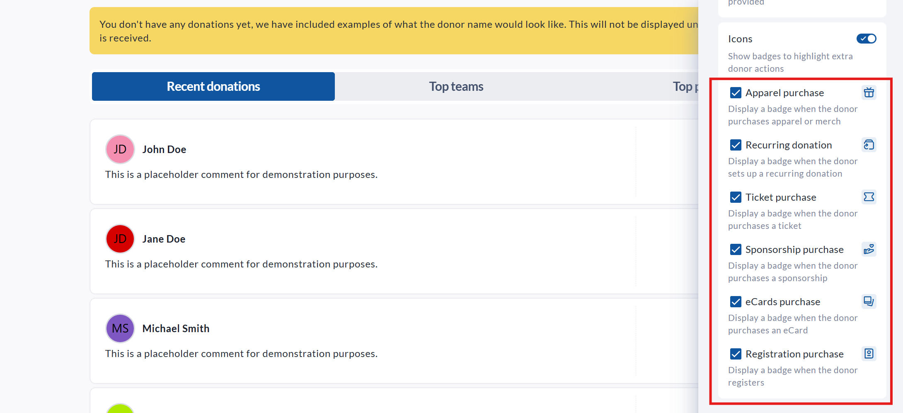
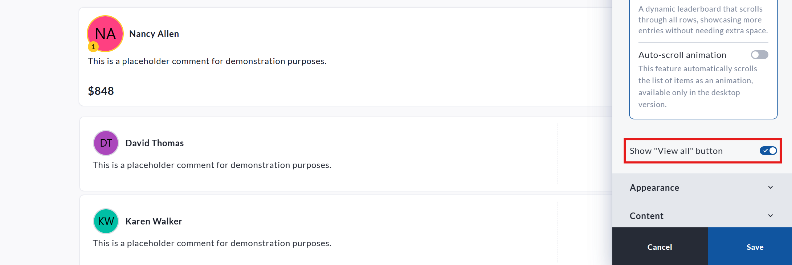
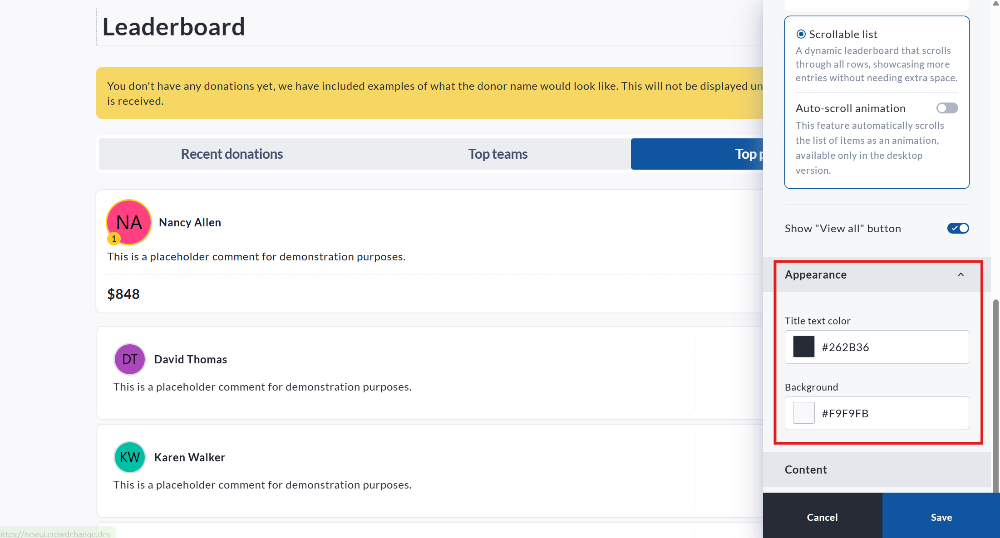
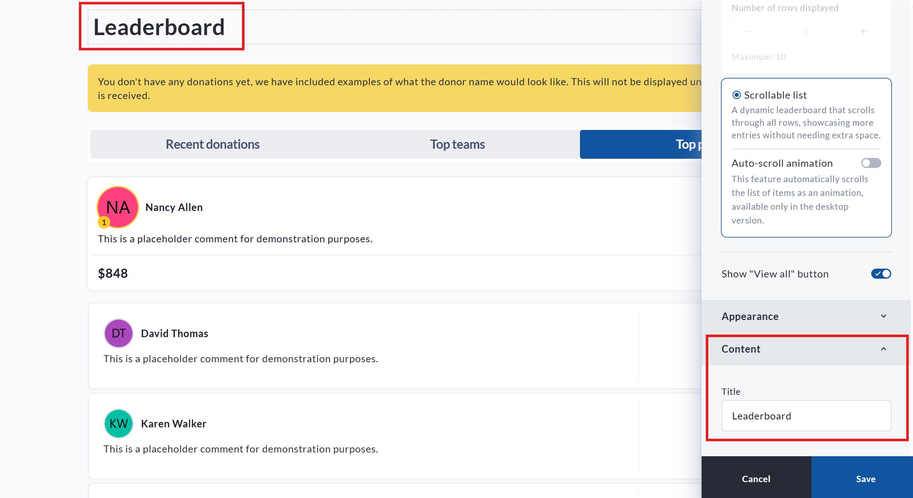
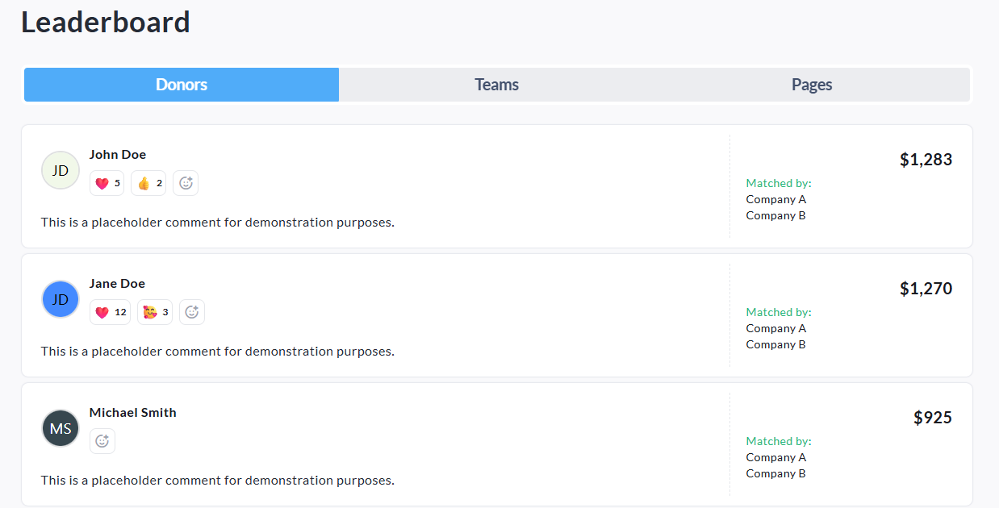

<!-- Source: https://ch.crowdchange.help/cnak/leaderboard-block-how-to-show-a-list-of-donations- | Nav: Leaderboard Block - How to show a list of donations, team fundraising pages and personal fundraising pages on your fundraiser | Mirrored 2026-10-14 -->

# Leaderboard Block - How to show a list of donations, team fundraising pages and personal fundraising pages on your fundraiser

The **Leaderboard block** is available by default on all fundraisers, and can show a list of **Donations** , **Team fundraising pages** , and **Personal fundraising pages** depending on your required settings. This is a customizable and dynamic element of the fundraiser user interface, and can be used as a critical part of your online campaigns.

*** ** * ** ***

## How to edit the **Leaderboard block**

To edit the **Leaderboard block**, follow the below steps:

* Go to your CrowdChange page and **Log in**

* Once on the fundraiser you would like to edit, click **Manage fundraiser**

* Once on the **Fundraiser dashboard** , click **Design your fundraiser**

* Scroll to the **Leaderboard block** , and click the **Edit** button

View of the **Leaderboard block** with the **Edit** button highlighted

*** ** * ** ***

## How to add a **Leaderboard block**

If your fundraiser is missing a leaderboard block, it is possible it was previously deleted. To restore or add a second leaderboard block, please follow these steps:

* Go to your CrowdChange page and **Log in**

* Once on the fundraiser you would like to edit, click **Manage fundraiser**

* Once on the **Fundraiser dashboard** , click **Design your fundraiser**

* Within the user interface, between any two blocks, click the **Plus** icon

* The list of available blocks will then be shown - select the **Leaderboard block**

After clicking the **Plus** icon, select the **Leaderboard block**from the list to add this element

*** ** * ** ***

## Display options - how to show different leaderboards on Fundraiser, Team, and Personal Pages

The **Leaderboard block** can be shown, or hidden, on different areas of your fundraiser depending on your needs. Using the **Display options** function, you can decide if a leaderboard is visible on the main **Fundraiser page** , on a **Team page** , or on a **Personal fundraising page**. This functionality also allows you to have different leaderboards, with different settings, shown in these various places.

To adjust the **Leaderboard block** 's **Display options**, please follow these steps:

* Go to your CrowdChange page and **Log in**

* Once on the fundraiser you would like to edit, click **Manage fundraiser**

* Once on the **Fundraiser dashboard** , click **Design your fundraiser**

* Scroll to the **Leaderboard block** , and click the **Edit** button

* Click the **Display options** button

* You then can check off where you want this **Leaderboard block** to be featured

As multiple **Leaderboard** **blocks** can be added to a single fundraiser, this can allow you to have, for example, a list of **Recent donations** on the main fundraiser page, but a list of **Top donations** shown on Team or Personal fundraising pages.

*** ** * ** ***

## **Leaderboard block** layout - how to adjust the order leaderboard elements are shown

By default, the **Leaderboard block** will show donations first, followed by Team fundraising pages, then Personal fundraising pages. This order, however, can be adjusted within the **Leaderboard block**'s edit functionality. To adjust this, please follow these steps:

* Go to your CrowdChange page and **Log in**

* Once on the fundraiser you would like to edit, click **Manage fundraiser**

* Once on the **Fundraiser dashboard** , click **Design your fundraiser**

* Scroll to the **Leaderboard block** , and click the **Edit** button

* Click the **Pencil icon**

* On the item you want to move, click the dots beside the **Donations** , **Teams** , or **Personal pages** and drag it to the desired new placement

* Once you are finished, click **Save**

Drag the highlighted icon to move the placement of your **Leaderboard block** options

Whichever option is listed first will be what is shown by default on your fundraiser publicly.

*** ** * ** ***

## Setting up each tab of your **Leaderboard block**

Each element of the leaderboard block can be uniquely customized. To customize any of these elements, please follow these steps:

* Go to your CrowdChange page and **Log in**

* Once on the fundraiser you would like to edit, click **Manage fundraiser**

* Once on the **Fundraiser dashboard** , click **Design your fundraiser**

* Scroll to the **Leaderboard block** , and click the **Edit** button

* Click the **Pencil icon**

* On the element you would like to customize, click **Set up**

The **Set up** option for **Donations** , **Teams** , and **Personal pages**

Additionally, any of these options can be hidden, if required, by toggling off the slider within each box.

### Donations

Within the **Donations**section, you can adjust the following items:

* **Title** - This allows you to adjust what this tab of your **Leaderboard block** is called.

* **Sorting** - here you can select whether or not to show your donations by **Top** (highest value donations listed first), or **Recent** (most recent donations shown first)

* **What information to show**

  * **Donation amount** - Here you can set the leaderboard to show donation values (default setting), or to hide these amounts. If hidden, the list will only show the donor's selected display name, but no donation value will be shown.

  * **Comment** - Here you can set whether or not optional comments made at the point of donation are shown (default settings) or hidden.

  * **Icons** - Here you can enable icons for various purchase options and types (**Apparel purchase** ,**Recurring donations** ,**Ticket purchase** ,**Sponsorship purchase** , **eCards purchase** ,and **Registration purchase**). These icons are pictured below.

View of the **Icons** options within the **Leaderboard block**

* **Date conditions** - Here you can specify which transactions are shown using specific date periods.

* **Amount raised conditions** - This function can be used to hide donations from the leaderboard that either do not meet, or exceed, specific donation value.

### Teams

* **Title** - This allows you to adjust what this tab of your **Leaderboard block** is called.

* **Sorting** - here you can select whether or not to show your donations by **Top** (highest value total page donations listed first), or **Recent** (most recently created Teams shown first)

* **What information to show**

  * **Donation amount** - Here you can set whether or not the Leaderboard block displays the total raised by the Team Fundraising Page

* **Date conditions** - Here you can specify which teams are shown using specific date periods. This is based on the creation date of the Team.

* **Amount raised conditions** - This function can be used to hide teams from the leaderboard that either do not meet, or exceed, specific total donation value.

### Personal pages

* **Title** - This allows you to adjust what this tab of your **Leaderboard block** is called.

* **Sorting** - here you can select whether or not to show your Personal pages by **Top** (highest value total page donations listed first), or **Recent** (most recently created pages shown first)

* **What information to show**

  * **Donation amount** - Here you can set whether or not the Leaderboard block displays the total raised by the Personal Fundraising Page.

* **Date conditions** - Here you can specify which pages are shown using specific date periods. This is based on the creation date of the page.

* **Amount raised conditions** - This function can be used to hide pages from the leaderboard that either do not meet, or exceed, specific total donation value.

*** ** * ** ***

## **Item display type** settings

The **Item display type** settings allow you to decide how the various entries in your **Leaderboard block** are displayed. There are two options as to how this is displayed, each with their own settings.

* **Standard** - This is the default setting for the **Leaderboard block** . This is the standardized list of Donations, Teams, and Personal pages. You can select as few as **one** and as many as **ten** items to display on this list at a time. Please note that the **View all**button at the bottom of the leaderboard will always be available (unless manually turned off), so all donors, teams, and pages will still be accessible, even if your total number of these items exceeds your list options.

* **Scrollable list** - This option allows your leaderboard to be scrollable, allowing for a longer list, that takes up less room. The **Auto-scroll animation** option causes the leaderboard to automatically scroll through entries, injecting some dynamic animation into your fundraiser.

*** ** * ** ***

## The **View all** button

The **View all** button allows users to browse entries within the leaderboard that fall outside of the settings assigned in the **Item display type** settings section. If you only want to show the options set in this area, you can uncheck the box beside the **Show "View all" button** option.  

You can turn off the **View all**button by toggling this function off

*** ** * ** ***

## Appearance

You can adjust the colors of your **Leaderboard block** within the **Appearance** section. By default, the fundraiser's theme settings are used here.  

Colors are assigned using hex codes, or using the color picker

*** ** * ** ***

## **Content** option - how to change the title of your **Leaderboard block**

The **Content** option allows you to change the title of your **Leaderboard block** . You can also change this by clicking the title within the user interface. If changes are made here, please ensure you click **Save** after the fact.  

**Leaderboard block** title can be adjusted either by clicking the title in the user interface, or by using the **Content** section of the **Leaderboard Block** 's **Edit** module

*** ** * ** ***

## Reactions - how to allow emoji reactions on Leaderboard donations

The **Reactions** setting allows visitors to add emoji reactions to donations shown in the **Donations** tab of your Leaderboard block. When enabled, each donation card will display reaction icons (with counts) and an option to add a reaction, helping supporters engage with and celebrate donations publicly.  

The **Leaderboard block** with **Reactions** enabled

### How to enable Reactions

To turn on Reactions for donations, follow these steps:

* Go to your CrowdChange page and **Log in**

* Once on the fundraiser you would like to edit, click **Manage fundraiser**

* Once on the Fundraiser dashboard, click **Design your fundraiser**

* Scroll to the **Leaderboard** block, and click the **Edit** button

* Under **Donations** , click **Set up**

* Scroll to **What information to show**

* Check the box beside **Reactions**

* Click **Save**

### How to disable Reactions

If you would like to remove reactions from donation cards, return to the same menu and uncheck **Reactions** , then click **Save**.
