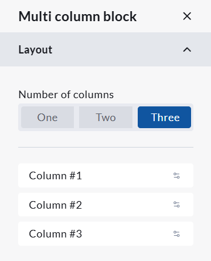
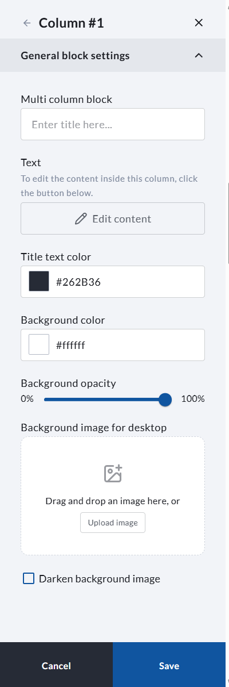

<!-- Source: https://ch.crowdchange.help/cnak/multi-column-block-how-to-add-multiple-content-columns-to-the-body-of-your-fundraising-page | Nav: Multi-Column Block - How to add multiple content columns to the body of your fundraising page | Mirrored 2026-10-14 -->

# Multi-Column Block - How to add multiple content columns to the body of your fundraising page

The Multi-Column Block allows you to add one, two, or three content columns directly within the body of your fundraiser page. This is a helpful way to organize information, highlight key campaign details, feature sponsors, share impact statements, or combine text and images in a clean layout.

Each column can be customized individually, allowing you to add text, images, titles, background colors, and styling to create a flexible content section that matches your fundraiser branding.  

A view of the **Multi-column block**featuring three columns

*** ** * ** ***

## How to add a Multi-Column Block

The Multi-Column Block is not enabled by default. To add a Multi-Column Block, please follow these steps:

1. Go to your CrowdChange page and log in.

2. Once on the fundraiser you would like to edit, click **Design**.

3. Within the user interface, between any two blocks, click the Plus icon.

4. The list of available blocks will then be shown. Select the Multi-Column Block.

*** ** * ** ***

## Layout - how to choose the number of columns

Within the Layout section of the Multi-Column Block editor, you can choose how many columns should display in the block.

Available layout options include:

One - Displays one full-width column.

Two - Displays two columns side by side.

Three - Displays three columns side by side.

Once you select the number of columns, each column will appear in the Layout section as its own editable item, such as Column #1, Column #2, and Column #3. To edit the individual column settings/content, click the icons on the far right hand side of the Column box.  

Layout settings within the multi-column block

*** ** * ** ***

## Appearance - how to adjust the overall block style

Within the Appearance section of the Multi-Column Block editor, you can customize the overall look of the full Multi-Column Block.

Available appearance settings include:

**Title text color** - Controls the colour of the main block title.

**Title alignment** - Controls whether the main block title is aligned left, right, centered, or hidden.

**Background color** - Controls the background colour behind the full Multi-Column Block.

**Background opacity** - Controls the transparency of the block background.

**Background image for desktop** - Allows you to upload a background image for the block.

*** ** * ** ***

## Content - how to set the block title

Within the Content section of the Multi-Column Block editor, you can update the main title for the full block.

If you do not want a title to appear above the block, you can hide the title using the Title alignment setting in the Appearance section.

*** ** * ** ***

## Column settings - how to edit each column

Each column within the Multi-Column Block has its own settings. To edit a column, click the column from the Layout section.

Within each column, you can customize:

**Column title** - Adds a title to the individual column.

**Text**- Allows you to edit the content displayed inside the column.

**Title text color**- Controls the colour of the individual column title.

**Background color** - Controls the background colour of the individual column.

**Background opacity** - Controls the transparency of the individual column background.

**Background image for desktop**- Allows you to upload a background image for that specific column.

**Darken background image** - Adds a dark overlay to the column background image, which can help make text easier to read.  

Customization options within a column

To edit the main text or image content inside a column, click Edit content. This will allow you to add or update the content displayed in that specific column.

*** ** * ** ***

## Tips for using the Multi-Column Block

For best results, keep each column similar in length so the layout remains balanced.

Use clear, concise titles for each column.

If using images, try to use images with similar dimensions or aspect ratios.

If placing text over a background image, use the Darken background image option to improve readability.

Use the three-column layout for shorter content, such as feature highlights or sponsor recognition. Use the one or two-column layout for longer descriptions or larger images.
