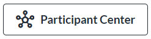
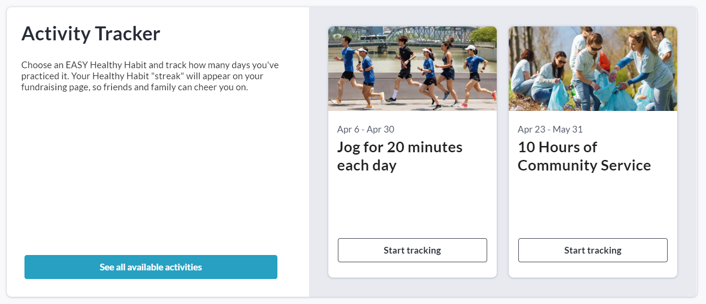
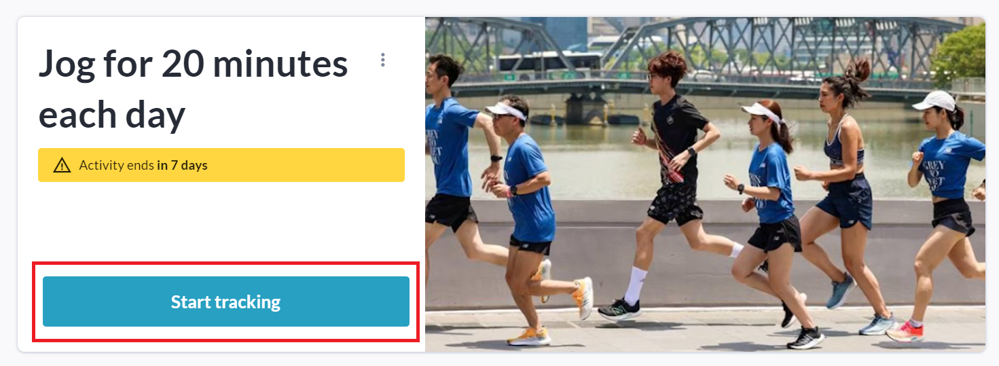
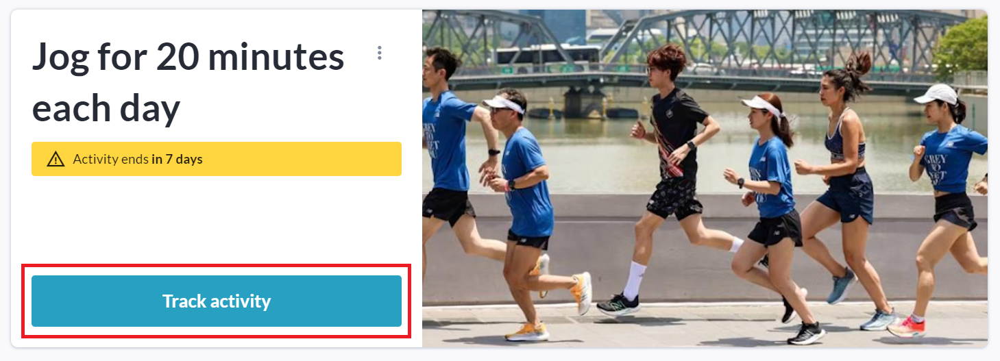
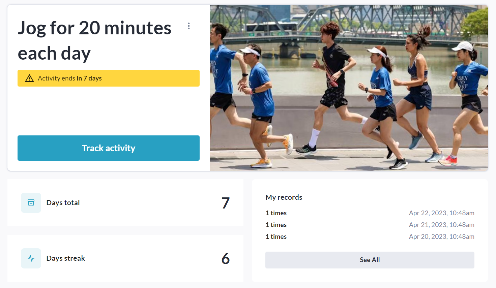
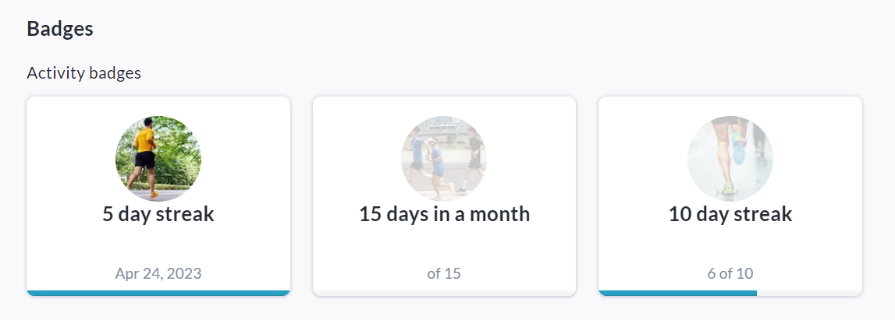
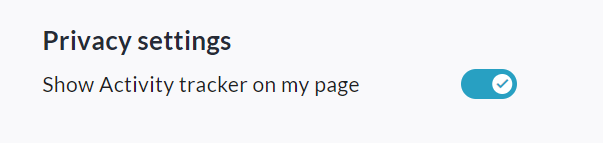

<!-- Source: https://ch.crowdchange.help/cnak/opting-in-to-an-activity-and-tracking-progress | Nav: Activity Tracker > Opting in to an Activity and Tracking Progress | Mirrored 2026-10-14 -->

# Opting in to an Activity and Tracking Progress

As a participant to a fundraising campaign with your own personal fundraising page, you have the ability to opt into any Activities created at the Admin or Fundraiser level via your Participant Center.  
On fundraisers using our multi-registration workflow, registrants can also opt-in during this process.

Follow the simple steps below to select and track an activity:

1. Go to your **Participant Center** (click the button at the top of your page).

   
2. Click the **Personal Pages** tab under your name.

   
3. Click on your specific personal page tile.

   
4. Scroll down to the **Activity Tracker** section.

5. Click **See all available activities** , or the **Start tracking** buttonon an activity shown.

   
   1. If you clicked **See all available activities** , click the**Start Tracking**button on the specific activity you would like to track progress towards. You may only track one activity at a time.

      
6. On the activity page, you can click the **Start Tracking** button, then the **Track Activity**button to track your first repetition of the activity:

   
   Start tracking  
   
   Track activity
7. Track activities consistently without missing a day to earn a streak, which will count towards **Badges and Milestones** ! Badges and Milestones can also be linked to a **total**reached instead of a streak if desired.

   

Some activities are**total-based** rather than**streak-based**, meaning that even if you miss a day, all days tracked within the activity time period will still count towards Badges and Milestones.

Any time you reach a **Milestone** set at the Activity level, you will receive a Milestone Notification Email and any associated **Badge**, which will live within your Participant Center and if desired, publicly on your page.  

## How to Hide Activity Progress

If you do not want your Activity progress to be displayed publicly on your personal fundraising page, follow the steps below to disable this feature:

1. Go to your **Participant Center** (click the button at the top of your page).

2. Click the **Personal Pages** tab.

3. Click on your personal page tile.

4. Scroll down to the **Activity Tracker** section.

5. Click **Manage Activity**on the activity you are tracking.

6. Scroll down to the bottom of the page and disable the '**Show Activity tracker on my page**' toggle.

