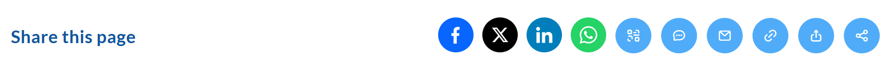
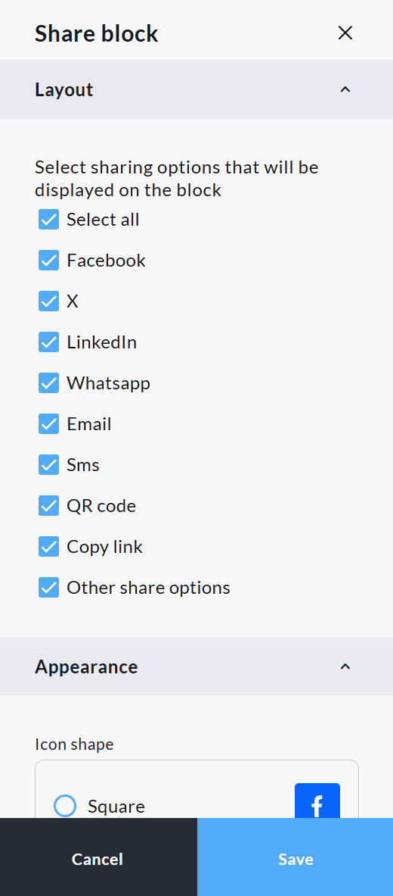
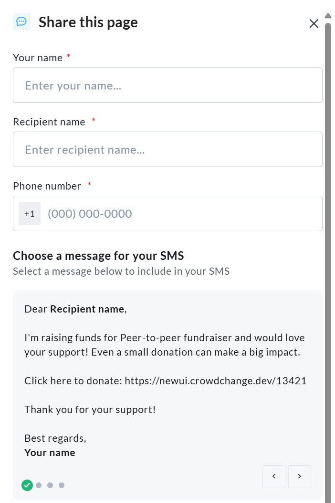

<!-- Source: https://ch.crowdchange.help/cnak/sharing-block-social-media-qr-codes-email-sms-and- | Nav: Sharing Block - Social media, QR Codes, Email, SMS, and more | Mirrored 2026-10-14 -->

# Sharing Block - Social media, QR Codes, Email, SMS, and more

The **Sharing block** allows users to share **Fundraisers** , **Team pages** , and **Personal pages** across a variety of social media platforms. This also allows users to send pre-written **email** and **SMS messages** , **as well as generate unique QR codes** for Fundraisers, Team pages and Personal pages.  

The **Sharing block** is shown above, with options for **Facebook** , **X** , **LinkedIn** , **WhatsApp** , **QR Code** generation, **SMS** , **Email** , **Link** copy and paste, and **Share with other options** displayed

Fundraiser owners can determine which of the above-mentioned options are shown using the **Design your fundraiser** functionality - to edit the **Sharing block**, follow these steps:

* Go to your CrowdChange page and **Log in**

* Once on the fundraiser you would like to edit, click **Manage fundraiser**

* Once on the Fundraiser dashboard, click **Design your fundraiser**

* Hover over the **Sharing block** and click **Edit**

* On the right sidebar that appears, scroll down and expand the **Layout** section

* Here you can decide what is shown in your Sharing block

* At the bottom of the sidebar, click **Save** to confirm and publish your changes

The **Edit** area of the **Sharing block**

You can also decide how these icons are displayed, as well as the text shown on the Sharing block, as well as background settings.

*** ** * ** ***

The **Sharing block** allows users to share using the following social media platforms:

* Facebook

* X (formerly Twitter)

* LinkedIn

* WhatsApp

If these options are selected, users will be prompted to either use a pre-written sharing message, which can be copied and pasted, or to write their own message. Once this is decided, the user will be taken directly to the social media platform selected. Please note that without an account on the social media platform in question, posts cannot be shared.

*** ** * ** ***

The **SMS** and **Email** functionality within the **Sharing block** allows users to send text messages and emails directly from CrowdChange, with no requirement to log in to their email account or link a phone number to the platform. These messages are templated, and are not editable by the users.  

An example of the pre-written **Email** option using the **Sharing block**  
At this time these messages are predetermined by CrowdChange and are not adjustable. For more detailed email messages, please use the **Mailing List**function
